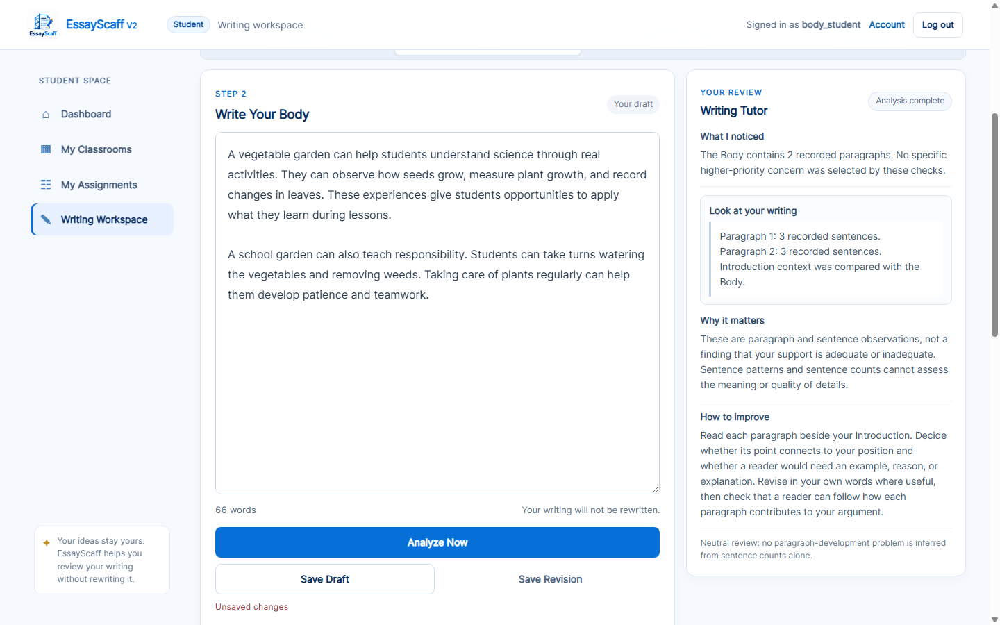
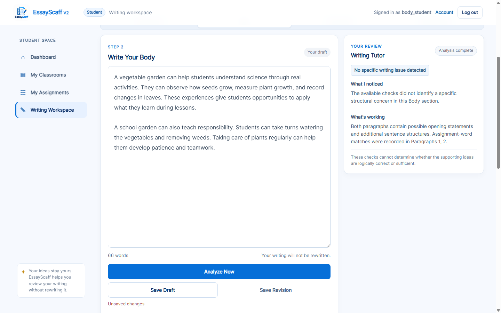

# Body Writing Tutor repair report

**Completed:** 2026-10-24, `C:\Users\My Pc\Desktop\EssayScaff-V2`.

**Result:** Body feedback is now contingent on supported concerns. A Body with no
selected concern receives a brief neutral result, up to two source-backed
observations, and a limitation. It receives no forced improvement task, instructional
trait, lesson ID, or error highlight. Supported concerns receive paragraph-specific
prepared instruction and verified source evidence through the existing catalog.

**Final verification:** **668 tests passed**; **12/12 focused Body Chrome cases
passed**; the complete transparency browser walkthrough and whole-app workflow
audit passed. Original Body NLP observations match the actual before capture in
all 12 cases.

## Evidence index

- [Actual before/after guidance for every Body case](body_feedback_repair_evidence/case-comparison.md).
- [Before API/presentation records](body_feedback_repair_evidence/before-outputs.json).
- [Final API/presentation records](body_feedback_repair_evidence/after-outputs.json).
- [Before data/source verification](body_feedback_repair_evidence/before-verification-summary.json)
  and [final data/source verification](body_feedback_repair_evidence/after-verification-summary.json).
- [Before Chrome log](body_feedback_repair_evidence/before-browser.log)
  and [final Chrome log](body_feedback_repair_evidence/after-browser.log).
- [SHA-256 manifest for 18 real screenshots](body_feedback_repair_evidence/screenshots.json).

## 1. Baseline and confirmed root causes

The full suite was run before implementation: **608 passed in 98.05 s**. A real
authenticated Chrome before-run reproduced the supplied vegetable-garden example
and the other Body cases. It also exercised controlled saves, reloads, unsaved edits,
and assignment switching before any production change.

Confirmed defects:

1. **Neutral selection still forced revision.** `FeedbackService.generate_body`
   selected `body_neutral_observable` when no concern applied, but its fallback
   Primary Feedback and `body_neutral_general` Next Step still told the student to
   revise/check development. Missing Introduction context selected another generic
   corrective next action, although it was only unavailable comparison data.
2. **The frontend replaced useful observations with counts.** `tutorBodyOverview`
   constructed a paragraph/sentence-count notice and a long improvement task.
   Existing topic-sentence/detail observations in What's Working did not reach the
   concise tutor. The neutral result had no shared instructional/selection record.
3. **Body was excluded from the established trace.** Backend instructional metadata,
   student `renderSixTraitTrace`, and the frontend presentation model were connected
   to Introduction only. A Body neutral result appeared to be a missing mapping
   rather than a deliberate no-concern outcome.
4. **Lexical review outranked more direct structural concerns.** An adjacent-pair
   wording absence could be selected ahead of a paragraph-development or repeated-
   opening concern. Paragraph focus-word absence and Introduction word-overlap
   absence also produced secondary corrective lessons without establishing a
   semantic writing defect.
5. **Selection could survive missing/nonfired source events.** Rule-ID filtering
   happened after branch selection. Body concern eligibility now requires its
   corresponding fired event, not just a finding flag that would later lose its
   provenance link.
6. **Body localization was not a shared backend plan.** Generic excerpt rendering
   did not record the same paragraph owner, anchor, exact mark and rationale for
   both tutor and Inspector.
7. **Final screenshot review exposed misleading Inspector wording.** A backend
   Primary Feedback message was labelled as the exact tutor message even when a
   prepared lesson supplied different wording. The Inspector now labels backend
   feedback accurately and explicitly displays the actual recorded tutor notice,
   supported observations, why, and next action. Neutral mapping placeholders now
   explain that no trait or lesson was assigned.
8. **A list could still receive word-match strength wording.** List-like
   paragraphs now receive their structural lesson without keyword-match praise.
   Those lexical observations remain in the Rule Base and Inspector. An entirely
   list-like Body also does not receive an Introduction-word-overlap strength.

The main example did **not** establish a defective NLP detector. Its topic-sentence
and supporting-detail events already existed. The repair therefore retains the
detectors and fixes selection, instructional presentation, localization and trace
integration. Publication asserts that all original analysis observations, excluding
source-location evaluation metadata, are identical before and after for all 12
cases. Body analysis additionally retains exact input/context information.

## 2. Actual result for the supplied 66-word Body

The exact two paragraphs are case **B01** in
`tests/body_feedback_repair_cases.json`. They retain **2 paragraphs, 6 sentences,
66 alphabetic words, 19 Rule Events**, and the existing source-backed What's
Working observations. No example marker is required.

### Before

> The Body contains 2 recorded paragraphs. No specific higher-priority concern
> was selected by these checks.

This was followed by paragraph counts, a general rationale, and a long task asking
the student to decide whether to add an example, reason, or explanation.

- Primary branch: `body_neutral_observable`.
- Next Step branch: `body_neutral_general`.
- Body instructional record: absent.

### After — actual visible tutor

**No specific writing issue detected**

> The available checks did not identify a specific structural concern in this Body
> section.

**What's working**

> Both paragraphs contain possible opening statements and additional sentence
> structures.
>
> Assignment-word matches were recorded in Paragraphs 1, 2.

**Limitation**

> These checks cannot determine whether the supporting ideas are logically correct
> or sufficient.

The evidence excerpt, Why it matters, and How to improve sections are hidden for
this neutral state. Next Step is an explicitly empty string. Needs Attention is
empty. There is no error highlight or assigned trait/skill/lesson.

Primary and Next Step now both record `body_neutral_observable`, with the explicit
selection/presentation status **`NO_SUPPORTED_CONCERN_SELECTED`**. This is a
FeedbackService status, **not** a new NLP Rule Event or passing grade.

The first displayed observation is supported by the actual
`BODY.P1.TOPIC_SENTENCE.CANDIDATE`, `BODY.P1.SUPPORTING_DETAIL.CANDIDATE`,
`BODY.P2.TOPIC_SENTENCE.CANDIDATE`, and `BODY.P2.SUPPORTING_DETAIL.CANDIDATE`
events, including first-sentence positions. The wording observation uses the
paragraph-specific `PARAGRAPH.FOCUS_TERMS_OBSERVED` events. The original Working
observations for this example and their provenance remain in the response/export;
their wording no longer turns every observation into another correction. For
list-like paragraphs, word matches remain in the raw research trace but are not
promoted as strengths or displayed under What's working.

## 3. Selection priority and lesson mapping

The old exported order was confirmed against `generate_body`: empty input, list,
unlinked adjacent pair, no additional sentence parts, repeated opening, missing
Introduction context, general next-step review. The last two were Next Step
fallbacks rather than separate Primary Feedback concerns.

The repaired order is:

1. Empty/non-substantive input: input guidance, not a trait assessment.
2. First supported list-like paragraph.
3. First supported paragraph-development concern.
4. First verified repeated-opening concern.
5. First supported adjacent-pair **wording review**.
6. Explicit neutral outcome when none of these concerns was selected.

Missing Introduction context and absent topic words are recorded availability/
wording observations rather than new corrective selections. Primary and Next Step
use the same selected concern. Each mapped concern requires its fired source event.
The response records matched check results, target paragraph indices, priority and
`SELECTED`, `NOT_MATCHED`, or `MATCHED_NOT_SELECTED_HIGHER_PRIORITY` outcomes.

| Actual selected branch | Trait / instructional skill | Existing lesson ID | Supporting Rule Event | Purpose |
|---|---|---|---|---|
| `body_ideas_develop_point` | Ideas · Develop Your Supporting Details | `HELP-BODY-DEVELOP-POINT` | `BODY.Pn.SUPPORTING_DETAIL.NOT_OBSERVED`, with a recorded subject-linked statement in that paragraph | `DEVELOPMENT_TASK` |
| `body_organization_paragraph_shape` | Organization · Build Your Paragraph | `HELP-BODY-PARAGRAPH-SHAPE` | `BODY.Pn.PARAGRAPH.KEYWORD_LIST_CANDIDATE` | `STRUCTURAL_REVIEW_TASK` |
| `body_sentence_fluency_sentence_beginnings` | Sentence Fluency · Review Repeated Sentence Openings | `HELP-BODY-SENTENCE-BEGINNINGS` | `BODY.Pn.REPETITION.REPEATED_SENTENCE_OPENINGS` | `WORDING_REVIEW_TASK` |
| `body_organization_paragraph_link` | Organization · Review Paragraph Connections | `HELP-BODY-PARAGRAPH-LINK` | `BODY.CONTINUITY.ADJACENT_PARAGRAPH_COMPARISON`, using its actual no-explicit-wording-link pair | `WORDING_REVIEW_TASK` |
| `body_neutral_observable` | None | None | Existing observations retained; no concern event is invented | `NO_SUPPORTED_CONCERN_SELECTED` |

The version-5 local catalog and its existing architecture are reused: **18 lessons,
18 primary bindings, 10 secondary bindings**. Body-only labels, lesson wording,
purposes and secondary bindings were repaired. Unsupported focus-absence and
Introduction-overlap corrective secondary mappings were replaced with the existing
list/repeated-opening instructional mappings. Word repetition alone does not
force a Word Choice lesson.

## 4. Required cases and additional controls

Exact before/after notices, actions, conditions, source marks and lessons for every
case are in the [generated comparison](body_feedback_repair_evidence/case-comparison.md).

| Case | Input / required behavior | Actual final outcome |
|---|---|---|
| B01 / Case C | Original two developed paragraphs; no explicit example marker | Neutral result; two supported observations; no corrective task, trait or mark |
| B02 / Case A | “A school garden can teach responsibility.” | Ideas · Develop Your Supporting Details; Paragraph 1 named; exact statement marked `[0, 41)` |
| B03 | First paragraph developed, second only the possible statement | Same Ideas lesson for **Paragraph 2**; only `[254, 295)` marked |
| B04 / Case D | “Garden, seeds, vegetables, teamwork, students.” | Organization · Build Your Paragraph; list-like finding explained; exact list `[0, 46)` marked; no keyword-match strength or What's working section |
| B05 / Case E | Three “Students can …” openings | Sentence Fluency · Review Repeated Sentence Openings; only `[0, 12)`, `[31, 43)`, `[62, 74)` marked; repetition may be intentional |
| B06 / Case B | One paragraph with opening and further sentence structures; no “for example” | Neutral result with supported structure observations; no demand for more examples or a fixed transition |
| B07 / Case F | Plant-growth detail followed by the purple-elephants sentence | Neutral uncertainty; no off-topic, factual-correctness or logical-support verdict |
| B08 | B06 without Introduction context | Same neutral result; missing comparison context recorded accurately |
| B09 | Two developed paragraphs with no recorded wording link | Conditional Organization review; no claim of semantic disconnection and no fabricated error highlight |
| B10 | One rich sentence with multiple recorded clause structures | Neutral result; sentence count alone does not establish underdevelopment |
| B11 | Topic words inside unreasonable details | Neutral structural observations with explicit limitations; no relevance or quality certification |
| B12 | Emoji, leading/trailing spaces and line breaks with repeated openings | Exact original offsets in direct-API tests; three narrow opening marks; no Unicode drift |

Additional regression coverage verifies that a development concern outranks an
adjacent-pair wording review, missing/nonfired events cannot select its lesson, and
corrupt mark text, anchors, paragraph ownership, subject evidence, provenance or
catalog references do not produce fallback paragraph highlights.

## 5. Highlighting and source integrity

`body_instructional_trace` creates localization plans from the completed choice and
already-recorded events. The renderer verifies the same plan against original text,
raw event evidence and the correct paragraph; it does not create another detector.

- Development: mark the first recorded possible statement in the selected
  paragraph, not another paragraph or the entire Body.
- Lists: use the list event's original source spans within its paragraph.
- Repetition: mark only the repeated opening words while preserving paragraph
  context and boundaries.
- Lexical-link absence: no precise error span is recorded, so nothing is marked.
  The tutor explicitly explains that limitation.
- Neutral result: no highlight is generated.
- Invalid evidence: no broad fallback mark is manufactured to make the panel active.

Plans retain original start/end/text, paragraph owner, event ID, evidence index,
nested anchor path, context, purpose and location rationale. All offsets are
Python Unicode-code-point, half-open offsets. Direct APIs preserve submitted CRLF;
Chrome textareas normalize CRLF to LF before sending. Student/professor comparisons
therefore use the same actual analyzed string, and direct-API tests separately
verify exact CRLF and emoji offsets.

## 6. One recorded decision across tutor, Inspector and export

The existing trace now includes:

```text
research_trace.stages.BODY.feedback_decisions.selection_status
research_trace.stages.BODY.feedback_decisions.selection_checks
research_trace.stages.BODY.feedback_decisions.instructional_feedback
```

The instructional record contains the selected branch/condition, prepared
trait/skill/lesson/purpose where applicable, actual Rule IDs and conditions,
paragraph-specific numeric observations and clause evidence, verified mark plans,
supported strengths and their paragraph/sentence source positions, exact compared
Introduction, coverage and limitations.

Backend five-field feedback and the prepared tutor interpretation remain explicitly
labelled. The Inspector now displays the **actual recorded tutor wording**, as well
as the backend Primary Feedback. It does not mislabel one as the other. Neutral
views explain why no trait or lesson was assigned; they do not describe that valid
state as a broken or unavailable mapping.

Simple Feedback Result, Technical Feedback, the existing decision flow, professor
Feedback Decisions and Copy Full Analysis consume the cached record. Actual Body
candidate-check outcomes explain higher-priority selection; untriggered Rule Base
conditions remain available in the existing evaluation trace. An intentionally
empty neutral Next Step is explained as no revision task selected, not missing data.

Real Chrome confirmed instructional-object equality between student and professor
APIs for **all 12 cases**, exact editor/tutor marks, actual prepared notice/action in
the professor view, and unchanged cached responses. Opening the result evidence or
building the full export issued no additional analysis request.

### Honest 6+1 scope

| Trait | Actual Body scope |
|---|---|
| Ideas | Topic-sentence and additional clause/statement candidates; no validity or sufficiency assessment |
| Organization | Blank-line boundaries, list-like structures and lexical-link observations |
| Sentence Fluency | Repeated two-word sentence openings |
| Word Choice | Surface/lemma repetition observations only; no word-quality assessment or forced lesson |
| Voice | Not evaluated |
| Conventions | Not evaluated |
| Presentation | Not evaluated |

All seven coverage rows explicitly record **`trait_quality_assessment: NOT_PERFORMED`**.
Instructional category selection is recorded separately. A neutral result assigns
none of the categories and is not seven completed trait evaluations.

## 7. Introduction-to-Body context investigation

The existing workspace submits `state.drafts.INTRODUCTION` for Body analysis. Its
Body snapshot includes that Introduction, assignment ID, topic, focus and current
Body text. The backend analyzes the supplied string; it does not silently look up
an assumed saved Introduction version.

Controlled **real Chrome tests passed before and after the repair**:

| Scenario | Actual compared Introduction / cache behavior |
|---|---|
| Save the keyword-list Introduction, then analyze Body | Exactly “Schools, playgrounds, vegetable gardens, students, learning.” |
| Edit Introduction to the corrected text without saving; switch to Body | Old Body analysis invalidated; the new request compares the exact unsaved current Introduction |
| Reload without saving that correction | The saved keyword-list Introduction is restored and compared |
| Save the corrected Introduction, then reload | The corrected saved text is restored and compared |
| Switch assignment A → B → A | Each assignment's own saved Introduction is used; prior Body analysis does not survive the switch |

**No stale-context or assignment-leak defect was reproduced.** The controlled test
reproduced the keyword-list comparison as saved-versus-unsaved test setup behavior.
It does not establish what the original tester saved in their particular session.
Persistence behavior was therefore not changed.

`BodyRuleBase.analyze` now retains the exact supplied Introduction in
`introduction_context`, with source and `persistence_status:
NOT_DETERMINED_BY_ANALYSIS`. The Inspector can show precisely which text was
compared without falsely certifying that it is a saved database version.

## 8. Actual source changes

| File / functions | Repair |
|---|---|
| `services/feedback_service.py` — `generate_body`, Body entries of `BRANCH_TRAIT_SKILL` | Evidence-gated concerns; structural priority; no forced neutral task; supported observations; no lexical/context-absence correction; recorded selection checks and status |
| `services/tutoring_lessons.py` — `body_instructional_trace` | Completed-decision mapping through the existing catalog, at most two displayed observations, paragraph-owned evidence plans, prepared wording and truthful coverage |
| `services/body_rules.py` — `BodyRuleBase.analyze` | Exact Body input and supplied Introduction context retention; detector findings retained unchanged |
| `content/lessons/feedback_help.json` — existing Body lessons/bindings | Appropriate trait/skill labels, paragraph-specific guidance, conditional wording review and supported secondary mappings |
| `static/app.js` — `bodyInstructionalItem`, `bodyRecordedStrengthText`, `selectBodyRecordedTutorItems` | Verify and render the recorded Body result, including the no-lesson neutral state |
| `static/app.js` — `tutorInstructionalExcerpt`, `buildTutorItem`, `selectTutorItems`, `studentFeedbackPresentation`, `renderTutorItem` | Paragraph/anchor verification, exact narrow marks, supported strengths and conditional display of tutor sections |
| `static/app.js` — `renderSixTraitTrace`, `renderScaffoldingTrace`, Body causal/feedback-flow rendering | Same cached decision, exact tutor wording, actual selection outcomes, neutral status, explicit empty Next Step and no false missing-mapping message |
| `static/research_inspector.js` — `renderFeedbackOutput` | Same Body record, actual tutor wording, strength sources, conditions, observations, exact spans and coverage in the existing Inspector |
| `templates/index.html` | IDs on three existing tutor sections so neutral display can hide them; existing layout retained |
| `tests/test_body_feedback_repair.py`, `body_feedback_repair_cases.json` | 59 focused real-backend/frontend/API/evidence regressions across the required cases and controls |
| `tests/body_feedback_browser_check.py`, `.cjs` | Disposable real-Chrome workflow, controlled context saves/switches, consistency checks and verified evidence publication |
| Existing Body/provenance/tutor/decision-flow/workspace tests and transparency browser harness | Updated intentional Body contracts with retained event, source, snapshot and cross-stage checks; an additional real lexical-review control preserves that branch's coverage |

Introduction and Conclusion feedback rules were not modified. Their rule files and
shared `stage_evidence.py` have identical before/after SHA-256 values. Their existing
protected feedback tests and browser behavior passed. The NLP pipeline, database
schema, authentication, teacher dashboard and research datasets were not changed.

The actual pre-repair five-field Body outputs were captured in
`tests/body_feedback_protected_baseline.json` before editing. Existing original
hashes still verify those historical snapshots. Live Body tests now assert the
intended branch/provenance/neutrality contracts; old hashes were not silently
replaced with new values, and no Introduction/Conclusion golden outputs were repinned.

## 9. Verification results

| Check | Actual result |
|---|---|
| Full pre-change baseline | **608 passed**, 98.05 s |
| New focused Body regressions | **59 passing tests included in the final suite**: selection, neutral policy, strengths, scoped marks, priority, missing context, semantic restraint, missing/nonfired events, no reparse/mutation, actual frontend/export parity, seven corrupt-evidence cases, 12 student/professor API comparisons |
| Focused affected-module run | **223 passed**, 31.95 s |
| Final full suite | **668 passed**, **126.35 s**, with a fresh isolated pytest temporary root |
| JavaScript syntax | `node --check` passed for changed application/Inspector scripts and Body/transparency Chrome harnesses |
| Body before/after Chrome | **12/12 passed**, five save/edit/reload/switch context checks passed, no JavaScript errors |
| Original Body observations | **12/12 identical** before/after; source evaluation metadata excluded from comparison, new input/context fields documented |
| Final complete transparency Chrome walkthrough | **PASS**, Chrome 155.0.8059.85; 45 panels, Simple/Technical views, clipboard/export, rule/feedback trees, context/snapshot rejection, automatic/manual analysis, retry, native undo/redo, independent concern tabs and desktop/mobile highlight/layout checks |
| Whole-app route/browser audit | **PASS**: 36 routes, 94 method results, 108 expected authorization/CSRF/method denials, 13 negative-input groups, 112 links, 18 JavaScript fetch URLs, 28 actual stage analyses, 69 Python files parsed and 9 templates compiled |
| Whole-app real Chrome workflows | **PASS**: student/teacher navigation, registration/login, classroom/assignment workflows, save/revision/restore, submission, ownership, duplicate handling and Inspector copy/download/staleness |
| Default-port startup probe | Not run because port 5000 was occupied; no existing process was stopped. Actual application Chrome checks ran on disposable local Flask servers. |
| Data/source integrity | Six original SQLite files and five research JSON files unchanged across before/final captures; original/read-only and isolated integrity checks `ok`, zero foreign-key violations |
| Analysis-only persistence | **0 persistence calls across the 12 Body examples**; the later context tests deliberately saved disposable work. Final Body-run isolated counts: 3 writing sessions, 0 revisions, 0 submissions. |

The increase from 608 to 668 consists of 59 new Body tests and one additional
real-pipeline priority/control case. A final verification attempt encountered a
missing pytest temporary directory while writing a fixture; the complete suite was
rerun successfully with a fresh `--basetemp`. No assertion was bypassed for that
environmental failure.

Artifact origins under `Temp/opencode`:

- Before Body: `essayscaff-body-repair-vbo3z7wr`.
- Final Body/publication: `essayscaff-body-repair-knylzjn3`.
- Final transparency walkthrough: `essayscaff-transparency-7v1ml0xd`.
- Whole-app audit: `essayscaff-pre-defense-rb6bttqz`.

## 10. Real Chrome screenshots

The [18-image manifest](body_feedback_repair_evidence/screenshots.json) verifies
byte-for-byte copies of actual 1440×900 desktop and 390×844 mobile captures.

| Evidence | Before | After |
|---|---|---|
| Original 66-word Body | [Desktop](screenshots/body-feedback-repair/before-B01-desktop.png) | [Desktop](screenshots/body-feedback-repair/after-B01-desktop.png) |
| Neutral tutor on mobile | [Mobile](screenshots/body-feedback-repair/before-B01-mobile.png) | [Mobile](screenshots/body-feedback-repair/after-B01-mobile.png) |
| Single-statement paragraph | [Desktop](screenshots/body-feedback-repair/before-B02-desktop.png) | [Desktop](screenshots/body-feedback-repair/after-B02-desktop.png) |
| Paragraph 2 development | [Desktop](screenshots/body-feedback-repair/before-B03-desktop.png) | [Desktop](screenshots/body-feedback-repair/after-B03-desktop.png) |
| Keyword list | [Desktop](screenshots/body-feedback-repair/before-B04-desktop.png) | [Desktop](screenshots/body-feedback-repair/after-B04-desktop.png) |
| Narrow repeated-opening marks | [Desktop](screenshots/body-feedback-repair/before-B05-desktop.png) | [Desktop](screenshots/body-feedback-repair/after-B05-desktop.png) |
| Unreasonable final detail | [Desktop](screenshots/body-feedback-repair/before-B07-desktop.png) | [Desktop](screenshots/body-feedback-repair/after-B07-desktop.png) |
| Student cached Body trace | — | [Neutral status and exact tutor wording](screenshots/body-feedback-repair/after-student-body-trace.png) |
| Professor neutral trace | — | [No trait/lesson and scope](screenshots/body-feedback-repair/after-professor-neutral-trace.png) |
| Professor selected concern | — | [Actual tutor wording and lesson](screenshots/body-feedback-repair/after-professor-concern-trace.png) |
| Professor exact source provenance | — | [Paragraph 2 span, rule and clause evidence](screenshots/body-feedback-repair/after-professor-highlight-provenance.png) |

Before, original example:



After, original example:



## 11. Reproduction

From the project directory in PowerShell:

```powershell
& ".venv\Scripts\python.exe" -B -m pytest -q -p no:cacheprovider --tb=short
& ".venv\Scripts\python.exe" -B tests\body_feedback_browser_check.py
& ".venv\Scripts\python.exe" -B tests\transparency_browser_check.py
& ".venv\Scripts\python.exe" -B tests\pre_defense_audit.py
```

Publish another verified final capture against the original before artifacts:

```powershell
& ".venv\Scripts\python.exe" -B tests\body_feedback_browser_check.py --publish-evidence "C:\Users\MYPC~1\AppData\Local\Temp\opencode\essayscaff-body-repair-vbo3z7wr"
```

Publication checks successful runs, protected data/source hashes and unchanged
original Body observations before copying outputs, logs and screenshots. The
pre-repair snapshot capture refuses to overwrite its existing fixture.

## 12. Remaining honest NLP limitations

- Structural candidates do not prove a topic sentence's rhetorical role or a
  detail's relevance, truth, quality, logical validity or sufficiency.
- Paragraph and sentence counts do not grade writing. A single rich sentence may
  contain multiple structural candidates; no new arbitrary sentence-count rule
  was introduced to label it deficient.
- Missing example/transition markers are not missing explanations/connections.
- Lexical absence can reflect rewording; lexical presence can occur in nonsense.
  B07/B11 therefore receive no invented semantic verdict or false approval.
- Repetition may be intentional. The repeated-opening lesson is conditional
  readability review, not a declaration that repetition is always an error.
- Blank-line segmentation and parser labels can miss intended structures. If
  reliable evidence/spans are unavailable, the tutor does not invent them.
- Neutral means no supported concern was selected **by the available checks**;
  it is not a grade, an endorsement of academic correctness, or an assessment of
  all seven traits.

The Body repair, regression checks and evidence publication are complete and ready
for review.
