# How EssayScaff V2 Reads a Student Essay

## An illustrated, start-to-finish walkthrough of one real analysis run

**Captured:** 2026-10-26T01:11:21.002Z  
**Application:** EssayScaff V2  
**Sample:** one Introduction, one Body, one Conclusion  
**Figures:** 28 screenshots selected from 34 captured frames  
**Evidence:** [`docs/essay_processing_walkthrough_evidence/`](essay_processing_walkthrough_evidence/)

---

## 0. What this document is

This walkthrough follows one complete writing session from the student's first draft to the final Technical Transparency view. Every screenshot comes from the real application running against a temporary, isolated database. Every number, status, rule ID, span, and message quoted below comes from the three saved response files:

- [`introduction-response.json`](essay_processing_walkthrough_evidence/introduction-response.json)
- [`body-response.json`](essay_processing_walkthrough_evidence/body-response.json)
- [`conclusion-response.json`](essay_processing_walkthrough_evidence/conclusion-response.json)

The goal is to show **how the output was produced**, not merely what the output says. Each section therefore follows the same causal order:

```text
student text
  -> browser request
  -> Flask validation and stage scoping
  -> shared focus-term preparation
  -> one spaCy Doc per supplied section
  -> concept extraction and focus matching
  -> stage Rule Base (including cross-stage comparisons)
  -> deterministic feedback branch selection
  -> JSON response
  -> Writing Tutor and Technical Transparency views
```

Two cautions apply throughout:

1. **The system reports observable evidence, not essay quality.** A triggered rule means that a recorded structural or lexical condition was met. It does not mean the sentence is correct, the argument is good, or the essay is ready.
2. **The screenshots show one sample.** A different text can trigger different rules and a different feedback branch. The recorded values below are specific to this sample and are labelled as such.

A short glossary is in [Appendix A](#appendix-a--short-glossary). The full figure index is in [Appendix B](#appendix-b--figure-index). Reproduction steps are in [Section 12](#12-reproducing-and-verifying-this-run).

---

## 1. The one-minute version

The student writes three sections. Each time the student presses **Analyze Now**, the browser sends only that section plus the earlier sections that are needed for comparison:

| Request | Text analyzed as the selected stage | Earlier context sent | Full-section spaCy `Doc`s | Focus-term spaCy calls | Total spaCy invocations |
|---|---|---|---:|---:|---:|
| Introduction | Introduction | none | 1 | 4 | 5 |
| Body | Body | Introduction | 2 | 4 | 6 |
| Conclusion | Conclusion | Introduction + Body | 3 | 4 | 7 |

For each request, Flask validates the account, CSRF token, sizes, and stage wiring. The analysis coordinator then:

1. prepares the assignment's focus terms **once per request**;
2. parses each supplied section **once** into a spaCy `Doc`;
3. reads tokens, POS tags, dependency links, lemmas, sentences, and noun chunks from that same `Doc`;
4. extracts noun-based concept candidates and matches them against the focus terms;
5. runs **only the selected stage's** Rule Base, including any cross-stage comparison that stage needs;
6. asks `FeedbackService` to choose a deterministic branch and fill five fields;
7. returns the selected stage's analysis, feedback, and technical trace as JSON.

The browser caches that response. Opening the Technical Transparency inspector afterwards does **not** call the server, parse the text again, rerun rules, or reselect feedback. It renders the cached evidence.

In this sample:

- The **Introduction** is a neutral review: a possible main statement plus a `because` part, with no caution.
- The **Body** receives a supported concern: Paragraph 2 has a possible statement but no additional clause/statement candidate under the supporting-detail check. The tutor highlights that statement.
- The **Conclusion** is a neutral synthesis review: one sentence combines words from earlier sections, but that comparison is not proof that the ideas are truly synthesized. No highlight is invented.

---

## 2. What was captured, and how it was isolated

### 2.1 Provenance

| Item | Recorded value |
|---|---|
| Capture timestamp | `2026-10-26T01:11:21.002Z` |
| Viewport | 1440 × 1000 |
| Screenshots captured | 34 |
| Figures used in this walkthrough | 28 |
| `/api/analyze-stage` calls | 3 |
| Write requests to drafts/revisions/submissions | 0 |
| Browser JavaScript errors | 0 |
| Isolated `writing_sessions` rows after capture | 0 |
| Isolated `writing_revisions` rows after capture | 0 |
| Isolated `submissions` rows after capture | 0 |
| Database used | Temporary isolated SQLite file |
| Real application database | Not opened |

The capture harness is [`tests/process_walkthrough_capture.py`](../tests/process_walkthrough_capture.py) and [`tests/process_walkthrough_capture.cjs`](../tests/process_walkthrough_capture.cjs). It starts a temporary Flask server, creates a temporary SQLite database and a dedicated test account, launches an isolated Chrome profile, performs the three analyses, captures the frames, and then asserts that the isolated database still contains **zero** writing sessions, revisions, and submissions. The real student database is never opened.

The machine-readable provenance file is [`walkthrough-verification.json`](essay_processing_walkthrough_evidence/walkthrough-verification.json). The image manifest with byte counts and SHA-256 hashes is [`screenshots.json`](essay_processing_walkthrough_evidence/screenshots.json).

### 2.2 Sample texts

These are the exact strings used in the three requests.

**Assignment topic**

> Should communities reduce their use of single-use plastics?

**Focus terms supplied with the setup**

> single-use plastics, communities, reduce, environment

**Introduction**

> Single-use plastics are everywhere in our communities. Communities should reduce their use of these plastics because they can pollute rivers and harm animals.

**Body**

> Communities can reduce single-use plastics by carrying reusable bags. Reusable bags reduce waste in rivers.
>
> Plastic containers harm animals. Communities can protect animals by using reusable containers.

**Conclusion**

> In conclusion, communities should reduce single-use plastics. Reusable bags and containers can protect rivers and animals.

The sample is deliberately ordinary. It contains a clear position, a repeated keyword set, two Body paragraphs of different structure, and a Conclusion that reuses earlier wording. That makes it useful for showing both a neutral outcome and a concern outcome in the same session.

### 2.3 What the capture proves, and what it does not

**It proves:**

- the screenshots are of the actual application, not mock-ups;
- the three requests happened, and no persistence request happened;
- the displayed evidence matches the saved response JSON;
- the inspector can render the cached trace without a new analysis.

**It does not prove:**

- that the feedback is educationally optimal;
- that the analyzer understands the essay's meaning;
- that a neutral result means the writing is correct;
- that a concern means the writing is deficient;
- that the measured in-process timings are end-to-end user-perceived latency.

Those limits are not incidental. They are part of the design and are repeated in the application's own wording.

---

## 3. The system at a glance

### 3.1 The starting state

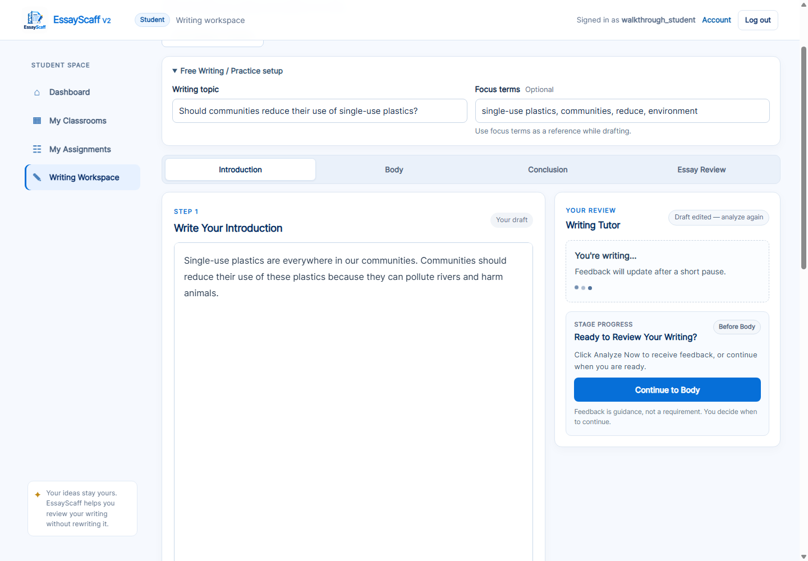

**Figure 1.** The starting state: assignment topic, optional focus terms, the Introduction draft, and the three stage tabs. The Writing Tutor on the right shows a typing indicator because the live-check placeholder is still active. **This frame is before the analysis described below**; it is included to show the input, not to claim that processing has occurred.

The student writes in one stage at a time. The interface treats the three stages as separate drafting and review steps, but the later stages can see earlier drafts for comparison. The inspector's **Current** panel later confirms exactly which analyzed snapshot is being displayed.

### 3.2 The inspector

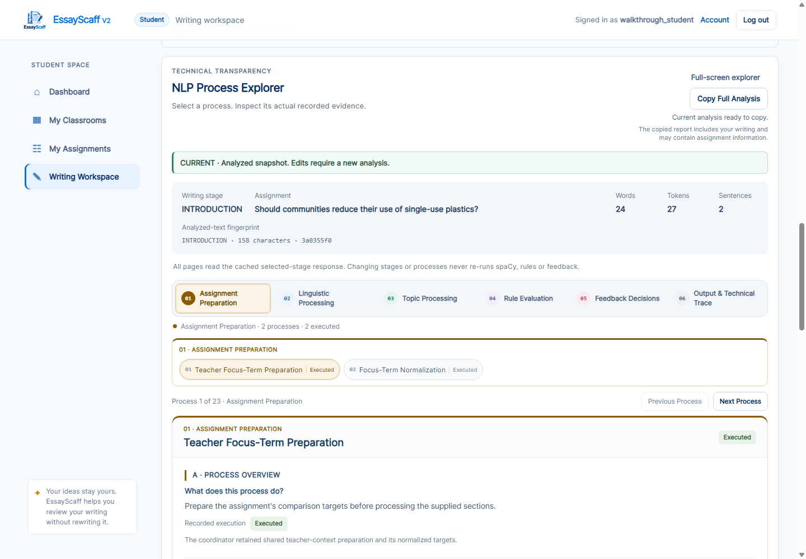

**Figure 2.** After the Introduction analysis, the Technical Transparency section reports: stage `INTRODUCTION`, 24 alphabetic words, 27 tokens, 2 sentences, and a green **CURRENT** state. The six stage groups are visible across the middle. The active process is **Teacher Focus-Term Preparation**, the first step of Assignment Preparation.

The six groups are not six separate analyses. They are six **views of the same cached stage response**:

1. **Assignment Preparation** — what focus targets were prepared.
2. **Linguistic Processing** — what spaCy recorded about the text.
3. **Topic Processing** — concepts, matches, WordNet, related words.
4. **Rule Evaluation** — which stage rules fired or did not fire.
5. **Feedback Decisions** — which branch produced the five fields.
6. **Output & Technical Trace** — how Flask returned and cached the response.

The current implementation exposes 73 process views in total (23 for Introduction, 25 for Body, 25 for Conclusion). The walkthrough uses the views needed to explain the causal chain; the complete inventory is in [`technical_analysis_inspector_report.md`](technical_analysis_inspector_report.md).

### 3.3 The source-verified processing map

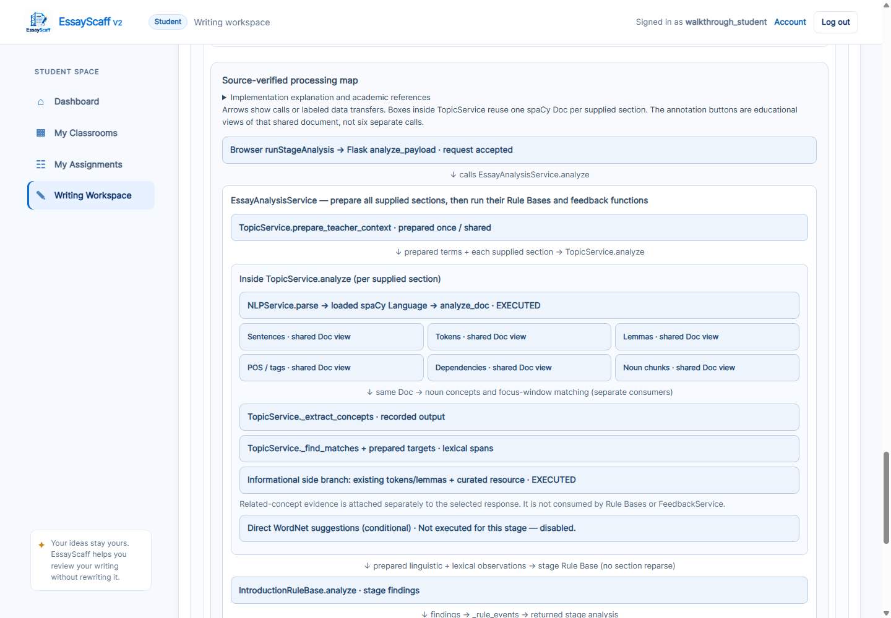

**Figure 3.** The inspector's own processing map. It shows the browser call, the Flask handler, shared focus-term preparation, one `nlp(text)` parse per supplied section, shared `Doc` views, concept extraction, focus matching, the informational related-word side branch, conditional direct WordNet, and then the stage Rule Base.

The key architectural claim is in the middle box:

> **Boxes inside TopicService reuse one spaCy `Doc` per supplied section. The annotation buttons are educational views of that shared document, not six separate calls.**

That is why the token table, POS view, dependency tree, lemma view, sentence view, and noun-chunk view all describe exactly the same annotations. Opening a different inspector process does not reparse the sentence.

The map also shows the two different WordNet paths:

- **Direct WordNet suggestions** are conditional and are disabled for this Introduction.
- **Nested cross-stage WordNet comparisons** run inside the Body and Conclusion Rule Bases when those stages have earlier sections to compare.

These are separate features and should not be conflated.

### 3.4 How the request is scoped

The browser builds the payload in [`static/app.js`](../static/app.js#L7429):

```js
const payload = {
  stage_id: stage,
  assignment_topic: assignmentTopic,
  focus_terms: focusInput.value,
  include_transparency_trace: true,
  [stage === "INTRODUCTION" ? "introduction_text"
    : stage === "BODY" ? "body_text" : "conclusion_text"]: stageText,
};
if (state.assignmentId !== null) payload.assignment_id = state.assignmentId;
if (stage === "BODY" || stage === "CONCLUSION") payload.introduction_text = state.drafts.INTRODUCTION;
if (stage === "CONCLUSION") payload.body_text = state.drafts.BODY;
```

On the server, [`app.py`](../app.py#L1312) enforces the same scope:

```python
if stage_id == "INTRODUCTION":
    introduction, body = stage_text, None
    conclusion = None
elif stage_id == "BODY":
    body = stage_text
    conclusion = None
else:
    conclusion = stage_text
```

The coordinator at [`services/essay_analysis_service.py`](../services/essay_analysis_service.py#L31) then prepares the teacher context once if any stage text exists, calls `TopicService.analyze` once for each supplied section, runs only the selected stage's Rule Base and feedback generator, and returns only `result["stages"][selected_stage]` to the API layer.

This explains several details visible later:

- The Introduction's direct WordNet path is disabled because direct suggestions are only enabled for the Conclusion.
- The Body Rule Base can compare against the Introduction because the Introduction text was supplied.
- The Conclusion Rule Base can compare against both earlier sections because both were supplied.
- A stage's feedback can cite evidence from an earlier section, but the earlier section's own rules are not re-run.

---

## 4. Assignment Preparation: what is being compared?

### 4.1 Focus-term preparation

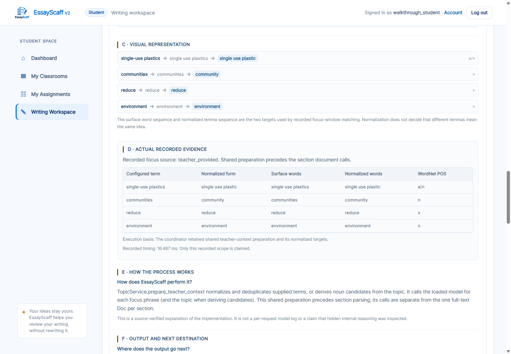

**Figure 4.** The recorded focus source is `teacher_provided`. Four terms were prepared, each with a surface sequence, a normalized lemma sequence, and a WordNet part-of-speech mapping. The recorded preparation time for this request is 16.487 ms.

The table is worth reading closely because it shows what “normalization” does and does not do:

| Configured term | Surface words | Normalized form | Normalized words | WordNet POS |
|---|---|---|---|---|
| `single-use plastics` | `single`, `use`, `plastics` | `single use plastic` | `single`, `use`, `plastic` | `a`, `n` |
| `communities` | `communities` | `community` | `community` | `n` |
| `reduce` | `reduce` | `reduce` | `reduce` | `v` |
| `environment` | `environment` | `environment` | `environment` | `n` |

The hyphen in `single-use` is a separate punctuation token in spaCy. The **surface word sequence** therefore contains `single`, `use`, and `plastics`; the normalized sequence uses the lemma `plastic`. Normalization is word-form handling, not synonym expansion. It does not decide that `environment`, `river`, and `animal` mean the same thing. That is why a separate, explicitly configured related-word resource exists later.

### 4.2 The same preparation, shown as a normalization view

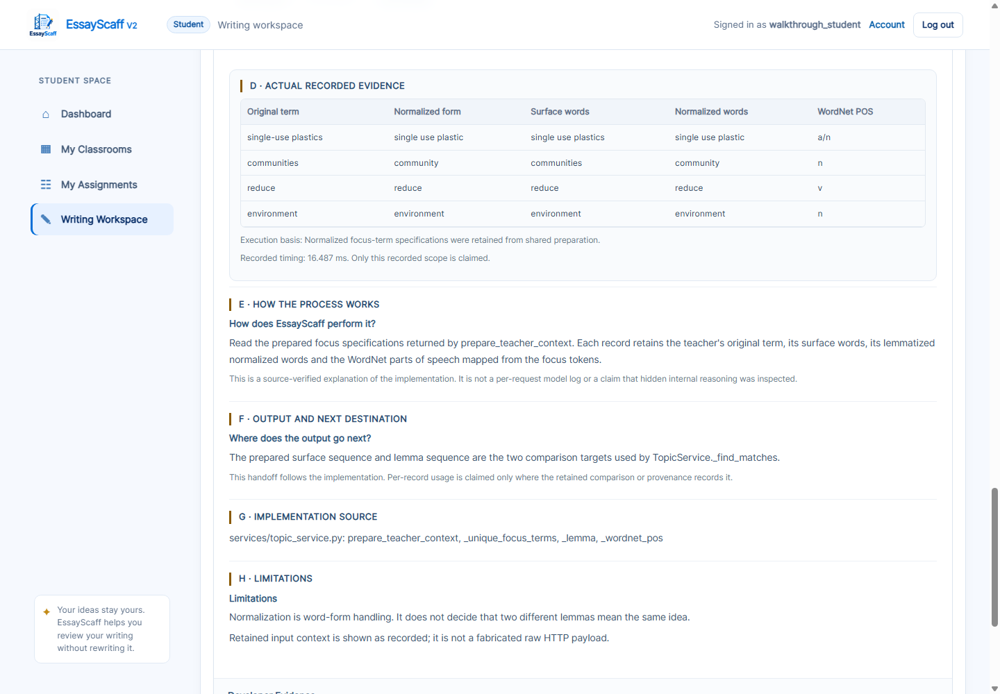

**Figure 5.** The same four prepared records, viewed through the **Focus-Term Normalization** process. The evidence, the 16.487 ms timing, and the limitation are identical because this is one prepared dataset, not a second computation.

The important limitation appears verbatim:

> **Normalization is word-form handling. It does not decide that two different lemmas mean the same idea.**

The shared preparation is called once per request, before the section documents. For this Introduction request it makes four focus-phrase calls and no topic-parsing call, because the focus list was supplied. Together with the one full-section `Doc`, the source-derived total is five spaCy invocations. The trace labels this count `SOURCE_DERIVED_CALL_COUNT_NOT_TIMED_SEPARATELY`; it is derived from the implementation, not measured with a separate counter.

Because the browser makes three separate stage requests, shared preparation happens once **per request**, not once for the whole essay session. The whole session therefore uses 4 focus calls for each of the three requests: 12 focus-term calls in total, plus one, two, and three full-section `Doc`s respectively.

---

## 5. Linguistic Processing: one `Doc`, six views

### 5.1 The counts

Figure 2 already shows the top-level counts. The Introduction response records:

| Measure | Value |
|---|---:|
| Alphabetic word count | 24 |
| Token count | 27 |
| Sentence count | 2 |

Body records 28 alphabetic words, 33 tokens, and 4 sentences. Conclusion records 17 alphabetic words, 21 tokens, and 2 sentences.

### 5.2 Tokenization

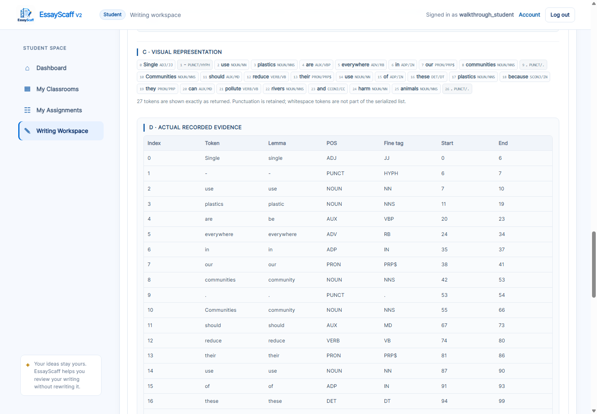

**Figure 6.** The recorded token strip. Each chip is an actual spaCy token span, not a reconstructed string.

The first sentence tokenizes as:

```text
Single  -  use  plastics  are  everywhere  in  our  communities  .
```

Two consequences are visible throughout the system:

1. The hyphenated word `Single-use` becomes three tokens: `Single`, `-`, and `use`.
2. The analyzer's alphabetic word count therefore counts `Single` and `use` separately. The editor's word counter treats `single-use` as one word. This is why the tutor shows **23 words** for the Introduction while the analyzer records **24**, **27 vs 28** for the Body, and **16 vs 17** for the Conclusion. Neither count is wrong; they use different definitions.

### 5.3 Part-of-speech tags

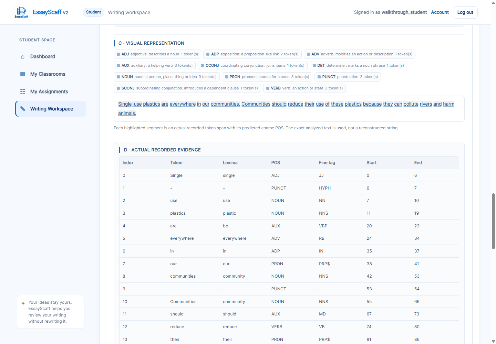

**Figure 7.** Coarse POS groups and the exact token table. The Introduction's 27 tokens break down as:

| Coarse POS | Tokens |
|---|---:|
| `ADJ` | 1 |
| `ADP` | 2 |
| `ADV` | 1 |
| `AUX` | 3 |
| `CCONJ` | 1 |
| `DET` | 1 |
| `NOUN` | 9 |
| `PRON` | 3 |
| `PUNCT` | 3 |
| `SCONJ` | 1 |
| `VERB` | 2 |
| **Total** | **27** |

The fine tags are more informative. For example, `are` is `AUX`/`VBP`, `reduce` is `VERB`/`VB`, and `plastics` is `NOUN`/`NNS`. These tags feed rule conditions such as “a finite root predicate with a subject.”

POS tagging is statistical. In the Body sample, this becomes directly relevant: `harm` in “Plastic containers harm animals.” is tagged `NOUN` (`NN`), and `animals` is treated as the root noun. As a result, that sentence is not treated as a finite clause candidate. Section 7.2 traces the consequence.

### 5.4 Dependency structure

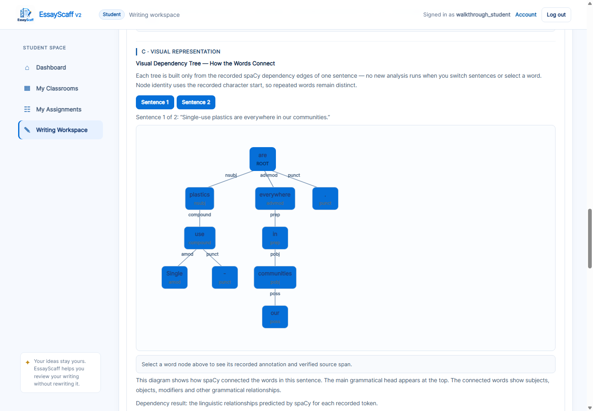

**Figure 8.** The dependency tree for Sentence 1. Nodes are drawn from the recorded head links; node identity uses character offsets, so repeated words remain distinct.

For Sentence 1, the root is `are`. Its subject is `plastics` (`nsubj`), `everywhere` is an `advmod`, and the prepositional phrase `in our communities` hangs from `everywhere`. For Sentence 2, the root is `reduce`, with `Communities` as `nsubj`; the `because` clause attaches as an `advcl` whose predicate is `pollute`.

These labels are the raw material for the stage rules:

- a **central direction candidate** needs a root predicate and a subject;
- the **reason clause** check needs a `because` advcl;
- the **position** check needs a modal or stance cue in a sentence that also matches a focus term;
- Body **topic sentence** and **supporting detail** candidates need parser-labeled clause structures.

A dependency parse is a grammatical hypothesis. It is not a semantic interpretation.

### 5.5 Lemmas

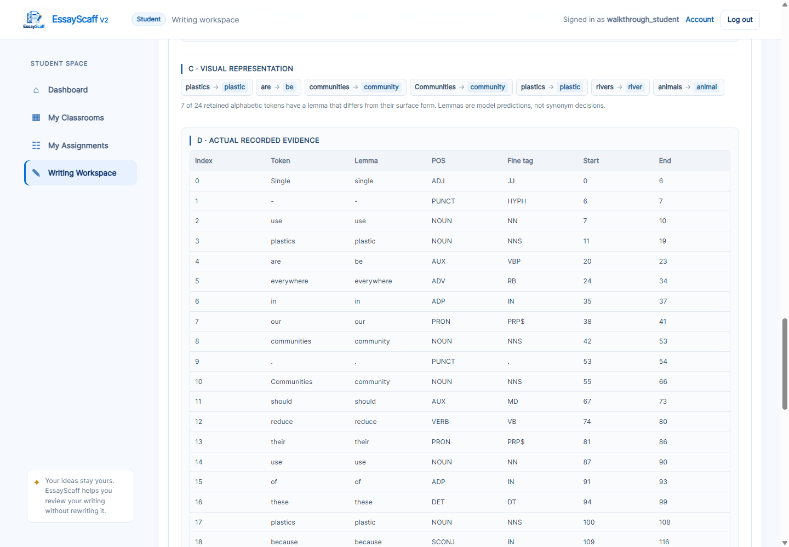

**Figure 9.** Token-to-lemma changes recorded for the Introduction. Examples include:

| Token | Lemma |
|---|---|
| `plastics` | `plastic` |
| `communities` | `community` |
| `are` | `be` |
| `rivers` | `river` |
| `animals` | `animal` |
| `pollute` | `pollute` |

Lemmas feed focus-term normalization, concept grouping, and cross-stage lexical comparison. They do not by themselves establish synonymy. `river` and `environment` remain different lemmas even though the curated related-word resource links them.

### 5.6 Sentences

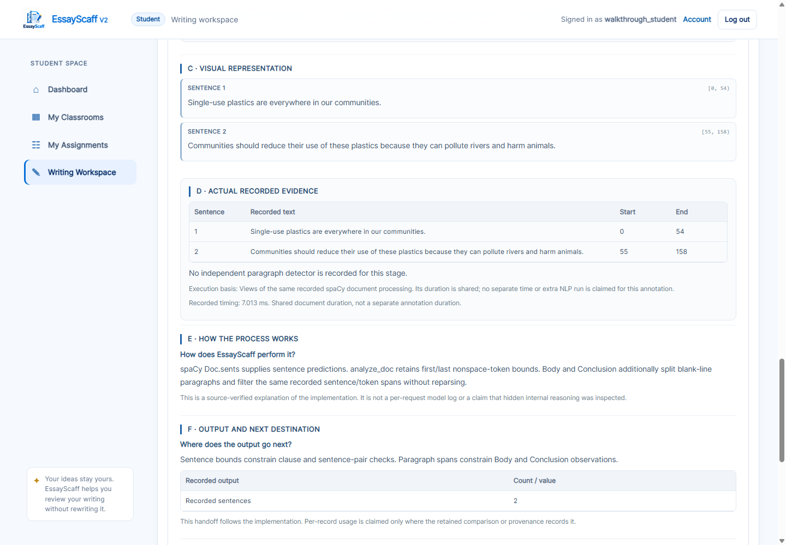

**Figure 10.** The two recorded sentence spans:

1. `[0, 54)` — “Single-use plastics are everywhere in our communities.”
2. `[55, 158)` — “Communities should reduce their use of these plastics because they can pollute rivers and harm animals.”

Sentence boundaries matter because the Introduction rules ask whether a sentence contains both a focus match and a clause candidate, and whether a `because` clause follows a main statement.

### 5.7 Noun chunks

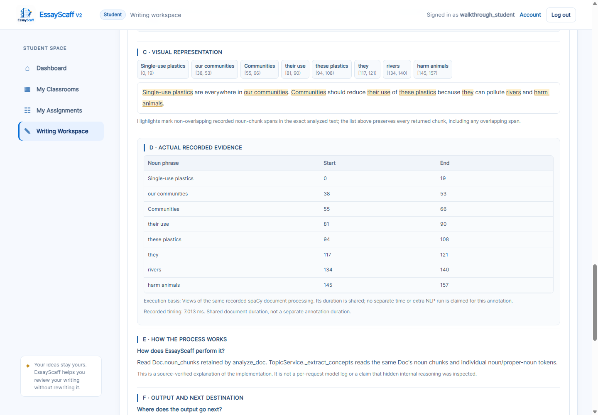

**Figure 11.** The eight recorded noun chunks:

| Span | Text |
|---|---|
| `[0, 19)` | `Single-use plastics` |
| `[38, 53)` | `our communities` |
| `[55, 66)` | `Communities` |
| `[81, 90)` | `their use` |
| `[94, 108)` | `these plastics` |
| `[117, 121)` | `they` |
| `[134, 140)` | `rivers` |
| `[145, 157)` | `harm animals` |

Noun chunks are the starting point for concept candidates, but not every chunk becomes a distinct concept. Overlapping chunks and single noun tokens are grouped and normalized in the next stage. This is why the concept list contains both `our communities` and `Communities`, yet the focus match still records `communities` twice as surface occurrences.

### 5.8 Runtime and pipeline components

The response records:

| Runtime item | Value |
|---|---|
| spaCy | 3.7.5 |
| Model | `core_web_sm` 3.7.1, language `en` |
| NLTK | 3.9.2 |
| Python | 3.11.9 |
| Flask | 3.1.3 |
| SQLite | 3.45.1 |
| Enabled components | `tok2vec`, `tagger`, `parser`, `attribute_ruler`, `lemmatizer`, `ner` |
| Disabled components | `senter` |
| Tokenizer | executed, but not listed in `pipe_names` |

The component timings are **not** individually instrumented. The recorded `parse_ms` covers the complete `nlp(text)` call. The analysis-service initialization is `PRECONSTRUCTED_NOT_INSTRUMENTED` with `duration_ms: null` in this run.

Two components deserve a note:

- `ner` runs, but named entities are not consumed by the active analysis output.
- `attribute_ruler` runs, but its attributes are not separately reported by EssayScaff.

So the pipeline list is longer than the list of components whose outputs are actively used. The inspector reports both facts rather than implying that every component contributes to feedback.

---

## 6. Topic Processing: concepts, matches, WordNet, related words

### 6.1 Concept candidates

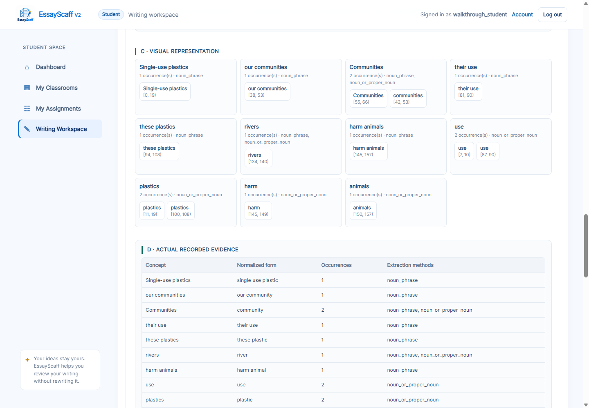

**Figure 12.** Eleven concept candidates extracted from the Introduction, grouped by normalized form and displaying every recorded occurrence span.

Concept extraction is intentionally noun-based. It collects candidate nouns from noun chunks and from individual noun/proper-noun tokens, then groups them. In this sample the candidates include:

- `single use plastic` — from `Single-use plastics`;
- `our community` — from `our communities`;
- `community` — from `Communities` and `communities`;
- `their use`, `these plastic`, `river`, `harm animal`, `use`, `plastic`, `harm`, `animal`.

Two observations follow:

1. **A verb focus term is not a concept candidate.** `reduce` is a focus term and is matched directly from the token stream, but it does not appear in the noun-based concept list.
2. **The noun-only view can merge and split wording imperfectly.** `harm animals` becomes a chunk and also yields separate `harm` and `animal` candidates; `harm` is tagged as a noun, which is the same parse decision that affects the Body paragraph later.

Concept candidates are lexical evidence, not verified “ideas.”

### 6.2 Focus matching

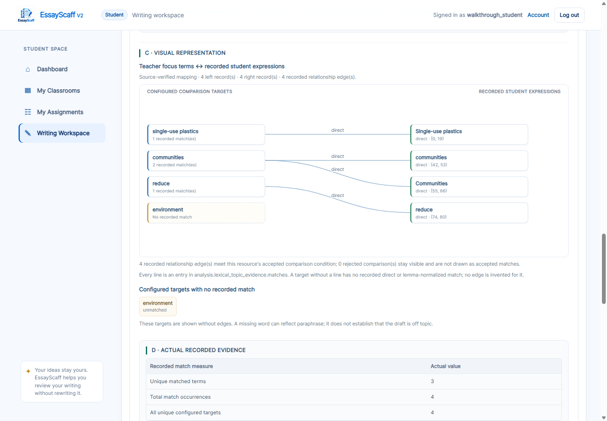

**Figure 13.** Four recorded relationship edges between configured focus terms and student expressions. `environment` is shown as unmatched, with no invented edge.

The recorded counts are:

| Measure | Value |
|---|---:|
| Unique matched terms | 3 |
| Total match occurrences | 4 |
| All unique configured targets | 4 |
| Unmatched targets | 1 (`environment`) |

The four matches are all **direct**:

| Focus term | Observed text | Span | Normalized form |
|---|---|---|---|
| `single-use plastics` | `Single-use plastics` | `[0, 19)` | `single use plastic` |
| `communities` | `communities` | `[42, 53)` | `community` |
| `communities` | `Communities` | `[55, 66)` | `community` |
| `reduce` | `reduce` | `[74, 80)` | `reduce` |

There are **zero lemma-normalized matches** in this sample. The normalized forms are retained on each direct match, but the matching method is still recorded as `direct`. The implementation checks direct surface and lemma-window matches with a direct-first policy, so a direct match is not double-counted as a normalized match.

`environment` is unobserved. That does **not** mean the Introduction is off-topic. It means the exact configured term was not present in the surface or normalized window. The application says so explicitly:

> A target without a line has no recorded direct or lemma-normalized match; no edge is invented for it.

### 6.3 Direct WordNet is skipped for the Introduction

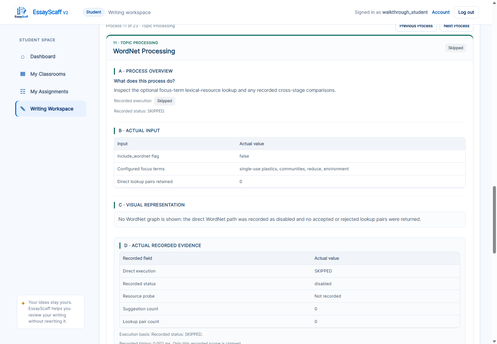

**Figure 14.** The direct WordNet path for the Introduction is **Skipped** with status `disabled`, because `include_wordnet` is false. It records zero lookup pairs and zero suggestions. No graph is drawn because no lookup pairs were returned.

This is easy to misread, so separate the two WordNet uses:

| Feature | Where it runs | This Introduction | This Body | This Conclusion |
|---|---|---|---|---|
| Direct focus-term WordNet suggestions | `TopicService` while matching the selected section | **Skipped / disabled** | **Skipped / disabled** | **Executed** (8 lookup pairs, 0 suggestions) |
| Nested cross-stage WordNet comparison | Inside the selected stage's Rule Base | Not applicable | **Available** (18 pairs, 0 suggestions) | **Available** (23 + 23 pairs, 0 suggestions) |

The direct path is an optional suggestion mechanism for the Conclusion only. It is not the same as the cross-stage comparison that Body and Conclusion use to ask whether earlier concepts are lexically or relationally connected.

### 6.4 Related words are informational only

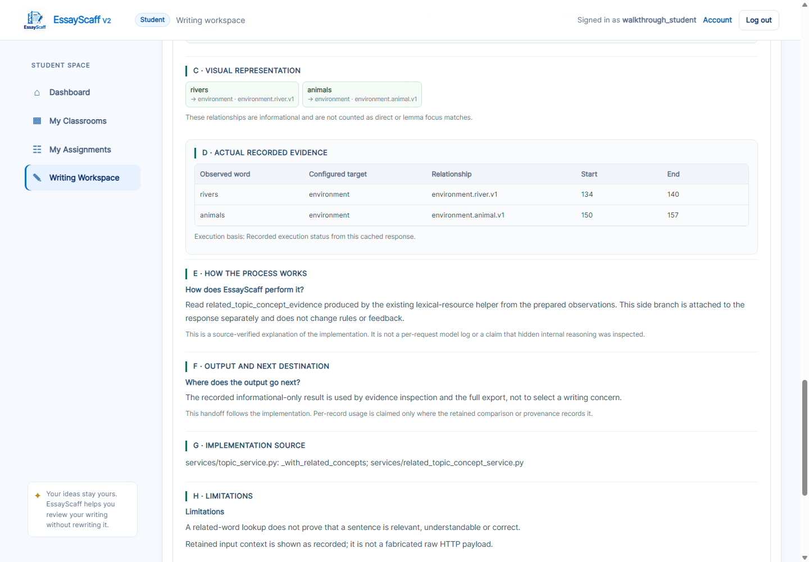

**Figure 15.** Two configured topic relationships were observed: `rivers` → `environment` (`environment.river.v1`, `[134, 140)`) and `animals` → `environment` (`environment.animal.v1`, `[150, 157)`).

These are **not** added to the four focus matches. The response records `affects_rules_or_feedback: false`, and the inspector states that the side branch is informational and is not consumed by Rule Bases or `FeedbackService`. It exists to help a reader see why words such as “rivers” and “animals” are relevant to the environment concept without pretending that they are exact matches.

This is a useful design distinction for a research audience: the system separates **strict coverage** (exact focus terms) from **informational relatedness** (a curated relationship resource), and it does not let the latter silently change the former.

---

## 7. Rule Evaluation: what actually fired, and why

### 7.1 How the trace is built

The stage analysis contains two related records:

- **`rule_evidence`** — the events that were actually emitted. In this sample: 9 for Introduction, 18 for Body, 9 for Conclusion.
- **`rule_evaluation_trace`** — every evaluated row, including rows that were evaluated but did not trigger, and rows that were not applicable. In this sample: 19 for Introduction, 33 for Body, 26 for Conclusion.

The trace is reconstructed from existing stage outputs and emitted events. It does **not** rerun the Rule Base or spaCy. That is why opening the Rule Evaluation inspector is instant and why the trace can show non-triggered rows without a second analysis.

Each row carries:

- a stage-namespaced rule ID (`INTRO.*`, `BODY.*`, `CONCLUSION.*`);
- a condition and configuration;
- the actual evidence or evidence reference;
- an outcome: `TRIGGERED`, `EVALUATED_NOT_TRIGGERED`, or `NOT_APPLICABLE`;
- an implementation location and interpretation limit.

A rule event is not a verdict. The inspector repeats this in every row's limitation.

### 7.2 Introduction rules

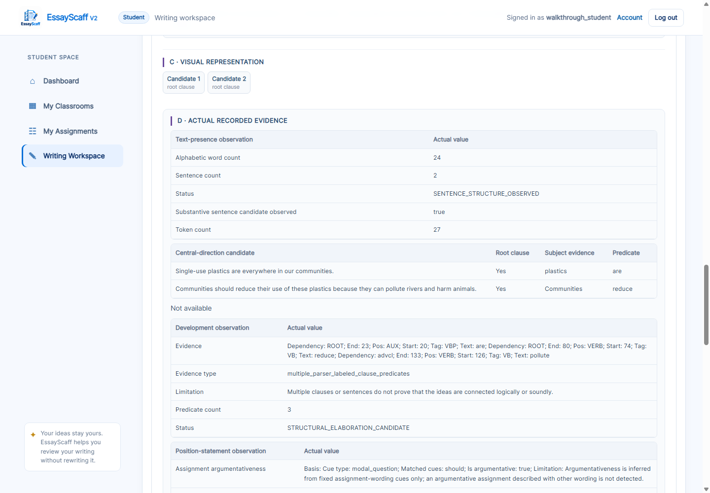

**Figure 16.** Introduction structural observations: 24 words, 2 sentences, `SENTENCE_STRUCTURE_OBSERVED`, two central-direction candidates, three supported clause predicates, and argumentativeness inferred from the modal question cue `should`.

The nine triggered rules are:

| Rule ID | What was observed |
|---|---|
| `INTRO.TEXT.PRESENT` | At least one alphabetic token. |
| `INTRO.CLAUSE.SUBJECT_PREDICATE_CANDIDATE` | Two root clauses with a subject: `plastics → are` and `Communities → reduce`. |
| `INTRO.TOPIC.FOCUS_TERMS_OBSERVED` | Three unique focus terms observed; four occurrences. |
| `INTRO.CONTEXT.TOPIC_AND_CLAUSE_CANDIDATE` | At least one clause sentence also contains a focus match. |
| `INTRO.DEVELOPMENT.MULTIPLE_CLAUSE_PREDICATES` | Three supported predicates (`are`, `reduce`, `pollute`); status `STRUCTURAL_ELABORATION_CANDIDATE`. |
| `INTRO.REASON.NO_CLAUSE_TOPIC_OVERLAP` | A `because` clause was found, but it contains no focus-term match. |
| `INTRO.POSITION.RELEVANT_POSITION_OBSERVED` | The assignment is argumentative (`should`), and a sentence contains a modal stance cue plus focus matches. |
| `INTRO.GOAL.OBSERVABLE_INTRODUCTION` | The observable Introduction goal condition was met. |
| `INTRO.LIMITATION.NO_SEMANTIC_VALIDATION` | The stage explicitly records that it did not validate meaning. |

The reason clause is the span `[109, 157)`:

> `because they can pollute rivers and harm animals`

Its predicate is `pollute` (`advcl` of `reduce`). The clause contains no focus-term match. The status is `BECAUSE_CLAUSE_NO_TOPIC_OVERLAP`. This is a lexical observation only: the pronoun `they` is not resolved, and the clause may still be a perfectly good explanation. The feedback therefore treats it as **neutral review evidence**, not as a problem.

The position evidence is separate. The assignment topic is argumentative because it contains the modal question cue `should`. The sentence “Communities should reduce…” contains a modal `should`, a subject, and two focus-term matches (`Communities`, `reduce`). The recorded status is `RELEVANT_POSITION_OBSERVED` with stance `MODAL_AFFIRMED`.

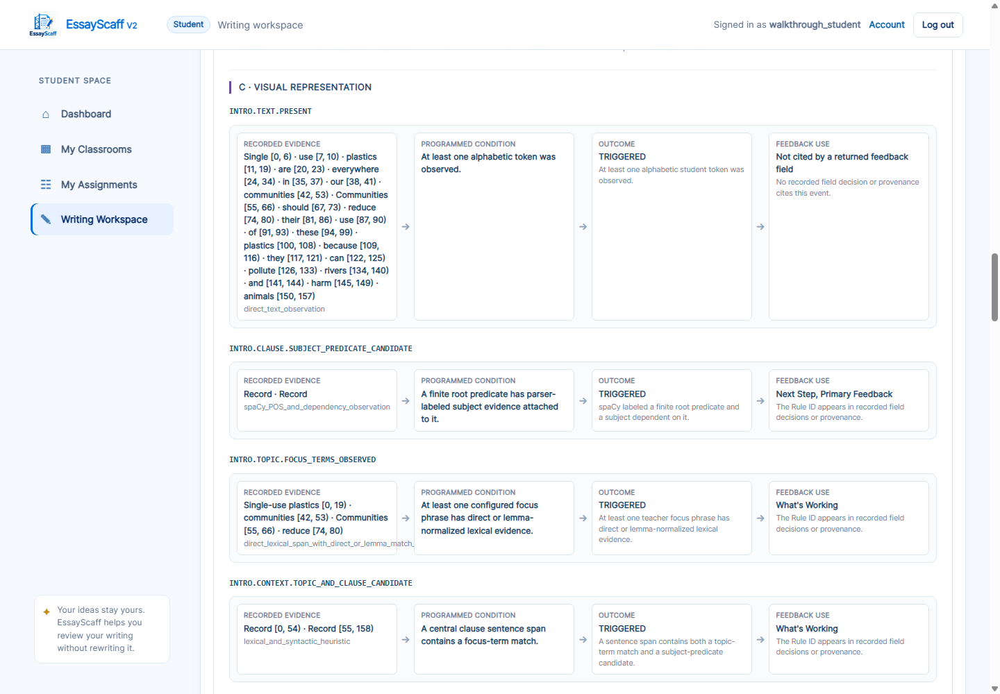

**Figure 17.** The emitted-event view. For each event, the inspector shows the recorded evidence, the programmed condition, the outcome, and whether a returned feedback field cites it.

This view makes a subtle point visible: not every triggered event is cited by a feedback field. `INTRO.TEXT.PRESENT` is triggered but is not cited by a returned feedback field, because “some text exists” is not useful student-facing feedback. The trace records both the event and its non-use.

### 7.3 Body rules

The Body request analyzed two substantive paragraphs.

| Paragraph | Alphabetic words | Sentences | Clause candidates | Topic-sentence candidates | Supporting-detail candidates | Repetition observed |
|---|---:|---:|---:|---:|---:|---|
| Paragraph 1 | 16 | 2 | 2 | 2 | 2 | `bags` ×2, `reduce` ×2, `reusable` ×2 |
| Paragraph 2 | 12 | 2 | 1 | 1 | 0 | `animals` ×2, `containers` ×2 |
| **Total** | **28** | **4** | **3** | **3** | **2** | — |

The Body emitted 18 events and has 33 evaluation rows. Key triggered rules include:

- `BODY.P1.PARAGRAPH.SEGMENTED`, `BODY.P1.PARAGRAPH.FOCUS_TERMS_OBSERVED`
- `BODY.P1.TOPIC_SENTENCE.CANDIDATE`, `BODY.P1.SUPPORTING_DETAIL.CANDIDATE`
- `BODY.P1.REPETITION.REPEATED_SURFACE_CONTENT_WORDS`
- `BODY.P2.PARAGRAPH.SEGMENTED`, `BODY.P2.PARAGRAPH.FOCUS_TERMS_OBSERVED`
- `BODY.P2.TOPIC_SENTENCE.CANDIDATE`, `BODY.P2.SUPPORTING_DETAIL.NOT_OBSERVED`
- `BODY.P2.REPETITION.REPEATED_SURFACE_CONTENT_WORDS`
- `BODY.CONTINUITY.ADJACENT_PARAGRAPH_COMPARISON`
- `BODY.INTRO_CONTINUITY.LEXICAL_COMPARISON`
- `BODY.GOAL.DEVELOP_BODY_IDEAS`
- `BODY.LIMITATION.NO_SEMANTIC_VALIDATION`

#### Why Paragraph 2 gets a concern

This is the most important causal detail in the walkthrough, because it shows why a **parser outcome** becomes a **feedback branch**.

The second paragraph is:

> Plastic containers harm animals. Communities can protect animals by using reusable containers.

The analyzer records only **one** clause candidate in this paragraph:

- `protect` — root `VERB`/`VB`, subject `Communities`, in the second sentence `[142, 203)`.

The first sentence does **not** produce a finite clause candidate. In the recorded parse, `harm` is `NOUN`/`NN`, and `animals` is the root noun of that sentence. `Plastic containers harm animals.` is therefore not accepted as a subject-linked finite clause.

The supporting-detail helper is conservative:

```python
details = clause_candidates if len(clause_candidates) >= 2 else []
```

Paragraph 2 has one clause candidate, so it yields **zero** supporting-detail candidates. The rule `BODY.P2.SUPPORTING_DETAIL.NOT_OBSERVED` fires with the whole paragraph `[109, 203)` as evidence. The condition is explicitly:

> No additional clause or statement candidate was detected within the paragraph.

This is not a claim that Paragraph 2 lacks support. The feedback says exactly the opposite kind of caution:

> Paragraph 2 has a possible statement, but the checks did not record another sentence part developing it. **Other kinds of supporting ideas may still be present.**

In other words:

```text
parser tags "harm" as a noun
  -> first sentence is not a finite clause candidate
  -> P2 has only one clause candidate ("protect")
  -> supporting-detail threshold (>= 2) not met
  -> BODY.P2.SUPPORTING_DETAIL.NOT_OBSERVED
  -> FeedbackService selects body_ideas_develop_point
  -> tutor shows a supported concern and highlights the statement
```

A different POS tag for `harm` could have changed this outcome. That is a genuine limitation of a statistical parser, and it is why the application describes the result as a review signal rather than a verdict.

#### Cross-paragraph comparison

The two Body paragraphs are compared as a pair. The recorded status is `LEXICAL_OR_TRANSITION_CANDIDATE`:

- 2 direct shared surface terms: `communities`, `reusable`;
- 4 normalized shared terms: `community`, `plastic`, `reusable`, `use`;
- 0 transition expressions.

The inspector does not infer coherence from this overlap. It says terms and transition expressions do not prove logical coherence or paragraph relevance.

#### Introduction → Body comparison

The Body Rule Base also compares the Body against the supplied Introduction. The status is `LEXICAL_COMPARISON_AVAILABLE`:

- 7 direct concept pairs;
- 0 lemma-normalized pairs;
- 4 Introduction concepts not observed in the Body: `harm animal`, `our community`, `their use`, `these plastic`;
- nested WordNet: `AVAILABLE`, 18 lookup pairs, **0 suggestions**.

The 7 direct pairs are `animal`, `community`, `harm`, `plastic`, `river`, `single use plastic`, and `use`. These are exact casefolded surface concept matches; the fact that they are direct matches is why there are zero normalized pairs here. Again, absence of a pair is not proof of irrelevance, and presence is not proof of coherence.

### 7.4 Conclusion rules

The Conclusion has 1 paragraph, 2 sentences, 17 alphabetic words, 21 tokens, and 10 concept candidates. `keyword_list_candidate` is `false`.

It emitted 9 events and has 26 evaluation rows: 9 triggered, 15 evaluated-not-triggered, and 2 `NOT_APPLICABLE`:

- `CONCLUSION.CONTINUITY.BODY_UNAVAILABLE`
- `CONCLUSION.CONTINUITY.INTRODUCTION_UNAVAILABLE`

The two N/A rows exist because a Conclusion **could** be analyzed without earlier sections. In this run both earlier sections were supplied, so the unavailable-context rules did not apply. The inspector keeps them visible rather than hiding them.

The triggered rules are:

| Rule ID | What was observed |
|---|---|
| `CONCLUSION.TEXT.PRESENT` | At least one alphabetic token. |
| `CONCLUSION.STRUCTURE.CLAUSE_CANDIDATE` | A clause candidate was recorded. |
| `CONCLUSION.TOPIC.FOCUS_MATCHES` | Three unique focus terms observed. |
| `CONCLUSION.CONTINUITY.INTRODUCTION_LEXICAL_COMPARISON` | Six direct pairs with the Introduction. |
| `CONCLUSION.CONTINUITY.BODY_LEXICAL_COMPARISON` | Nine direct pairs with the Body. |
| `CONCLUSION.SYNTHESIS.STRUCTURE_CANDIDATE` | A sentence combines concepts from more than one earlier section. |
| `CONCLUSION.CLOSURE.STRUCTURE_CANDIDATE` | A final clause and a closing expression were recorded. |
| `CONCLUSION.LIMITATION.NO_SEMANTIC_VALIDATION` | The stage explicitly records that it did not validate meaning. |
| `CONCLUSION.GOAL.REVIEW_TOPIC_AND_PRIOR_IDEAS` | The observable Conclusion goal condition was met. |

#### Synthesis

The status is `SYNTHESIS_STRUCTURE_CANDIDATE`. There are two candidates:

1. `In conclusion, communities should reduce single-use plastics.` — combines earlier normalized forms `community`, `single use plastic`, `use`, and `plastic`.
2. `Reusable bags and containers can protect rivers and animals.` — combines `reusable bag`, `container`, `river`, `animal`, and `bag`.

This is a **structure candidate**, not proof of synthesis. The words recur, but the system does not know whether the sentence actually brings the ideas together. That is exactly why the resulting feedback is neutral and asks the student to read the Conclusion with the earlier sections.

#### Closure

The closure candidates are:

- a final sentence clause: `Reusable bags and containers can protect rivers and animals.` `[62, 122)`;
- a closing expression: `In conclusion` `[0, 13)`.

Status: `CLOSURE_STRUCTURE_CANDIDATE`. The final sentence has no modal or recommendation cue recorded, but no particular cue is required. A closing phrase alone does not establish rhetorical closure.

#### New material

The status is `COMPARISON_WITH_BOTH_PRIOR_SECTIONS`:

- 0 unobserved concept candidates;
- 0 paraphrase/rewording candidates;
- 0 surface rewording candidates;
- `phrase_combinations_of_observed_concepts` is empty.

This does **not** prove that the Conclusion introduces no new ideas. The limitation says that concepts not lexically observed in supplied sections are not necessarily new arguments, and paraphrases may be missed.

#### Conclusion cross-stage comparison

| Comparison | Status | Direct pairs | Normalized pairs | Unmatched source concepts | Nested WordNet |
|---|---|---:|---:|---|---|
| Introduction → Conclusion | `LEXICAL_COMPARISON_AVAILABLE` | 6 | 0 | `harm`, `harm animal`, `our community`, `their use`, `these plastic` | `AVAILABLE`, 23 lookup pairs, 0 suggestions |
| Body → Conclusion | `LEXICAL_COMPARISON_AVAILABLE` | 9 | 0 | `harm`, `plastic container harm animal`, `reusable container`, `waste` | `AVAILABLE`, 23 lookup pairs, 0 suggestions |

The Body→Conclusion shared forms are `animal`, `bag`, `community`, `container`, `plastic`, `reusable bag`, `river`, `single use plastic`, and `use`. The Introduction→Conclusion shared forms are `animal`, `community`, `plastic`, `river`, `single use plastic`, and `use`.

The nested WordNet comparisons ran and were **available**, but recorded **zero relationship suggestions** in this sample. That is a real recorded result, not a skipped check. It also explains why the overall Body Rule Base time is large: the nested comparison runs inside that timer. It does not explain it as “cold start,” and the trace does not isolate the comparison's own duration.

### 7.5 Cross-stage summary

| Observation | Introduction | Body | Conclusion |
|---|---|---|---|
| Earlier sections available | none | Introduction | Introduction + Body |
| Cross-stage status in the stage analysis | N/A | `LEXICAL_COMPARISON_AVAILABLE` | `LEXICAL_COMPARISON_AVAILABLE` for both paths |
| Direct pairs | — | 7 (Introduction→Body) | 6 (Introduction→Conclusion), 9 (Body→Conclusion) |
| Normalized pairs | — | 0 | 0 |
| Nested WordNet status | — | `AVAILABLE` | `AVAILABLE` |
| Nested WordNet suggestions | — | 0 | 0 |

Cross-stage evidence is a **comparison record**, not a revision instruction. It is used to ask whether the earlier wording recurs; it is never used to certify that the essay is coherent.

---

## 8. Feedback Decisions: how five fields are chosen

### 8.1 The decision lane

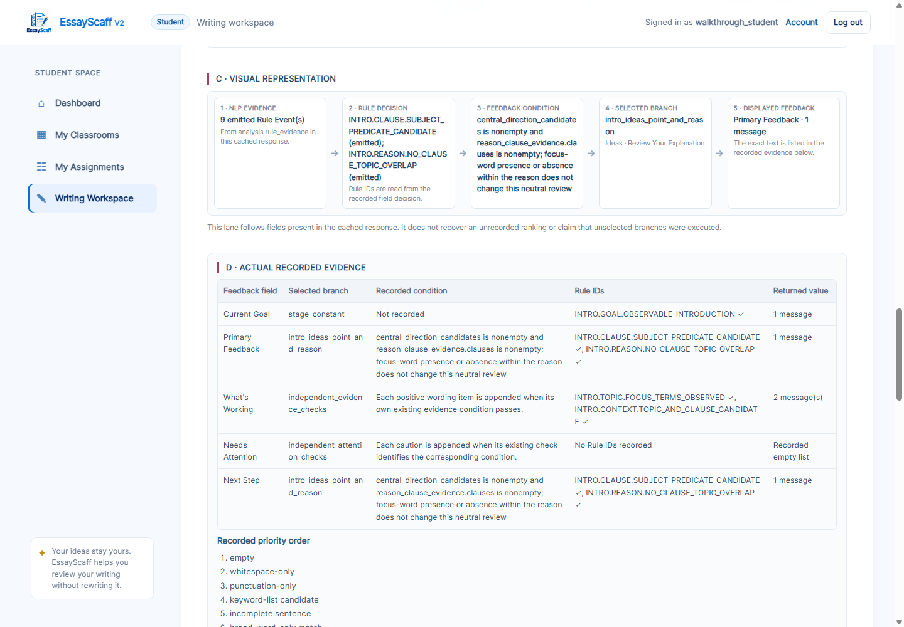

**Figure 18.** The causal lane for the Introduction:

```text
9 emitted Rule Events
  -> two rule decisions (INTRO.CLAUSE.SUBJECT_PREDICATE_CANDIDATE,
     INTRO.REASON.NO_CLAUSE_TOPIC_OVERLAP)
  -> condition: central direction candidates nonempty and reason clauses nonempty
  -> branch: intro_ideas_point_and_reason
  -> displayed feedback: Primary Feedback, 1 message
```

The lane is built from fields already present in the cached response. It does not recover an unrecorded ranking. The response explicitly says:

> `FeedbackService` does not record unselected candidate messages or a hidden ranking.

The priority order is recorded, with 13 entries. The selected branch is the first whose condition matches. In this sample, the Introduction selected `intro_ideas_point_and_reason`; the Body selected `body_ideas_develop_point` at priority 3; the Conclusion selected `conclusion_ideas_bring_together`.

### 8.2 The five fields

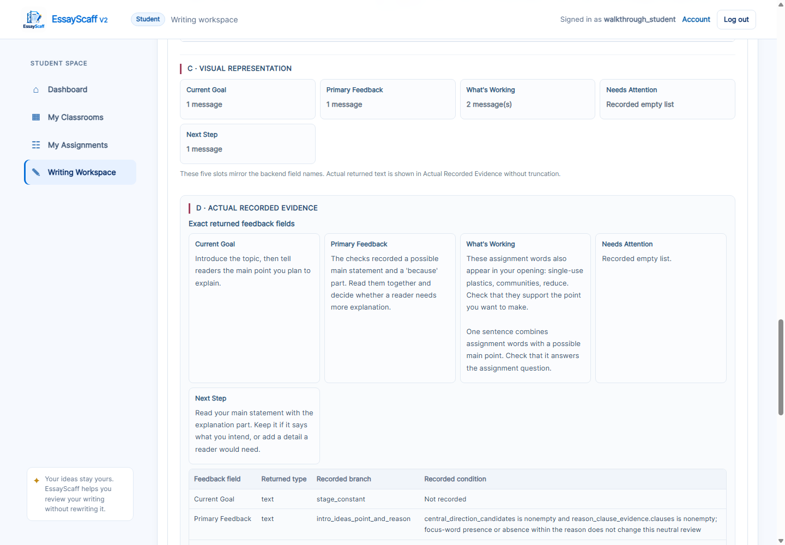

**Figure 19.** The exact five fields returned for the Introduction. The empty `Needs Attention` list is shown as a recorded empty list, not as a missing value.

Every stage returns the same five keys:

1. `Current Goal`
2. `Primary Feedback`
3. `What's Working`
4. `Needs Attention`
5. `Next Step`

The student tutor does not necessarily display these five fields verbatim. It shows prepared guidance derived from the same selected branch. The inspector is where the exact returned fields can be checked without paraphrase.

### 8.3 Introduction feedback, exactly as returned

| Field | Value |
|---|---|
| Current Goal | “Introduce the topic, then tell readers the main point you plan to explain.” |
| Primary Feedback | “The checks recorded a possible main statement and a 'because' part. Read them together and decide whether a reader needs more explanation.” |
| What's Working | 1. “These assignment words also appear in your opening: single-use plastics, communities, reduce. Check that they support the point you want to make.” 2. “One sentence combines assignment words with a possible main point. Check that it answers the assignment question.” |
| Needs Attention | *(empty list)* |
| Next Step | “Read your main statement with the explanation part. Keep it if it says what you intend, or add a detail a reader would need.” |

There are **7 provenance items**:

| Field | Rule(s) |
|---|---|
| Current Goal | `INTRO.GOAL.OBSERVABLE_INTRODUCTION` |
| Primary Feedback | `INTRO.CLAUSE.SUBJECT_PREDICATE_CANDIDATE`, `INTRO.REASON.NO_CLAUSE_TOPIC_OVERLAP` |
| What's Working | `INTRO.TOPIC.FOCUS_TERMS_OBSERVED`, `INTRO.CONTEXT.TOPIC_AND_CLAUSE_CANDIDATE` |
| Next Step | `INTRO.CLAUSE.SUBJECT_PREDICATE_CANDIDATE`, `INTRO.REASON.NO_CLAUSE_TOPIC_OVERLAP` |

The branches are:

| Field | Branch |
|---|---|
| Current Goal | `stage_constant` |
| Primary Feedback | `intro_ideas_point_and_reason` |
| What's Working | `independent_evidence_checks` |
| Needs Attention | `independent_attention_checks` |
| Next Step | `intro_ideas_point_and_reason` |

The field-level mapping is `Ideas` / `Review Your Explanation`. The prepared lesson is `HELP-INTRO-EXPLAIN-POINT` version 6, with purpose `NEUTRAL_REVIEW_TASK`.

### 8.4 The neutral-presentation nuance

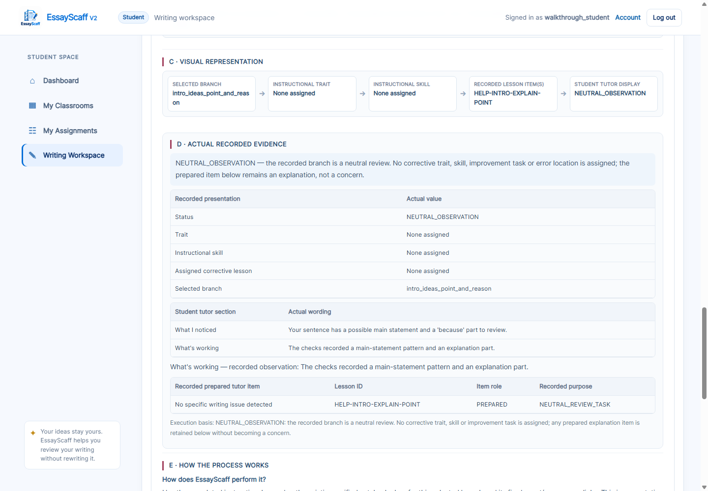

**Figure 20.** The recorded mapping after branch selection. The selected branch is `intro_ideas_point_and_reason`. The instructional trait and skill boxes show **None assigned**, the recorded lesson is `HELP-INTRO-EXPLAIN-POINT`, and the student tutor display is `NEUTRAL_OBSERVATION`.

This looks contradictory only if the layers are conflated:

- The **field-level decision metadata** carries `Ideas` and `Review Your Explanation`. This says which instructional area the prepared guidance belongs to.
- The **student presentation state** is `NEUTRAL_OBSERVATION`. This says the branch is a neutral review, not a detected concern.
- No corrective trait, corrective skill, improvement task, or error location is assigned.
- The prepared item remains an explanation, not a concern.

The inspector states it directly:

> `NEUTRAL_OBSERVATION` — the recorded branch is a neutral review. No corrective trait, skill, improvement task or error location is assigned; the prepared item below remains an explanation, not a concern.

This distinction matters for interpreting the tutor screenshots later. “Trait: None assigned” does **not** mean the system failed to find a trait; it means this branch is not presented as a trait deficiency.

### 8.5 Highlight evidence

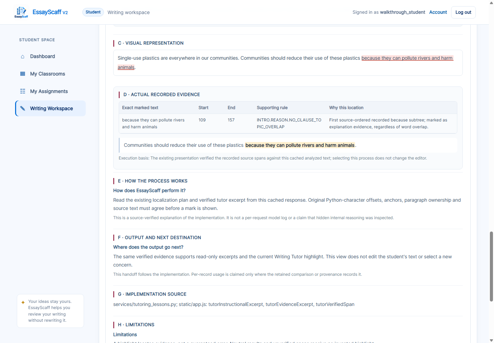

**Figure 21.** The verified highlight span for the Introduction: `[109, 157)`, “because they can pollute rivers and harm animals,” tied to `INTRO.REASON.NO_CLAUSE_TOPIC_OVERLAP`.

The highlight is **source evidence**, not an error label. The selection reason is:

> First source-ordered recorded because subtree; marked as explanation evidence, regardless of word overlap.

The application verifies the original Python-character offsets, anchors, paragraph ownership, and source text before displaying a mark. If those do not agree, no highlight is shown. This is why the Conclusion later has no highlight: there is no verified span for its neutral state, and the system does not invent one.

### 8.6 Body feedback, exactly as returned

The Body selected branch is `body_ideas_develop_point`, priority 3, for Paragraph 2. The selection status is `SUPPORTED_CONCERN_SELECTED`. The five branch checks are recorded, and only the third matched:

| Priority | Branch | Status |
|---:|---|---|
| 1 | `body_neutral_empty` | `NOT_MATCHED` |
| 2 | `body_organization_paragraph_shape` | `NOT_MATCHED` |
| 3 | `body_ideas_develop_point` | **`SELECTED`** |
| 4 | `body_sentence_fluency_sentence_beginnings` | `NOT_MATCHED` |
| 5 | `body_organization_paragraph_link` | `NOT_MATCHED` |

The returned fields are:

| Field | Value |
|---|---|
| Current Goal | “Body review covers recorded paragraph structure, development patterns, sentence openings, and wording links.” |
| Primary Feedback | “Paragraph 2 has a possible statement, but the checks did not record another sentence part developing it. Other kinds of supporting ideas may still be present.” |
| What's Working | Eight messages: P1 assignment words; P1 possible introductory sentence; P1 additional details; P1 `bags` repeated twice; P2 assignment words; P2 possible introductory sentence; P2 `animals` repeated twice; Introduction overlap. |
| Needs Attention | “Paragraph 2 has a possible statement, but no additional sentence part was recorded under this check.” |
| Next Step | “Think of an activity, example, or explanation that could help readers understand Paragraph 2. Write it in your own words if needed.” |

There are 12 provenance items. The field-level trait is `Ideas`, the skill is `Develop Your Supporting Details`, the lesson is `HELP-BODY-DEVELOP-POINT` version 6, and the purpose is `DEVELOPMENT_TASK`. The highlight is `[142, 203)`, “Communities can protect animals by using reusable containers.”, tied to `BODY.P2.SUPPORTING_DETAIL.NOT_OBSERVED`.

The field-level mapping includes a warning that is essential to the interpretation:

> The selected paragraph has a recorded subject-linked statement, no additional qualifying development pattern, and its own fired absence event. Ideas · Develop Your Supporting Details is a structural review task, **not a finding that no meaningful support exists**.

### 8.7 Conclusion feedback, exactly as returned

The Conclusion selected branch is `conclusion_ideas_bring_together`. The five fields are:

| Field | Value |
|---|---|
| Current Goal | “Return to your main idea, connect it with earlier points, and leave the reader with one clear ending thought.” |
| Primary Feedback | “One sentence combines ideas from more than one earlier section. Read it with those sections and check that it brings the ideas together as you intend.” |
| What's Working | Five messages: assignment words; Introduction overlap; Body overlap; synthesis candidate; final sentence/closing phrase. |
| Needs Attention | “These checks record structure and wording only; they cannot tell whether an idea is true or whether the ending works well.” |
| Next Step | “Read the Conclusion with the earlier sections. Does it bring the points you chose together?” |

There are 9 provenance items. The field-level trait is `Ideas`, and the skill is `Bring Ideas Together`. The cached response does **not** contain an `instructional_feedback` item or a prepared lesson for this branch; the tutor therefore stays neutral and no verified highlight is produced. This is an honest absence, not an unfinished UI state: the field-level mapping still reports the conceptual skill, but there is no prepared corrective lesson to attach.

---

## 9. Output and Technical Trace: what the browser receives

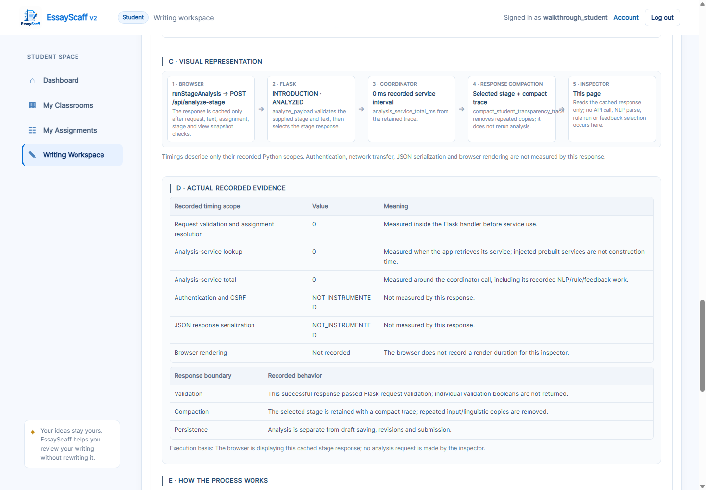

**Figure 22.** The output lane: browser `runStageAnalysis` → Flask `analyze_payload` → coordinator → response compaction → inspector. The response is cached after the request; the inspector reads the cached response only.

The response body for one stage contains:

```text
stage_id
availability
analysis
feedback
interpretation_limit
[related_topic_concept_evidence]   (conditional)
research_trace                    (when requested)
```

The API layer at [`app.py`](../app.py#L1357) returns only the selected stage:

```python
response = {
    "stage_id": stage["stage_id"],
    "availability": stage["availability"],
    "analysis": response_analysis,
    "feedback": response_feedback,
    "interpretation_limit": result["interpretation_limit"],
}
```

The trace is compacted to the selected stage for the student path, and the runtime metadata is filled from the already-loaded NLP service. The browser then checks that the returned text matches the draft that was submitted and that any earlier-section context matches the browser's own drafts ([`static/app.js`](../static/app.js#L7462)). If either differs, the browser refuses the result instead of displaying evidence for the wrong text.

### 9.1 Timing, with scope

The reliable in-process timings for this run are:

| Recorded step | Introduction | Body | Conclusion |
|---|---:|---:|---:|
| Teacher context preparation | 16.487 ms | 13.307 ms | 12.628 ms |
| `TopicService` outer time | 10.232 ms | 8.861 ms | 6.707 ms |
| — spaCy document processing | 7.013 ms | 6.728 ms | 4.903 ms |
| — concept extraction | 0.215 ms | 0.336 ms | 0.135 ms |
| — focus matching | 1.087 ms | 1.242 ms | 0.546 ms |
| — direct WordNet suggestions | 0.002 ms (skipped) | 0.001 ms (skipped) | 0.471 ms (executed) |
| `TopicService` internal total | 8.780 ms | 8.781 ms | 6.437 ms |
| Rule Base (including nested comparisons) | 0.625 ms | **2,106.659 ms** | 1.108 ms |
| Feedback generation | 0.093 ms | 0.249 ms | 0.024 ms |

Read these numbers with four cautions:

1. **The scopes are narrow.** They cover marked in-process Python calls. Flask authentication, CSRF handling, network transfer, JSON serialization, and browser rendering are not included.
2. **The Body Rule Base includes nested cross-stage WordNet.** The 2,106.659 ms is the whole recorded Rule Base scope, not an isolated WordNet duration. The trace does not separately measure the nested comparison, and this walkthrough does not claim a cause such as a cold cache.
3. **Step timings do not necessarily sum to the recorded total.** For the Introduction, the four recorded steps sum to 8.317 ms while the `TopicService` internal total is 8.780 ms. The remainder is untimed bookkeeping/serialization inside the total, not a hidden NLP step. The outer 10.232 ms includes additional coordinator overhead.
4. **The three top-level timing totals are zero in this student capture.** `request_validation_and_assignment_resolution_ms`, `analysis_service_lookup_ms`, and `analysis_service_total_ms` are recorded as `0` because they are only timed when the research-inspector request flag is set. They are **not** evidence that the request took zero milliseconds. The stage-level timings above are measured regardless of that flag.

The UI's runtime row for these three totals says “0” and describes the intended scope. The correct reading is “not measured on this path,” not “instant.”

### 9.2 Call frequency

| Measure | Introduction | Body | Conclusion |
|---|---:|---:|---:|
| Focus-phrase normalization calls | 4 | 4 | 4 |
| Assignment-topic calls (focus list absent) | 0 | 0 | 0 |
| Full-section `Doc`s | 1 | 2 | 3 |
| **Source-derived total spaCy invocations** | **5** | **6** | **7** |

The trace labels this `SOURCE_DERIVED_CALL_COUNT_NOT_TIMED_SEPARATELY`: the count is derived from the code path, not from an instrumented call counter. This is still useful because it shows the cost structure: the number of full-section documents grows with the stage, while focus normalization stays at four calls per request.

### 9.3 Runtime metadata

| Item | Value |
|---|---|
| spaCy | 3.7.5 |
| Model | `core_web_sm` 3.7.1, language `en` |
| NLTK | 3.9.2 |
| Python | 3.11.9 |
| Flask | 3.1.3 |
| SQLite | 3.45.1 |
| WordNet version for direct Conclusion lookup | 3.0 |
| Analysis-service initialization | `PRECONSTRUCTED_NOT_INSTRUMENTED`, `duration_ms: null` |

The runtime metadata is read from the already-loaded NLP service. It does not parse text or query WordNet. The inspector's “Not recorded” cells for model initialization or per-component timings are therefore accurate statements about instrumentation, not missing display values.

---

## 10. What the student and inspector see, stage by stage

### 10.1 Introduction: a neutral review

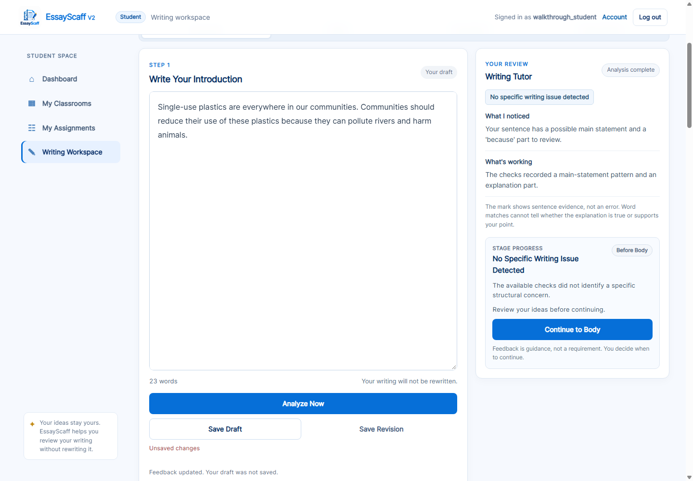

**Figure 23.** The Introduction tutor after analysis. It shows **No Specific Writing Issue Detected**, the prepared “What I noticed”/“What's working” guidance, the mark explanation, and **Continue to Body**. The editor shows **23 words**, while the analyzer recorded 24.

Why neutral? The branch `intro_ideas_point_and_reason` is a **review** branch. It was selected because a possible main statement and a `because` clause were both recorded. It is not a concern branch. The `because` clause has no focus-term overlap, but that is not treated as a defect; the feedback asks the student to read the statement and explanation together.

The tutor's words are the prepared guidance from the branch, not a paraphrase invented by an LLM. The underlying five fields are in the inspector.

### 10.2 Body: a supported concern and a verified highlight

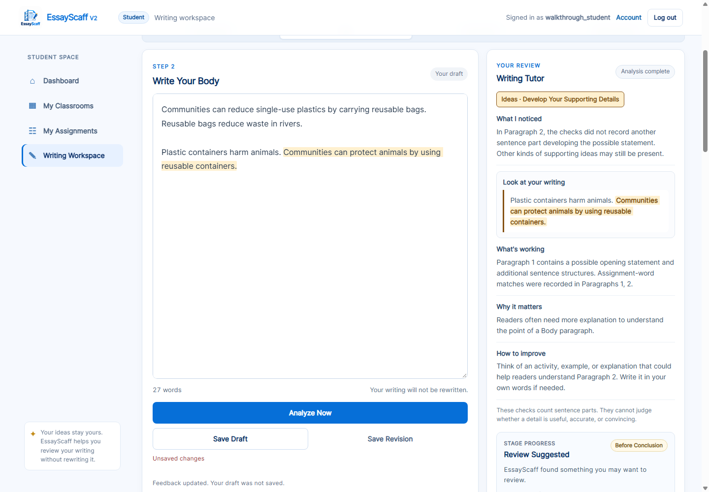

**Figure 24.** The Body tutor after analysis. The badge is **Ideas · Develop Your Supporting Details**. The tutor says Paragraph 2 has a possible statement but no additional sentence part was recorded under this check. It shows the highlighted statement in “Look at your writing,” and the stage progress says **Review Suggested**. The editor shows **27 words**; the analyzer recorded 28.

This is the only stage in the sample with a **supported concern**. The concern is tied to a specific verified span, `[142, 203)`, and a specific rule, `BODY.P2.SUPPORTING_DETAIL.NOT_OBSERVED`. The tutor still says “Other kinds of supporting ideas may still be present,” because the rule cannot see all forms of support.

The editor count discrepancy is the same tokenization difference described in Section 5.2: `single-use` is one editor word and two analyzer words.

### 10.3 Body cross-stage evidence

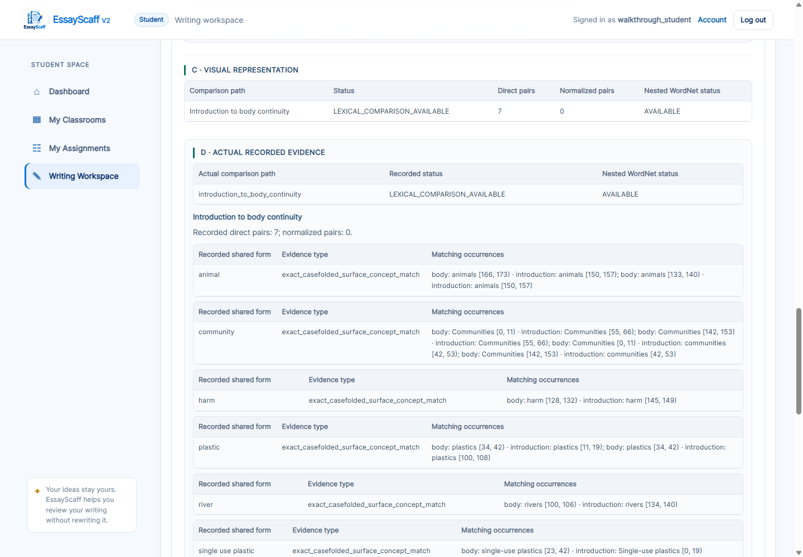

**Figure 25.** The inspector view of the Introduction→Body comparison: status `LEXICAL_COMPARISON_AVAILABLE`, 7 direct pairs, 0 normalized pairs, nested WordNet `AVAILABLE`.

This screenshot is included because it shows the exact evidence behind the “Introduction overlap” item in the Body's **What's Working** list. The shared forms are surface concepts such as `animal`, `community`, `harm`, `plastic`, `river`, `single use plastic`, and `use`. The nested WordNet comparison is available, but accepted zero candidates in this sample.

### 10.4 Conclusion: a neutral synthesis review, with no invented highlight

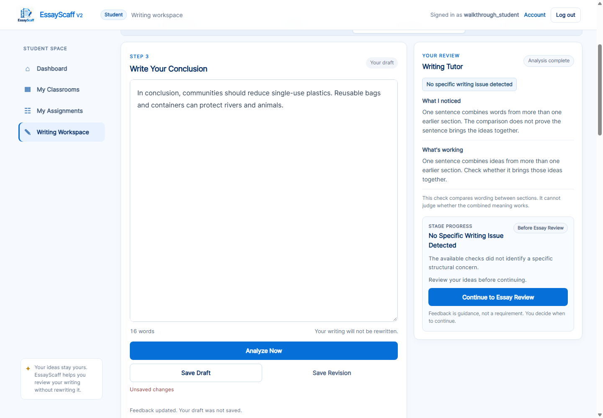

**Figure 26.** The Conclusion tutor after analysis. It shows **No Specific Writing Issue Detected**, the synthesis review guidance, the comparison caution, and **Continue to Essay Review**. The editor shows **16 words**; the analyzer recorded 17.

The tutor's “What I noticed” wording is deliberately cautious:

> One sentence combines words from more than one earlier section. The comparison does not prove the sentence brings the ideas together.

This is the presentation of the synthesis branch. The underlying branch is neutral, not a concern, and no verified highlight is available. The absence of a highlight is visible in the next figure.

### 10.5 Conclusion cross-stage evidence

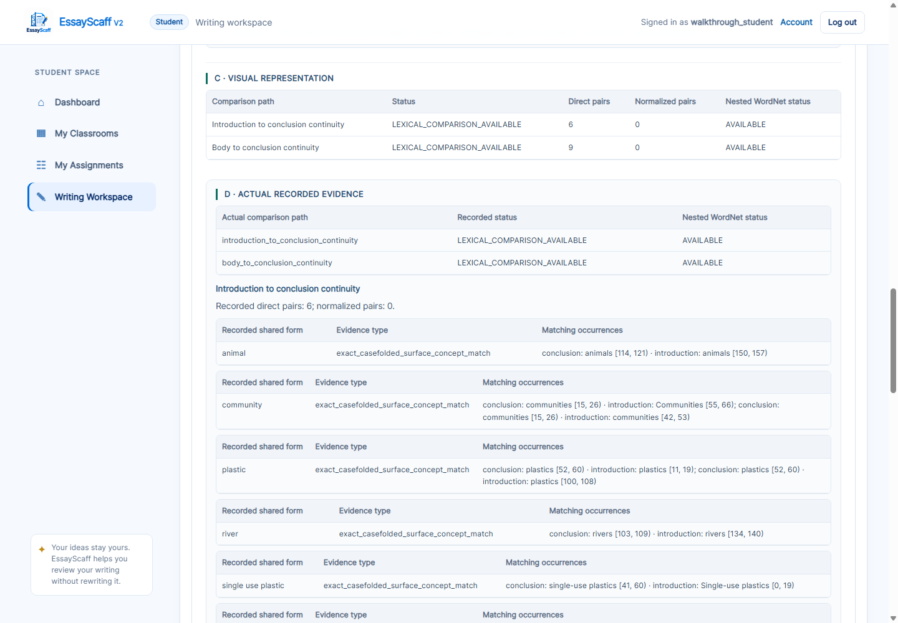

**Figure 27.** The inspector view of both Conclusion comparisons: Introduction→Conclusion has 6 direct pairs and 0 normalized pairs; Body→Conclusion has 9 direct pairs and 0 normalized pairs. Both nested WordNet statuses are `AVAILABLE`.

This is why the Conclusion's **What's Working** list can say that some words also appear in the Introduction and the Body. It is still a lexical observation. The nested WordNet comparisons were available but accepted zero candidates in this sample.

### 10.6 Conclusion highlight: unavailable, not fabricated

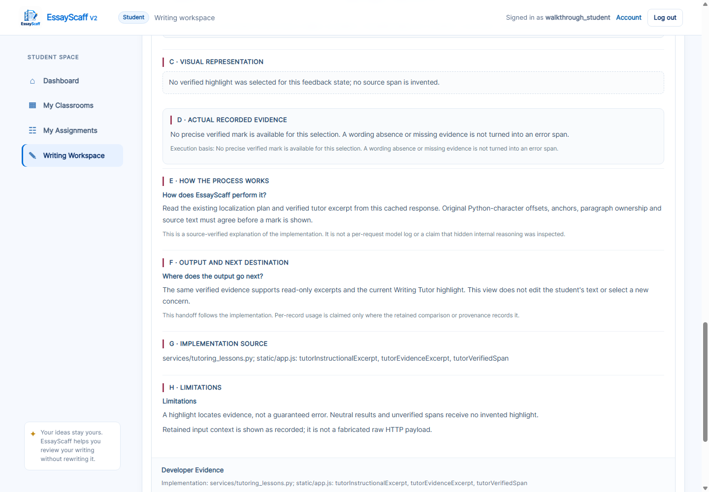

**Figure 28.** The Conclusion highlight-evidence state. It says: “No verified highlight was selected for this feedback state; no source span is invented.” The evidence section repeats that a wording absence or missing evidence is not turned into an error span.

This is the correct behavior. The Conclusion branch is neutral, so there is no concern span to highlight. The inspector does not fall back to the synthesis sentence or the final sentence and pretend that it is an error location. The absence is itself recorded evidence.

---

## 11. What this walkthrough does and does not establish

### 11.1 Supported claims

- EssayScaff V2 performs a **stage-scoped** analysis, not a single hidden analysis of the whole essay.
- For this sample, the browser made three `/api/analyze-stage` calls and zero write requests.
- The analyzer used **one full-text spaCy `Doc` per supplied section**: 1 for Introduction, 2 for Body, 3 for Conclusion.
- Focus-term preparation was shared once per request and made four focus-phrase calls each time.
- The Introduction's four focus matches were direct; `environment` was unobserved; no normalized matches were recorded.
- Direct WordNet was skipped for Introduction and Body and executed for Conclusion; nested cross-stage WordNet was available in Body and Conclusion, with zero suggestions in this sample.
- The Body's Paragraph 2 concern is traceable to a specific parser outcome (`harm` as `NOUN`) and a specific threshold (`len(clause_candidates) >= 2`).
- The Introduction and Conclusion produced neutral review branches; the Body produced a supported concern.
- The Body highlight `[142, 203)` and the Introduction highlight `[109, 157)` are verified source spans. The Conclusion has no verified highlight and no invented span.
- The inspector rendered the cached response without a new analysis request.

### 11.2 Claims the system does not make

- It does not claim the essay is correct, coherent, well argued, or ready.
- It does not claim a neutral result means “no issues.”
- It does not claim a concern means the paragraph lacks support in every sense.
- It does not claim lexical overlap proves relevance.
- It does not claim a missing focus term makes the draft off-topic.
- It does not claim a `because` clause is logically valid.
- It does not claim WordNet relationships prove meaning.
- It does not claim the `6+1` trait mapping is a trait-quality assessment. The mapping is a prepared instructional category, and the recorded assessment status is `NOT_PERFORMED`.
- It does not claim the in-process timings are end-to-end latency.

### 11.3 Known limitations visible in this sample

1. **Parser variability.** The `harm` tag drives the Body concern. A different model or sentence could produce a different parse and a different outcome.
2. **Noun-only concepts.** Verb focus terms such as `reduce` are matched from tokens but are not concept candidates.
3. **Lexical matching.** The system finds exact surface and lemma-window matches; paraphrases can be missed.
4. **Pronoun non-resolution.** `they` in the `because` clause is not resolved to `plastics`.
5. **Curated related words.** `rivers → environment` and `animals → environment` are explicit configured relationships, not general WordNet synonymy, and they do not affect rules or feedback.
6. **WordNet coverage.** A WordNet comparison can be available and still accept zero candidates.
7. **Fixed cues.** Argumentativeness is inferred from fixed cues such as `should`; a differently worded assignment may not be detected.
8. **No semantic validation.** Every stage records `NO_SEMANTIC_VALIDATION`.
9. **Editor vs analyzer counts.** `single-use` is one editor word and two analyzer words, so the displayed counts differ by one.
10. **Timing scope.** The Body Rule Base includes nested WordNet and is not a general app-latency figure.

None of these limitations makes the evidence fabricated or the UI misleading, because the application states them next to the evidence. They do mean that the output should be read as **revision guidance**, not as an automated grade.

---

## 12. Reproducing and verifying this run

### 12.1 Reproduce

From the repository root:

```bat
.venv\Scripts\python.exe tests\process_walkthrough_capture.py
```

The launcher:

- creates a temporary artifacts directory under `%LOCALAPPDATA%\Temp\opencode`;
- creates a temporary SQLite database;
- creates the isolated user `walkthrough_student` with password `walkthrough-password-1`;
- starts a threaded Flask server with the secret `isolated-walkthrough`;
- runs the Node capture script against an isolated Chrome profile at 1440 × 1000;
- asserts that the isolated database has zero `writing_sessions`, `writing_revisions`, and `submissions` rows after the run.

The real application database is not opened. No draft, revision, or submission is written.

### 12.2 What to verify in the saved evidence

| File | What it contains |
|---|---|
| [`walkthrough-verification.json`](essay_processing_walkthrough_evidence/walkthrough-verification.json) | Timestamp, viewport, 3 analysis calls, 0 writes, 0 JS errors, isolated row counts, sample texts, figure count. |
| [`screenshots.json`](essay_processing_walkthrough_evidence/screenshots.json) | 34 captured frames, byte counts, SHA-256 hashes, figure numbers, used/unused status, and notes. |
| [`introduction-response.json`](essay_processing_walkthrough_evidence/introduction-response.json) | Full recorded response for the Introduction. |
| [`body-response.json`](essay_processing_walkthrough_evidence/body-response.json) | Full recorded response for the Body. |
| [`conclusion-response.json`](essay_processing_walkthrough_evidence/conclusion-response.json) | Full recorded response for the Conclusion. |
| [`walkthrough-capture.json`](essay_processing_walkthrough_evidence/walkthrough-capture.json) | Capture-script metadata. Some tutor-frame stage/process labels in this file are stale; use the curated mapping in `screenshots.json` for figures 23–28. |

The response files are the authority for every number and message in this document. The screenshots are the authority for what the UI displayed. Where the two differ in wording (for example, the tutor's prepared guidance versus the exact five fields), both are reported rather than merged.

### 12.3 Integrity check

The screenshot manifest records a SHA-256 hash for every frame. A quick integrity check on Windows:

```bat
certutil -hashfile docs\essay_processing_walkthrough_evidence\01-practice-setup.png SHA256
```

Compare the result with the `sha256` value in [`screenshots.json`](essay_processing_walkthrough_evidence/screenshots.json).

### 12.4 Scope confirmation

This walkthrough was produced without:

- migrating or modifying the real database;
- enabling production writing-time tracking;
- writing test data to the real database;
- modifying real student records;
- changing NLP algorithms, rules, thresholds, feedback selection, authentication, classroom, draft, submission, or database contracts;
- committing, pushing, or deploying.

It is documentation and evidence only.

---

## Appendix A — Short glossary

| Term | Meaning in this document |
|---|---|
| **Token** | A word, punctuation mark, or symbol produced by the spaCy tokenizer. `Single-use` becomes `Single`, `-`, `use`. |
| **Lemma** | The dictionary-ish base form recorded by spaCy: `plastics` → `plastic`, `communities` → `community`. |
| **POS** | Part of speech. Coarse labels include `NOUN`, `VERB`, `AUX`, `ADJ`, `ADP`; fine tags include `NN`, `VB`, `VBP`, `JJ`. |
| **Dependency** | A labeled grammatical link between a head token and a dependent token, such as `nsubj`, `dobj`, `advcl`, `ROOT`. |
| **Noun chunk** | A noun phrase span recorded by spaCy, such as `our communities` or `harm animals`. |
| **`advcl`** | An adverbial clause dependent. The `because` clause in the Introduction is an `advcl` of `reduce`. |
| **Focus term** | A configured comparison target supplied with the assignment/setup. In this run the source is recorded as `teacher_provided`. |
| **Normalized form** | The lemma sequence used for comparison, e.g. `single use plastic`. It is not a synonym expansion. |
| **Rule Event** | A record that a stage rule's condition was met, with evidence and a rule ID. |
| **Rule Evaluation Trace** | The complete evaluated-row record, including rows that did not trigger or were not applicable. It is reconstructed without rerunning rules or spaCy. |
| **Branch** | A deterministic `FeedbackService` selection path with a condition, messages, and optional instructional mapping. |
| **Provenance** | The mapping from a returned feedback field to the rule(s) that support it. |
| **Verified span** | A source span whose offsets, anchors, and source text agree before the UI displays a highlight. |
| **`NEUTRAL_OBSERVATION`** | A student-facing presentation state for a neutral review. No corrective trait, skill, task, or error location is assigned. |
| **`SUPPORTED_CONCERN_SELECTED`** | A Body feedback selection state where a supported concern branch was chosen. It is still described as a revision signal, not a verdict. |

---

## Appendix B — Figure index

All paths are relative to this document. Every image is in [`essay_processing_walkthrough_evidence/`](essay_processing_walkthrough_evidence/).

| Figure | File | Section | What it shows |
|---:|---|---|---|
| 1 | [`01-practice-setup.png`](essay_processing_walkthrough_evidence/01-practice-setup.png) | 3.1 | Practice setup before analysis. |
| 2 | [`03-technical-inspector-overview.png`](essay_processing_walkthrough_evidence/03-technical-inspector-overview.png) | 3.2, 5.1 | Inspector overview and Introduction counts. |
| 3 | [`04-pipeline-map.png`](essay_processing_walkthrough_evidence/04-pipeline-map.png) | 3.3 | Source-verified processing map. |
| 4 | [`05-focus-preparation.png`](essay_processing_walkthrough_evidence/05-focus-preparation.png) | 4.1 | Focus-term preparation and normalization. |
| 5 | [`06-focus-normalization.png`](essay_processing_walkthrough_evidence/06-focus-normalization.png) | 4.2 | The same records through the normalization view. |
| 6 | [`07-tokenization.png`](essay_processing_walkthrough_evidence/07-tokenization.png) | 5.2 | Token strip from the shared `Doc`. |
| 7 | [`08-pos.png`](essay_processing_walkthrough_evidence/08-pos.png) | 5.3 | POS groups and exact token table. |
| 8 | [`09-dependencies.png`](essay_processing_walkthrough_evidence/09-dependencies.png) | 5.4 | Dependency tree for Sentence 1. |
| 9 | [`10-lemmas.png`](essay_processing_walkthrough_evidence/10-lemmas.png) | 5.5 | Token-to-lemma changes. |
| 10 | [`11-sentences.png`](essay_processing_walkthrough_evidence/11-sentences.png) | 5.6 | Two recorded sentence spans. |
| 11 | [`12-noun-phrases.png`](essay_processing_walkthrough_evidence/12-noun-phrases.png) | 5.7 | Eight recorded noun chunks. |
| 12 | [`13-concepts.png`](essay_processing_walkthrough_evidence/13-concepts.png) | 6.1 | Eleven concept candidates. |
| 13 | [`14-focus-matching.png`](essay_processing_walkthrough_evidence/14-focus-matching.png) | 6.2 | Four direct matches; `environment` unmatched. |
| 14 | [`15-wordnet-skipped.png`](essay_processing_walkthrough_evidence/15-wordnet-skipped.png) | 6.3 | Direct WordNet skipped for Introduction. |
| 15 | [`16-related-words.png`](essay_processing_walkthrough_evidence/16-related-words.png) | 6.4 | Informational related-word evidence. |
| 16 | [`18-stage-rule-checks.png`](essay_processing_walkthrough_evidence/18-stage-rule-checks.png) | 7.2 | Introduction structural rule checks. |
| 17 | [`20-rule-events.png`](essay_processing_walkthrough_evidence/20-rule-events.png) | 7.2 | Emitted Rule Events with evidence and use. |
| 18 | [`21-feedback-decision.png`](essay_processing_walkthrough_evidence/21-feedback-decision.png) | 8.1 | Feedback decision lane. |
| 19 | [`22-feedback-fields.png`](essay_processing_walkthrough_evidence/22-feedback-fields.png) | 8.2 | The five returned fields. |
| 20 | [`23-trait-mapping.png`](essay_processing_walkthrough_evidence/23-trait-mapping.png) | 8.4 | Neutral mapping and presentation nuance. |
| 21 | [`24-highlight-evidence.png`](essay_processing_walkthrough_evidence/24-highlight-evidence.png) | 8.5 | Verified Introduction highlight. |
| 22 | [`25-api-rendering.png`](essay_processing_walkthrough_evidence/25-api-rendering.png) | 9 | Response, timing scope and caching. |
| 23 | [`27-introduction-tutor.png`](essay_processing_walkthrough_evidence/27-introduction-tutor.png) | 10.1 | Introduction tutor, neutral. |
| 24 | [`28-body-tutor.png`](essay_processing_walkthrough_evidence/28-body-tutor.png) | 10.2 | Body tutor, supported concern and highlight. |
| 25 | [`30-body-cross-stage.png`](essay_processing_walkthrough_evidence/30-body-cross-stage.png) | 10.3 | Introduction→Body comparison. |
| 26 | [`31-conclusion-tutor.png`](essay_processing_walkthrough_evidence/31-conclusion-tutor.png) | 10.4 | Conclusion tutor, neutral. |
| 27 | [`32-conclusion-cross-stage.png`](essay_processing_walkthrough_evidence/32-conclusion-cross-stage.png) | 10.5 | Introduction/Body→Conclusion comparisons. |
| 28 | [`34-conclusion-highlight.png`](essay_processing_walkthrough_evidence/34-conclusion-highlight.png) | 10.6 | No verified Conclusion highlight. |

### Supplemental captures not used as figures

| File | Why it is not a primary figure |
|---|---|
| [`02-introduction-editor.png`](essay_processing_walkthrough_evidence/02-introduction-editor.png) | Pre-analysis placeholder state; redundant with Figure 1. |
| [`17-cross-stage-introduction.png`](essay_processing_walkthrough_evidence/17-cross-stage-introduction.png) | Clean “not applicable” earlier-section state; explained in text. |
| [`19-sentence-connection-review.png`](essay_processing_walkthrough_evidence/19-sentence-connection-review.png) | Clean empty review state; no candidate was recorded. |
| [`26-technical-trace.png`](essay_processing_walkthrough_evidence/26-technical-trace.png) | Contains presentation defects: concatenated step summaries, an `[object Object]` cell, and “Not recorded” runtime model/version fields. Do not use it as a polished evidence figure. |
| [`29-body-topic-sentences.png`](essay_processing_walkthrough_evidence/29-body-topic-sentences.png) | Paragraph counts and statuses are valid, but per-candidate detail cells show “Reason not recorded” / “Start not recorded,” so the table is incomplete. |
| [`33-conclusion-new-material.png`](essay_processing_walkthrough_evidence/33-conclusion-new-material.png) | Repeated unlabeled “Not available” rows; the recorded zero counts are reported in text instead. |

The existence of these unusable frames is disclosed deliberately. The walkthrough does not present a defective screenshot as if it were clean evidence.

---

## Appendix C — Source map

| Question | Where to look |
|---|---|
| Stage-scoped API route | [`app.py`](../app.py#L935) |
| Request validation and response assembly | [`app.py`](../app.py#L1251) |
| Stage context wiring | [`app.py`](../app.py#L1312) |
| Analysis coordinator | [`services/essay_analysis_service.py`](../services/essay_analysis_service.py#L31) |
| Teacher context preparation | [`services/topic_service.py`](../services/topic_service.py#L195) |
| Concept extraction | [`services/topic_service.py`](../services/topic_service.py#L265) |
| Focus matching | [`services/topic_service.py`](../services/topic_service.py#L315) |
| Direct WordNet status / suggestions | [`services/topic_service.py`](../services/topic_service.py#L361), [`services/topic_service.py`](../services/topic_service.py#L380) |
| Cross-stage comparison | [`services/stage_evidence.py`](../services/stage_evidence.py#L164) |
| Introduction Rule Base | [`services/introduction_rules.py`](../services/introduction_rules.py#L48) |
| Introduction clause candidates | [`services/introduction_rules.py`](../services/introduction_rules.py#L419) |
| Body Rule Base | [`services/body_rules.py`](../services/body_rules.py#L32) |
| Body supporting-detail candidates | [`services/body_rules.py`](../services/body_rules.py#L407) |
| Body Introduction continuity | [`services/body_rules.py`](../services/body_rules.py#L565) |
| Conclusion Rule Base | [`services/conclusion_rules.py`](../services/conclusion_rules.py#L33) |
| Conclusion new-material observations | [`services/conclusion_rules.py`](../services/conclusion_rules.py#L602) |
| Feedback generation | [`services/feedback_service.py`](../services/feedback_service.py#L71) |
| Body feedback generation | [`services/feedback_service.py`](../services/feedback_service.py#L628) |
| Conclusion feedback generation | [`services/feedback_service.py`](../services/feedback_service.py#L386) |
| Rule evaluation trace | [`services/research_inspector.py`](../services/research_inspector.py#L795) |
| Runtime metadata | [`services/research_inspector.py`](../services/research_inspector.py#L800) |
| Browser analysis request | [`static/app.js`](../static/app.js#L7340), fetch at [`static/app.js`](../static/app.js#L7450) |
| Transparency data assembly | [`static/app.js`](../static/app.js#L1130) |
| Inspector rendering | [`static/app.js`](../static/app.js#L1883) |
| Inspector process catalog | [`static/nlp_process_explorer.js`](../static/nlp_process_explorer.js#L6) |
| Inspector page renderer | [`static/nlp_process_explorer.js`](../static/nlp_process_explorer.js#L1374) |

### Related reports

- [`technical_analysis_inspector_report.md`](technical_analysis_inspector_report.md) — the inspector's architecture, 73 process views, and 709-test verification.
- [`feedback_decision_flow_report.md`](feedback_decision_flow_report.md) — branch selection and provenance detail.
- [`introduction_stage_evaluation.md`](introduction_stage_evaluation.md) — Introduction behavior and edge cases.
- [`body_feedback_repair_report.md`](body_feedback_repair_report.md) — Body feedback repair evidence.
- [`conclusion_feedback_correction_report.md`](conclusion_feedback_correction_report.md) — Conclusion neutral-presentation correction.
