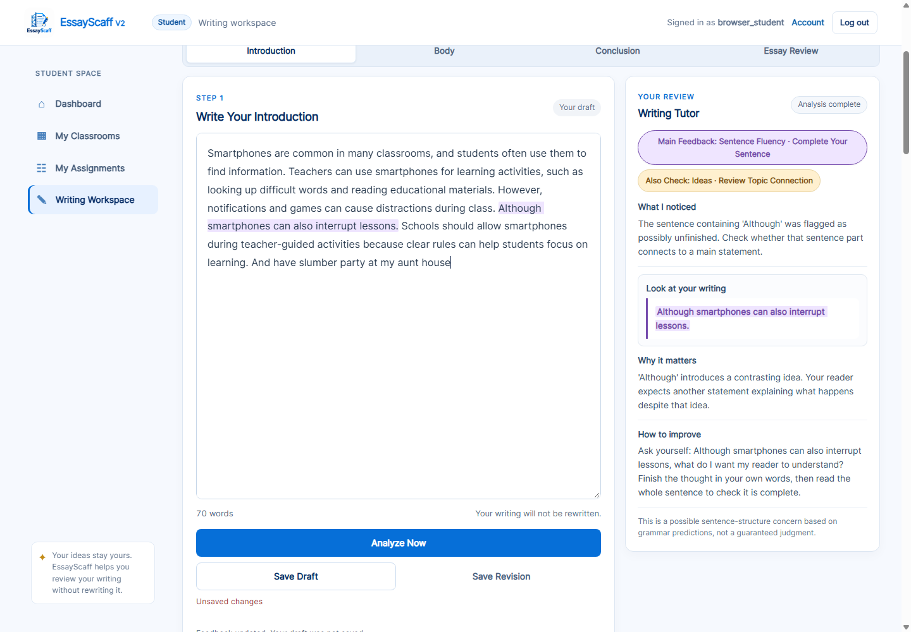
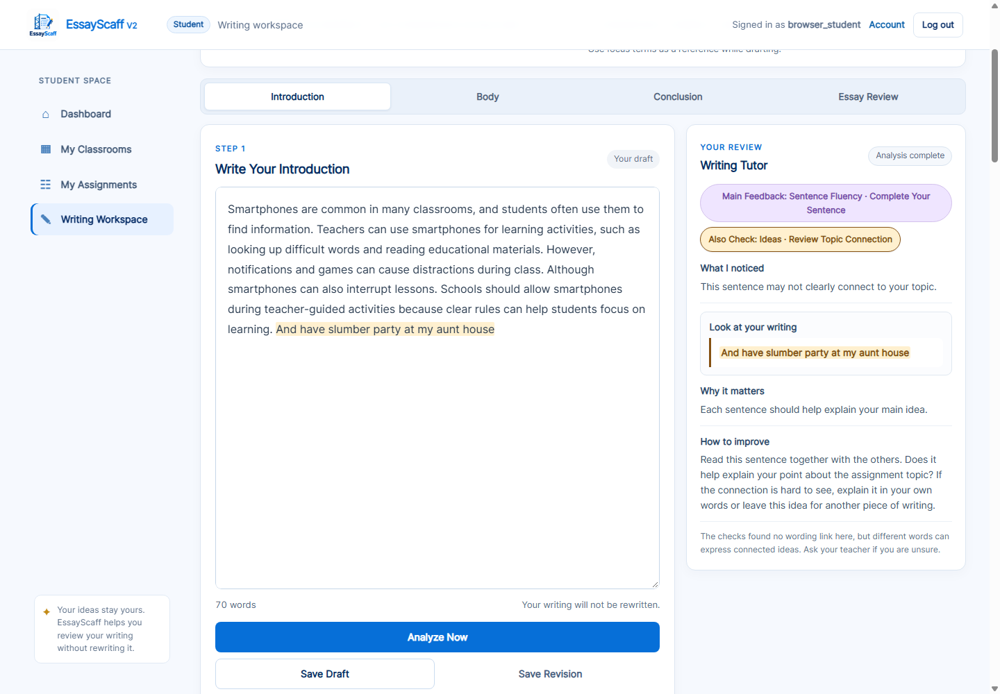
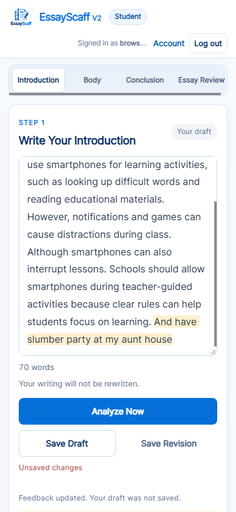
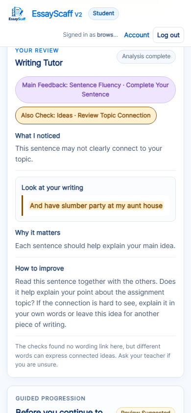

# Introduction feedback quality improvement

## Pre-change investigation (recorded before implementation)

Baseline: **531 passed**, full Python suite, 2026-10-23. Project: `EssayScaff-V2`.
The user supplied no focus list; the reproducible explicit-focus run uses the
existing smartphone fixture vocabulary: smartphones, students, classroom,
learning, distractions. Derived-focus behavior is also tested separately.

Assignment: “Should students be allowed to use smartphones during class?”

spaCy `en_core_web_sm` records these zero-based, end-exclusive Python-character spans:

| Sentence | Span | Exact text | Recorded focus terms |
|---|---|---|---|
| 1 | 0–91 | Smartphones are common in many classrooms, and students often use them to find information. | smartphones, students, classroom (lemma) |
| 2 | 92–215 | Teachers can use smartphones for learning activities, such as looking up difficult words and reading educational materials. | smartphones, learning |
| 3 | 216–285 | However, notifications and games can cause distractions during class. | distractions |
| 4 | 286–334 | Although smartphones can also interrupt lessons. | smartphones |
| 5 | 335–457 | Schools should allow smartphones during teacher-guided activities because clear rules can help students focus on learning. | smartphones, students, learning |
| 6 | 458–497 | And have slumber party at my aunt house | none |

Final-sentence dependencies: `And` CCONJ/CC → cc(have); `have` VERB/VB →
ROOT(have); `slumber` ADJ/JJ → amod(party); `party` NOUN/NN → dobj(have);
`at` ADP/IN → prep(have); `my` PRON/PRP$ → poss(house); `aunt` NOUN/NN →
compound(house); `house` NOUN/NN → pobj(at). There is no subject dependent.
This resembles a base-form imperative as well as a possible unfinished addition;
the parse cannot settle grammatical correctness. No new missing-subject warning
is justified from this evidence alone; teacher review remains appropriate.

All emitted Introduction events before changes:

- `INTRO.TEXT.PRESENT`
- `INTRO.CLAUSE.SUBJECT_PREDICATE_CANDIDATE`
- `INTRO.TOPIC.FOCUS_TERMS_OBSERVED`
- `INTRO.CONTEXT.TOPIC_AND_CLAUSE_CANDIDATE`
- `INTRO.CLAUSE.POSSIBLE_INCOMPLETE_SUBORDINATOR`
- `INTRO.DEVELOPMENT.MULTIPLE_CLAUSE_PREDICATES`
- `INTRO.REASON.CLAUSE_TOPIC_OVERLAP`
- `INTRO.GOAL.OBSERVABLE_INTRODUCTION`
- `INTRO.LIMITATION.NO_SEMANTIC_VALIDATION`

Root causes:

1. TopicService matches whole-document focus phrases. `_context_candidates`
   associates matches with subject-linked sentences, but does not record a
   sentence-by-sentence absence/context decision. Whole-section matches mask an
   isolated zero-match sentence.
2. `_list_or_fragment_finding` retains sentence 6 as non-clausal evidence, but its
   fragment flag requires **no** qualifying clause anywhere in the Introduction.
   Other complete sentences make the whole-section flag false. The final text
   contains no configured subordinator, so that separate rule does not flag it.
3. FeedbackService prioritizes empty/list/subordinator checks before focus and
   main-point/reason review. It correctly selects
   `intro_sentence_fluency_complete_sentence`; Needs Attention is empty. The
   final-sentence topic concern has no emitted event and cannot be selected.
4. The reason event concerns sentence 5, not sentence 6. Topic overlap there
   does not validate the reason's logic. Existing clause-only highlighting must
   remain intact.

Relevant existing branches: `intro_sentence_fluency_complete_sentence`,
`intro_word_choice_specific_subject`, `intro_ideas_topic_match`,
`intro_ideas_main_point`, `intro_ideas_point_and_reason`, and
`intro_ideas_check_your_reason`. The frontend already supports independently
provenanced Needs Attention lessons, so a new response architecture is unnecessary.

## Implementation and verification

### Small changes made

| File | Change |
|---|---|
| `services/introduction_sentence_evidence.py` | Small helper over the existing TopicService result; returns sentence observations and cautious local review candidates. No model, similarity metric, threshold tuning, or additional parse. |
| `services/introduction_rules.py` | Retains `sentence_topic_evidence` and emits `INTRO.TOPIC.SENTENCE_CONNECTION_REVIEW` only when its condition is satisfied. Existing grammatical rules are reused. |
| `services/feedback_service.py` | Adds `intro_ideas_review_topic_connection` (Ideas · Review Topic Connection); preserves higher-priority sentence feedback; reuses Needs Attention for the independent secondary observation. |
| `content/lessons/feedback_help.json` | Adds one prepared lesson with primary/secondary mappings and a no-highlight fallback; retains the current v4 schema. |
| `static/app.js` | Introduction shows Main Feedback and at most one Also Check through existing concern tabs; uses verified sentence spans for the new concern. Incomplete-marker tutor evidence now marks the whole verified sentence, matching the editor. Existing reason-only marking is preserved. |
| `services/research_inspector.py` | Registers the new rule, its condition/source/limitations, and triggered/nontriggered decision basis. |

The existing `NLPService`, `TopicService`, shared `stage_evidence`, coordinator,
storage routes, Body/Conclusion rule algorithms, and five feedback fields remain
the foundation. No student-specific replacement prose is generated.

### Exact new condition

The helper records every existing spaCy sentence with:

- Exact text, Python-character start/end offsets, sentence index and span verification.
- Existing direct/lemma focus matches and normalized TopicService noun concepts.
- Content lemmas (NOUN, PROPN, VERB, ADJ; common `be`, `have`, `do` excluded as weak links).
- Immediately neighboring sentence indices, focus-matched neighbor indices,
  shared content lemmas and third-person/demonstrative reference cues.
- An explicit status, review-signal Boolean, condition and limitation.

A review event requires **all** of the following:

1. Explicit teacher-provided focus terms, rather than automatically derived topic candidates.
2. Verified original sentence/token spans.
3. A noun/proper noun and a ROOT verb/auxiliary in the sentence. This avoids
   treating short planning labels such as “Communities. Plastics.” as a
   sentence-level connection problem. It does not test grammatical correctness.
4. No direct/lemma focus match within that sentence.
5. At least one immediately neighboring, verified sentence with a focus match.
6. No shared neighboring content lemma and no third-person/demonstrative
   reference cue such as “she,” “it,” “they,” “this,” or “that.”

Matching words produce `WORDING_MATCH_OBSERVED_NOT_RELEVANCE`, not an approval.
Shared neighboring wording or a reference cue produces
`CONTEXT_REVIEW_DEFERRED`, not a resolved semantic link. Missing explicit focus
produces `REVIEW_WITH_TEACHER_NO_CONFIGURED_FOCUS` for zero-match sentences.
Insufficient local input produces `INSUFFICIENT_LOCAL_TOPIC_EVIDENCE`; invalid
spans produce `INSUFFICIENT_SPAN_EVIDENCE`. These statuses do not emit the new warning.

The existing curated related-concept resource was inspected. It supplies
assignment-scoped, informational associations (not a validated smartphone-topic
vocabulary). It stays informational, preserving its existing contract and
protected tests. The new check reuses existing concepts and neighboring lemma
evidence, rather than promoting curated associations or WordNet possibilities
to confirmed relevance. No new synonym dictionary was added.

### Feedback selection and highlighting

Existing empty-input, list, incomplete-subordinator, broad-only and whole-topic
checks retain precedence. The new event-backed local review is considered
before the lower-priority general main-point/reason review. The recorded
priority list and frontend source explanations include that position.

If the new concern is not primary, it is appended to **Needs Attention** with
its actual Rule ID and provenance. The existing secondary-lesson machinery
selects it as **Also Check**. Introduction is limited to two tutor items total;
the primary concern remains first. Duplicate lessons are suppressed. There is
no empty second slot and no new response architecture.

The new concern requires an emitted event, paired provenance and a verified
sentence finding. The frontend cross-checks the source substring, sentence
index, span and finding before highlighting. A secondary item with missing or
contradictory sentence evidence is omitted. A primary item with unverified
evidence displays its fallback without a mark. Neither path substitutes the
whole Introduction as the target.

### Before and after: confirmed example

| Version / input | Main Feedback | Also Check / target |
|---|---|---|
| Before, full input | Sentence Fluency · Complete Your Sentence | None. The final-sentence concern had no Rule Event. |
| After, full input with explicit focus | Sentence Fluency · Complete Your Sentence — sentence 4, `[286,334)` | Ideas · Review Topic Connection — sentence 6, `[458,497)` |
| After, remove the Although sentence | Ideas · Review Topic Connection — final sentence | No duplicate secondary topic concern. |

Actual new prepared guidance:

> **What I noticed:** This sentence may not clearly connect to your topic.
>
> **Look at your writing:** And have slumber party at my aunt house
>
> **Why it matters:** Each sentence should help explain your main idea.
>
> **How to improve:** Read this sentence together with the others. Does it help
> explain your point about the assignment topic? If the connection is hard to
> see, explain it in your own words or leave this idea for another piece of writing.

Its limitation explicitly says that different words can express connected
ideas and encourages asking the teacher when unsure. It makes no grammar
diagnosis about the final sentence.

### Real-analysis regression results

`tests/test_introduction_feedback_quality.py` adds **18 passing cases**. The
existing `tests/test_reason_highlighting.py` cases also pass.

| Required case | Observed result |
|---|---|
| A — Full six-sentence input | Six exact boundaries retained. Although remains primary; the final sentence emits a distinct topic-review event and is selectable as Also Check. |
| B — Remove Although | Final-sentence topic review becomes primary; no duplicate secondary message. |
| C — “She helped me understand the lesson better.” after the supplied context | No automatic off-topic warning; reference cue defers to contextual review. |
| D — “We had a slumber party at my aunt's house.” after the supplied context | Cautious local wording-gap review, not an off-topic or grammar verdict. |
| E — “Students can communicate with invisible dragons during class.” | Wording matches recorded, explicitly not logical relevance or truth. No semantic approval is inferred. |
| F — Complete Although sentence | No incomplete-subordinator event for “Although smartphones can distract students, teachers can use them for learning.” |
| G — Educational-app and invisible-dragon reasons | Existing respective branches retained; only the correct `because …` subtree is marked in editor and tutor. |
| Unicode, repeated words, simultaneous events | Verified source offsets retained; existing reason regressions pass; exact new sentence selection works with an emoji before the text. |
| Missing/corrupted evidence | Missing/false event, invalid offset/text, missing finding and stale editor omit the unsupported Also Check. |
| Imperatives/coordination | No new missing-subject grammar rule; valid complex/imperative/coordinated examples retain existing behavior. |
| Parse count | One student `NLPService.parse` invocation; the helper makes no additional spaCy or WordNet call. |
| Body/Conclusion | Existing Python and full-browser stage, continuity, provenance and lifecycle checks pass. |

### Full verification

Final commands, 2026-10-23:

```powershell
& ".venv\Scripts\python.exe" -B -m pytest -q -p no:cacheprovider --tb=short
node --check static/app.js
node --check tests/transparency_browser_check.cjs
& ".venv\Scripts\python.exe" -B tests\transparency_browser_check.py
```

- **549 passed** in the final full Python run, up from the verified 531 baseline.
- Both JavaScript syntax checks passed.
- Full real-Chrome/CDP regression passed, **Chrome 155.0.8059.85**.
- Desktop **1440×1000** and mobile **390×844** checked for exact editor/tutor
  marks, matching editor/mirror geometry and no page-wide horizontal overflow.
- Five-process Simple View, Technical View and Advanced Inspector remain
  available; all 45 existing sub-tabs, source/provenance views, rule and feedback
  decision flows, keyboard behavior and copy-report equality pass.
- New observations are inspectable in existing rule details and the primary
  feedback causal disclosure; copy reports retain the complete sentence data.
- Browser result: `javascriptErrors: []`.
- Isolated persistence counts: writing_sessions **0**, writing_revisions **0**,
  submissions **0**. Browser/test data used temporary isolated databases.

The browser script contained pre-existing stale expectations for the older
Clarity/Coherence/Structure labels, five tutor sections, and pre-reason-check
event counts. These were reconciled with the already-current trait catalog and
real records so the **entire** browser regression could run. Production Body/
Conclusion behavior was not rewritten to satisfy those stale expectations.

Final full-browser artifacts and detailed `verification.json`:
`C:\Users\My Pc\AppData\Local\Temp\opencode\essayscaff-transparency-dc4153zq`.

### Protected fingerprint audit

The previous protected hash remains:

```text
ff6ea8aae5e067fbce29c9fb9587f1933889343038b37ce877c884e2bd9e5c04
```

The exact plastics Introduction gains an additive sentence-observation field,
one **nontriggered** evaluation row, and a descriptive priority-list entry. Its
original events, linguistic records, matches, feedback and selected decision
fields are unchanged. Existing Introduction helper bodies shifted eight source
lines due to the analyze integration and return field. The protected test
removes only those audited additions and restores the eight-line displacement
in a **test-only copy**, then checks the **original hash**. The expectation was
not replaced with a new hash. Other provenance, curated-evidence independence,
source-integrity and stage regression tests also pass.

### Actual feedback screenshots

The captures below were produced by the final isolated Chrome run and copied
into the report folder. They are actual feedback, not mockups.

**Desktop — Main Feedback and exact Although-sentence mark**



**Desktop — Also Check and exact final-sentence mark**



**Mobile — final-sentence editor highlight**



**Mobile — simple, actionable Also Check guidance**



## Remaining limitations / review decision

- This is a transparent local wording-gap prompt, **not** validated semantic
  topic detection. It can miss irrelevant text containing assignment words.
- Pronoun cues and shared words can defer a real concern. They are conservative
  safeguards, not coreference resolution or evidence of logical connection.
- Relevant paraphrases with no detected connection may still receive a review
  prompt. The student/teacher decides whether the sentence belongs.
- Explicit teacher focus is required for the new event. With derived-only
  focus, records preserve neutral teacher-review status and existing feedback;
  the new sentence warning is not manufactured.
- Neighboring-sentence context is local. The check does not understand longer
  discourse, sarcasm, word sense, world knowledge, truth or argument quality.
- The final sentence's missing explicit subject remains a **teacher-review
  grammar question**. No claim of grammatical accuracy was added, and valid
  imperatives are not labeled incomplete merely for omitting a subject.
- Regression success establishes tested behavior, not measured precision or
  recall against a human-labeled student-writing dataset.

Implementation and verification are complete. Stopped for review; no commit or
push was made, and stored student submissions/research datasets were not edited.
