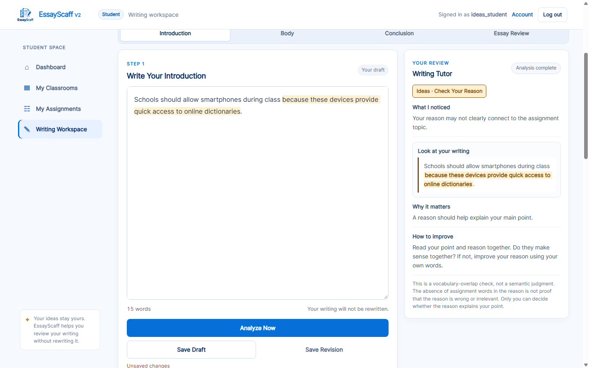
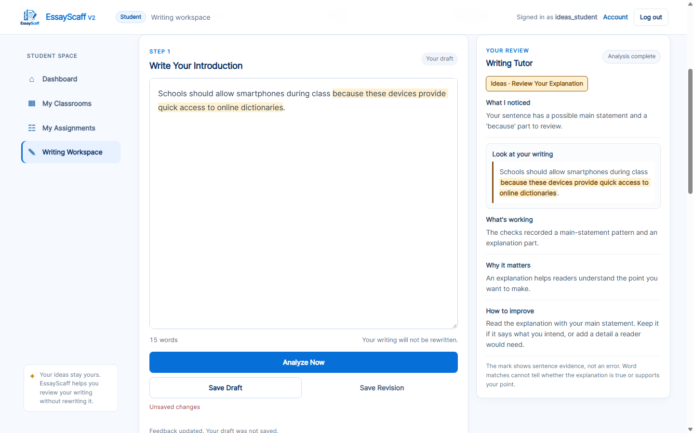

# Introduction Ideas feedback improvement

**Completed:** 2026-10-24, `EssayScaff-V2`.

**Result:** Introduction Ideas now distinguishes a recorded statement to develop,
additional details to review, and an explicit explanation part to review. A reason
with no assignment-word overlap receives the same neutral lesson as its
keyword-matching counterpart. Observable strengths and exact evidence locations
are recorded with the completed backend decision and exposed in the existing
student and professor transparency views.

**Verification:** **608 tests passed**, all **13 required examples** passed real
Chrome checks, and the complete transparency and whole-app browser audits passed.

Evidence: [actual case-by-case comparison](introduction_ideas_evidence/case-comparison.md),
[before outputs](introduction_ideas_evidence/before-outputs.json),
[after outputs](introduction_ideas_evidence/after-outputs.json),
[browser/data verification](introduction_ideas_evidence/verification-summary.json),
and [screenshot hashes](introduction_ideas_evidence/screenshots.json).

## Before-change investigation

2026-10-24, `EssayScaff-V2`. Actual full baseline: **572 passed** (240.13 s).
Real Chrome before run: `Temp/opencode/essayscaff-intro-ideas-4j92ru6d`.
All T01–T13 ran through the real authenticated API and Writing Tutor. No original
database/research file changed; isolated writing/revision/submission counts were zero.

Confirmed roots:

- `IntroductionRuleBase._rule_events` emits structural/lexical events; structure
  is retained in `observable_structure`, `development_evidence`,
  `reason_clause_evidence`, and `sentence_topic_evidence`.
- `FeedbackService.generate` uses an if/elif priority chain, records the chosen
  branch/condition/trait/skill, and copies fired Rule Event evidence into provenance.
- An explicit because-clause with no focus match selected the negative-sounding
  `intro_ideas_check_your_reason` branch. T04 and T05 therefore differed solely
  in wording overlap, not evidence of argument quality.
- A central statement without additional development and a no-central fallback
  shared `intro_ideas_main_point` and one lesson. Its generic notice said the
  checks did not confirm a clear main point even when a candidate existed.
- Additional clause patterns without because selected the same point/reason
  lesson as explicit because evidence, producing generic, repetitive tasks.
- The Introduction candidate filter rejected a VBN root even when a linked
  subject and finite modal/auxiliary are recorded. In the inspected passive
  statement, `Students` is nsubjpass(allowed), `should` is aux(allowed), and
  `allowed` is VERB/VBN/ROOT. This is available structural evidence, not a
  semantic thesis judgment.
- Frontend `selectScaffoldingGuidance` verifies branch/event/provenance pairs and
  resolves the prepared catalog. `selectTutorItems` maps primary/secondary
  lessons; `tutorEvidenceExcerpt` verifies Python-character spans. The generic
  main-statement path marked every recorded root sentence, sometimes a passage.
- `studentFeedbackPresentation` feeds the tutor, student transparency and Full
  Analysis. Professor Inspector reads the same backend branch trace but did not
  yet expose the actual prepared lesson mapping/coverage/highlight plan.

Inspected: introduction_rules.py, feedback_service.py,
introduction_sentence_evidence.py, topic_service.py, tutoring_lessons.py,
essay_analysis_service.py, research_inspector.py, feedback_help.json, app.js,
research_inspector.js, index.html, and the associated provenance, tutor,
highlight, decision-flow, inspector, snapshot and browser regression tests.

## Implemented decision changes

`FeedbackService.generate` remains the branch-selection authority. The existing
empty/list/incomplete/broad-word/no-focus/sentence-connection priorities run before
the refined Ideas branches. Primary Feedback and Next Step now use the same
recorded Ideas condition for these three cases:

| Recorded observation, after higher-priority checks | Selected branch | Trait / skill | Actual prepared lesson | Purpose |
|---|---|---|---|---|
| Main-statement candidate; no recorded because clause; no additional qualifying clause pattern | `intro_ideas_develop_main_point` | Ideas / Develop Your Main Point | `HELP-INTRO-DEVELOP-POINT` | Development task |
| Main-statement candidate and a recorded because subtree, with or without focus-word overlap | `intro_ideas_point_and_reason` | Ideas / Review Your Explanation | `HELP-INTRO-EXPLAIN-POINT` | Neutral review |
| Main-statement candidate; additional qualifying clause patterns; no recorded because clause | `intro_ideas_review_details` | Ideas / Review Your Details | `HELP-INTRO-REVIEW-DETAILS` | Neutral review |
| No main-statement candidate under this limited pattern check | `intro_ideas_main_point` | Ideas / State Your Main Point | `HELP-INTRO-MAIN-POINT` | Cautious pattern fallback |
| Existing possible incomplete-subordinator event | `intro_sentence_fluency_complete_sentence` | Sentence Fluency / Complete Your Sentence | `HELP-INTRO-COMPLETE-SENTENCE` | Recorded structural concern |
| Existing locally supported sentence-connection review event | `intro_ideas_review_topic_connection` | Ideas / Review Topic Connection | `HELP-INTRO-TOPIC-CONNECTION` | Wording review |

The main-point fallback no longer says that the checks failed to confirm a
**clear** main point. The new development lesson explicitly acknowledges the
recorded candidate, offers a reason, example, or explanation, and says that no
fixed starting word is required. The details lesson asks students to consider a
detail already present instead of assuming an explanation is absent.

The active `intro_ideas_check_your_reason` and next-step-only
`intro_ideas_explain_your_point` mappings were retired. The lexical reason events
were retained: they describe actual word matches, without selecting a negative
reason-quality warning.

### Narrow structural recognition correction

The existing candidate extractor now also accepts a VBN/VBG predicate with both
a directly linked subject and a directly linked finite AUX (`aux`/`auxpass`, tagged
MD/VBD/VBP/VBZ). Its existing finite-tag cases remain supported. The newly admitted
candidate records `finite_auxiliary_evidence`.

For T03, this recognizes `Students` → `allowed`, supported by modal `should`,
using the already-returned spaCy labels. Actual counts change from **2 to 3 central
candidates** and **3 to 4 qualifying predicates**. This records another sentence
pattern; it does not identify the best thesis or evaluate argument quality.

## Student guidance and observable strengths

The tutor presents the existing notice, source excerpt, reason for reviewing, and
student-authored next action. Applicable Ideas lessons additionally show
**What's working** using these prepared, evidence-backed observations:

| Lesson | Recorded strength |
|---|---|
| Develop Your Main Point | A subject-and-verb pattern was recorded as a possible main statement. |
| Review Your Explanation | The checks recorded a main-statement pattern and an explanation part. |
| Review Your Details | More than one subject-and-verb pattern was recorded in your opening. |

These observations do not praise relevance, truth, logic, clarity, or essay
quality. The strength section is hidden when its prepared mapping has no supported
strength. The existing five backend feedback fields remain available alongside
provenance. Introduction concern selection remains **Main Feedback + at most one
Also Check** with a separate supported lesson.

The local catalog is version **5**, with **18 lessons, 18 primary bindings, and
10 secondary bindings**. The existing Model–Practice–Reflect activity continues
to use its own authored lesson.

## Actual T01–T13 outcomes

Assignment: “Should students be allowed to use smartphones during class?”
Configured focus: `smartphones`, `students`, `class`, `classroom`, `learning`.
Exact inputs are in `tests/introduction_ideas_cases.json` and the
[generated comparison](introduction_ideas_evidence/case-comparison.md), which
includes each actual before/after notice, task, condition, Rule IDs, counts,
strength, and highlight rationale.

Offsets below are original Python-character, half-open `[start, end)` offsets.
Every listed mark was verified in both the actual Chrome editor and tutor against
the backend plan.

| Case | Input feature | Actual selected trait / skill | Verified mark | Interpretation |
|---|---|---|---|---|
| T01 | Main statement only | Ideas / Develop Your Main Point | `[0, 46)` Schools should allow smartphones during class. | A recorded statement to develop; no missing-point verdict. |
| T02 | Statement with explicit reason | Ideas / Review Your Explanation | `[46, 105)` because students can research information for their lessons | Explanation evidence to review. |
| T03 | Passive opening and two further sentences, no because | Ideas / Review Your Details | `[56, 92)` They can search for difficult words. | Additional patterns exist; no prescribed connective. |
| T04 | Reason refers to “these devices” | Ideas / Review Your Explanation | `[46, 111)` because these devices provide quick access to online dictionaries | No negative warning based on missing reason keywords. |
| T05 | T04 with “smartphones” repeated | Ideas / Review Your Explanation | `[46, 109)` because smartphones provide quick access to online dictionaries | Same prepared guidance as T04. |
| T06 | Incomplete Because opening | Sentence Fluency / Complete Your Sentence | `[0, 50)` Because students can use smartphones during class. | Existing possible-incomplete concern preserved. |
| T07 | Complete fronted Because sentence | Ideas / Review Your Explanation | `[0, 49)` Because students can use smartphones for learning | Reason clause only; not an incomplete-sentence warning. |
| T08 | Incomplete Although opening | Sentence Fluency / Complete Your Sentence | `[0, 43)` Although smartphones can distract students. | Existing possible-incomplete concern preserved. |
| T09 | Complete complex Although sentence | Ideas / Review Your Details | `[25, 33)` distract | Additional predicate evidence, not an error label. |
| T10 | Three connected-looking sentences | Ideas / Review Your Details | `[40, 79)` Students can read educational articles. | One additional sentence as a review location; no coherence certification. |
| T11 | Matched opening beside unrelated-looking sentence | Ideas / Review Topic Connection | `[47, 89)` We had a slumber party at my aunt's house. | Existing local wording/context review; teacher decides relevance. |
| T12 | Keyword-rich invisible-dragons statement | Ideas / Develop Your Main Point | `[0, 61)` Students can communicate with invisible dragons during class. | Only a subject-and-verb pattern is acknowledged. |
| T13 | Nonsensical reason with repeated keyword | Ideas / Review Your Explanation | `[46, 99)` because smartphones control invisible dragons on Mars | Word overlap and reason structure do not certify validity. |

### T04/T05 counterfactual check

T04 still records `BECAUSE_CLAUSE_NO_TOPIC_OVERLAP` and
`INTRO.REASON.NO_CLAUSE_TOPIC_OVERLAP`. T05 still records
`BECAUSE_CLAUSE_WITH_TOPIC_OVERLAP` and `INTRO.REASON.CLAUSE_TOPIC_OVERLAP`.
Both select the same branch, skill, lesson, neutral purpose, and prepared guidance:

> Your sentence has a possible main statement and a 'because' part to review.

> Read the explanation with your main statement. Keep it if it says what you
> intend, or add a detail a reader would need.

The system does not resolve “these devices” as coreference. The observed lexical
difference remains inspectable without being treated as a reason-quality result.

## Shared backend trace and existing transparency views

The completed decision now carries:

```text
research_trace.stages.INTRODUCTION.feedback_decisions.instructional_feedback
```

`introduction_instructional_trace` resolves the selected branch against the
existing local lesson catalog, emitted events, and feedback-field provenance.
It is called after feedback selection, reuses the same observations, and makes no
NLP calls. Each recorded instructional item includes:

- Actual feedback field, selected branch and condition, trait/skill, catalog file,
  version, lesson ID, mapping basis, and instructional purpose.
- Actual supporting Rule IDs, fired IDs and triggering conditions.
- Central-candidate, qualifying-predicate, sentence and reason-clause counts;
  development/reason statuses; observed focus terms and exact match records.
- Prepared notice, supported strength, why, task and limitation. Existing marker
  slots are resolved only from a single verified incomplete-marker sentence.
- Original highlight offsets/text, source event and evidence index, nested anchor
  path, sentence context, selection rationale, and explicit non-error interpretation.
- Framework coverage and the stated interpretation limits.

The student renderer verifies the catalog/branch/provenance/evidence pairing and
renders this recorded localization plan. The professor Inspector displays the
same item and its supporting raw evidence. Simple View's existing Feedback Result,
Technical View's Feedback overview, and Copy Full Analysis expose the same record.
The existing six main Technical groups and 45 sub-tabs remain the navigational
structure; the new record appears within the relevant result panel.

Real Chrome checks confirmed student/professor instructional-object equality for
all 13 examples, displayed strength equality, exact tutor/editor marks, and cached
response preservation. Inspecting the new evidence and building the full export
did not issue another analysis request. Existing stale topic/focus/text/stage and
Inspector snapshot protections passed the full regression/browser checks.

### What the 6+1 coverage actually means

| Framework trait | Recorded Introduction scope | Status |
|---|---|---|
| Ideas | Limited statement/development and wording observations | `LIMITED_OBSERVATIONAL_CHECKS_RECORDED` |
| Organization | Existing list/broad-word instructional labels | `INSTRUCTIONAL_CATEGORY_ONLY` |
| Voice | No Introduction trait check implemented | `NOT_EVALUATED` |
| Word Choice | Existing list/broad-word instructional labels | `INSTRUCTIONAL_CATEGORY_ONLY` |
| Sentence Fluency | Possible incomplete-subordinator pattern only | `LIMITED_OBSERVATIONAL_CHECKS_RECORDED` |
| Conventions | No Introduction trait check implemented | `NOT_EVALUATED` |
| Presentation | No Introduction trait check implemented | `NOT_EVALUATED` |

Each row separately records whether its instructional category was selected.
Every row's `trait_quality_assessment` is **`NOT_PERFORMED`**. Seven framework rows
are not seven completed trait assessments or seven quality scores.

## Highlight selection and fallback behavior

- Explicit reasons use the first source-ordered recorded because subtree, excluding
  the rest of the sentence and trailing punctuation. This applies with or without
  focus-word matches.
- Development tasks show the first verified subject-linked root sentence.
- Details review shows one additional recorded predicate's sentence. If it shares
  the statement's sentence, only that extra predicate is marked: T09 deliberately
  marks `distract`, without labelling the complete Although sentence unfinished.
- A single incomplete-marker event locates its own sentence. Ambiguous multiple
  markers do not produce a guessed single-marker span.
- Topic-connection review uses its already-recorded sentence. It does not mark the
  whole opening or classify semantic relevance.
- Both backend and frontend check source text, offsets, evidence anchors and
  sentence context. Missing/corrupt plans, events or provenance do not fall back
  to highlighting an entire reason sentence. Five dedicated damage cases passed.

## Actual screenshots

Captured in real headless Chrome at 1440×900 and 390×844. The before images were
captured before implementation; after images were captured from the verified final
application. All **13 PNGs** were copied byte-for-byte and checked against the
[SHA-256 manifest](introduction_ideas_evidence/screenshots.json).

| Example | Before | After |
|---|---|---|
| T01 statement-only guidance | [Desktop](screenshots/introduction-ideas/before-T01-desktop.png) | [Desktop](screenshots/introduction-ideas/after-T01-desktop.png) |
| T03 developed opening, no because | [Desktop](screenshots/introduction-ideas/before-T03-desktop.png) | [Desktop](screenshots/introduction-ideas/after-T03-desktop.png) |
| T04 “these devices” reason | [Desktop](screenshots/introduction-ideas/before-T04-desktop.png) | [Desktop](screenshots/introduction-ideas/after-T04-desktop.png) |
| T05 repeated keyword reason | [Desktop](screenshots/introduction-ideas/before-T05-desktop.png) | [Desktop](screenshots/introduction-ideas/after-T05-desktop.png) |
| T04 narrow-screen tutor | [Mobile](screenshots/introduction-ideas/before-T04-mobile.png) | [Mobile](screenshots/introduction-ideas/after-T04-mobile.png) |
| Existing student Feedback Result, expanded mapping | — | [Recorded condition and exact span](screenshots/introduction-ideas/after-student-framework-trace.png) |
| Professor Inspector mapping and seven-row coverage | — | [Framework coverage](screenshots/introduction-ideas/after-professor-framework-trace.png) |
| Professor Inspector expanded evidence | — | [Condition, numeric observations and source span](screenshots/introduction-ideas/after-professor-evidence-detail.png) |

T04 before:



T04 after:



## Verification performed

| Check | Actual result |
|---|---|
| Full baseline before changes | **572 passed**, 240.13 s |
| New dedicated Introduction Ideas tests | **35 passed**: 13 backend cases, 13 frontend cases, counterfactual wording, coverage/limits, passive recognition, no reparse/mutation, five corrupt-evidence cases |
| Final focused tutor/Ideas/causal/flow/reason/NLP regressions | **102 passed**, 27.13 s |
| Final full Python suite | **608 passed**, 91.47 s |
| JavaScript syntax | `node --check` passed for `app.js`, `research_inspector.js`, `teacher.js`, the Ideas Chrome harness, transparency harness and reason-verification harness |
| Real Introduction Ideas browser run | **13/13 passed**; all tutor/editor spans and strengths match the backend; student/professor mapping equality; no JavaScript errors |
| Complete transparency browser walkthrough | **PASS**, Chrome 155.0.8059.85; actual clipboard/export equality, all 45 sub-tabs, Simple/Technical views, read-only inspection, stale/queued requests, manual and automatic analysis, Unicode/CRLF, incomplete/complete clauses, desktop/mobile highlights and layouts; no JavaScript errors |
| Whole-app route/system audit | **PASS**: 36 routes, 94 method results, 108 expected role/CSRF/method denials, 13 negative-input groups, 112 links, 18 JavaScript fetch URLs |
| Startup, syntax, templates and stage regression audit | **PASS**: real `/login` HTTP 200 from `app.py`; 67 Python files parsed; 9 templates compiled; 28 real Introduction/Body/Conclusion analyses |
| Whole-app real Chrome workflows | **PASS**: registration/login; teacher classroom/assignment management; student enrollment, workspace, save/revision/restore and submission; ownership and duplicate handling; Inspector copy/download/staleness; desktop/laptop/mobile layouts |
| Data integrity | Six original SQLite files and five research JSON files have unchanged SHA-256 values; original/read-only and isolated database integrity `ok`, zero foreign-key violations |
| Analysis-only persistence | Ideas and transparency runners each ended with **0 writing sessions, 0 revisions, 0 submissions** in their isolated databases |

The suite increase is 35 dedicated Ideas tests plus one additional retained
nonclausal provenance case. The passive provenance regression was corrected to
recognize actual structural evidence rather than being removed.

Original protected feedback digests remain in `BASELINE_FIELD_DIGESTS`; deliberate
Introduction changes have separately named `INTRO_IDEAS_FIELD_DIGESTS`. The actual
pre-change API fixture, `tests/introduction_ideas_protected_baseline.json`, preserves
the original protected hash
`ff6ea8aae5e067fbce29c9fb9587f1933889343038b37ce877c884e2bd9e5c04`.
The live NLP observations are checked against that fixture with only documented
source-location/configuration metadata excluded. The protected hash was not
silently replaced with a new expected value. Body/Conclusion protected field
digests continue to pass.

Artifact origins for this run, under `Temp/opencode`:

- Original before capture: `essayscaff-intro-ideas-4j92ru6d`.
- Verified after capture and publication: `essayscaff-intro-ideas-9m42vi5h`.
- Complete transparency walkthrough: `essayscaff-transparency-gkilegiw`.
- Whole-app route/browser audit: `essayscaff-pre-defense-3etz_d01`.

## Files changed for this improvement

| File | Focused change |
|---|---|
| `services/feedback_service.py` | Refined Intro Ideas choices, aligned next actions, actual conditions, completed-decision instructional record |
| `services/introduction_rules.py` | Narrow linked finite-auxiliary admission and its evidence |
| `services/tutoring_lessons.py` | Catalog validation, prepared mapping/strengths, existing-evidence localization and 6+1 scope record |
| `services/research_inspector.py` | Source/configuration description for the structural pattern |
| `content/lessons/feedback_help.json` | Catalog5, distinct prepared Ideas lessons, neutral reason review and observable strengths |
| `static/app.js` | Verified recorded mapping/marks, optional strength display, shared trace/export and consistent Process07 labels |
| `static/research_inspector.js` | Same actual instructional mapping, conditions, source evidence and scope in the existing Inspector |
| `templates/index.html` | Optional supported-strength section in the existing tutor |
| `tests/introduction_ideas_cases.json`, `test_introduction_ideas.py` | Exact required corpus and backend/frontend/evidence regressions |
| `tests/introduction_ideas_browser_check.py`, `.cjs` | Isolated real-Chrome before/after verification and reproducible evidence publication |
| Existing feedback, provenance, rule, Inspector, interface, workspace, reason and transparency test modules/harnesses | Reconciled intentional wording, catalog, branch and auxiliary-evidence expectations while retaining their safeguards |
| `docs/introduction_ideas_evidence/`, `docs/screenshots/introduction-ideas/` | Captured authored-case outputs, actual comparison, data check, logs and screenshots |

## Reproduction

Run from `C:\Users\My Pc\Desktop\EssayScaff-V2` in PowerShell:

```powershell
& ".venv\Scripts\python.exe" -B -m pytest -q -p no:cacheprovider --tb=short
& ".venv\Scripts\python.exe" -B tests\introduction_ideas_browser_check.py
& ".venv\Scripts\python.exe" -B tests\transparency_browser_check.py
& ".venv\Scripts\python.exe" -B tests\pre_defense_audit.py
```

To publish a fresh verified after capture beside the original before evidence:

```powershell
& ".venv\Scripts\python.exe" -B tests\introduction_ideas_browser_check.py --publish-evidence "C:\Users\MYPC~1\AppData\Local\Temp\opencode\essayscaff-intro-ideas-4j92ru6d"
```

Publication validates the original before inputs and successful final captures,
then copies only the authored-case outputs, logs, data verification and selected
PNGs. The pre-change protected fixture's capture mode refuses to overwrite it.

## Interpretation limits and review status

The recorded limitations explicitly state that lexical overlap is not semantic
relevance; clause structure is not argument quality; missing because does not
prove an explanation is absent; and missing assignment keywords does not prove a
reason unrelated. Demonstratives and pronouns are not resolved references.
No automatic correctness or essay-quality certification is performed.

T11 remains a cautious wording/context review. T12/T13 demonstrate that nonsense
can satisfy these limited patterns. A teacher/student must judge truth, intended
meaning, relevance, explanation quality, logic and clarity. First source-ordered
evidence is a transparent review location, not a claim that it is the strongest
main point or most important detail. Parser and rule coverage remain limited.

Implementation, verification and evidence publication are complete and ready for
review.
