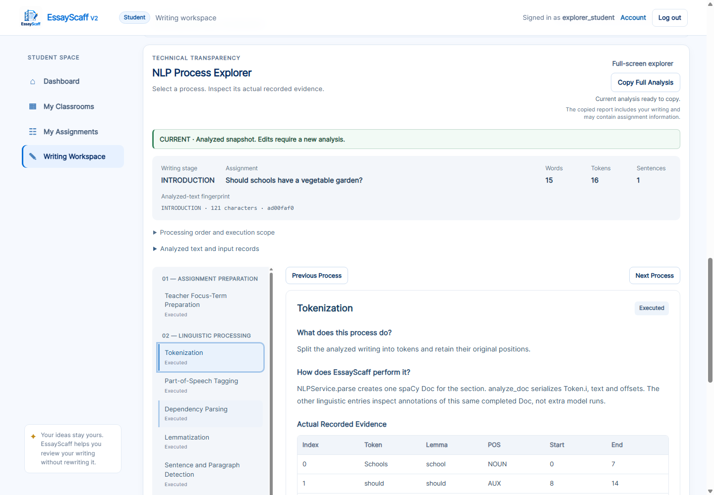
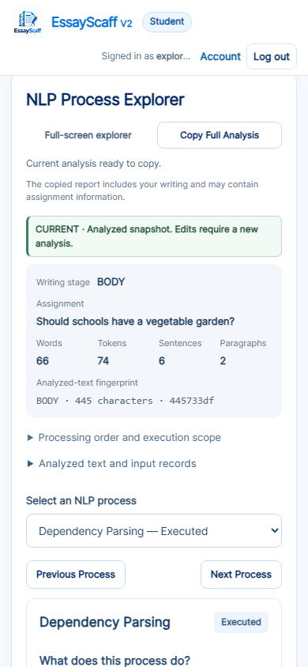

# NLP Process Explorer redesign report

**Completed:** 2026-10-25  
**Project:** `C:\Users\My Pc\Desktop\EssayScaff-V2`  
**Scope:** Frontend redesign of the writing workspace's Transparency Mode.

## Result

Transparency Mode now uses a two-panel **NLP Process Explorer**:

- **Left:** grouped, unique process entries with a clear selected state and recorded
  execution/availability status.
- **Right:** one reading panel containing purpose, actual implementation, recorded
  evidence, next consumer, limitations and expandable Developer Evidence.
- **Mobile:** a grouped process selector above the reading panel, with Previous /
  Next controls. The desktop navigation panel is hidden.
- **Header:** selected stage, current assignment title/question, word/token/sentence
  counts, applicable paragraph count and the existing analyzed-text fingerprint.

The horizontal group tabs, nested subtab rows and Simple/Technical mode switch
were removed. Original student-text/request metadata is accessible from the compact
header. Final feedback is inside Feedback Selection. No separate Student Text,
Feedback Result or Guided/Technical navigation stage is created.

**Verification:** **682 tests passed**. All **58 process views** across the three
stages were checked in real Chrome: 18 Introduction, 20 Body, 20 Conclusion.
All **45 original technical evidence sections** have exactly one reachable home.
Before/after analysis, feedback and full-export records matched after normalizing
variable measured timings. Protected backend/content/dependency files and original
research/database files retained their hashes.

## Evidence index

- [Before captured evidence/export records](nlp_process_explorer_evidence/before-outputs.json).
- [Final captured evidence/export records and complete section mapping](nlp_process_explorer_evidence/after-outputs.json).
- [Before verification](nlp_process_explorer_evidence/before-verification-summary.json)
  and [final verification](nlp_process_explorer_evidence/after-verification-summary.json).
- [Before Chrome log](nlp_process_explorer_evidence/before-browser.log)
  and [final explorer Chrome log](nlp_process_explorer_evidence/after-browser.log).
- [SHA-256 screenshot manifest: 17 images](nlp_process_explorer_evidence/screenshots.json).

## 1. Original UI problems

The before-run confirmed a horizontal group row, a second horizontal navigation
row, and 45 technical views distributed across the original evidence categories.
Simple/Technical modes added another navigation decision and relocated visualizers
between their summaries and technical panels. General explanations, technical
evidence and final output appeared in overlapping views.

On narrow screens, horizontal navigation required side-scrolling. Technical tables
also had their own fixed-height vertical scrolling, adding nested reading areas.
Finding one specific operation required knowing both the group and subtab names.
Student Text and Final Feedback were navigational peers of actual NLP operations.

The original evidence itself was valuable. This redesign changes its organization
and reading experience rather than dropping long records or replacing them with
fabricated examples.

## 2. Information architecture and real processing order

The implementation was inspected before choosing the groups:

1. `EssayAnalysisService.analyze` prepares shared teacher context before section
   processing. Focus normalization can call the loaded model for each phrase;
   topic-derived targets also require the topic call.
2. Each supplied section gets its own `TopicService.analyze` preparation. One
   full-section spaCy Doc supplies its token/sentence/lemma/POS/dependency/chunk
   observations. These annotations are views of one completed document, not six
   separate analysis calls or separately measured execution steps.
3. TopicService extracts concepts, matches prepared targets, conditionally performs
   its direct WordNet suggestion path, and retains the informational related-word
   side branch.
4. The stage Rule Base reuses prepared observations. Body/Conclusion comparisons
   are nested inside the applicable stage analyzer, before its event output.
5. Emitted events and completed stage observations support FeedbackService.
6. The evaluation trace is reconstructed **after feedback**, using the existing
   inventory and returned findings. It is inspection evidence, not a later rerun
   of the rules or an earlier input to feedback selection.

To represent the actual preparation boundary, the final organization uses six
groups rather than placing shared target preparation after document processing:

| Group | Actual UI entries |
|---|---|
| **01 — Assignment Preparation** | Teacher Focus-Term Preparation |
| **02 — Linguistic Processing** | Tokenization; Part-of-Speech Tagging; Dependency Parsing; Lemmatization; Sentence and Paragraph Detection; Noun Phrase Extraction |
| **03 — Topic Processing** | Concept Candidate Extraction; Teacher Focus-Term Matching; Direct WordNet Suggestions; Related-Word Resource Evidence |
| **04 — Stage Rule Checks** | Only the current stage's applicable structural/lexical operations, listed below |
| **05 — Cross-Stage Analysis** | Actual current-stage earlier-section comparisons, or explicitly Not applicable for Introduction |
| **06 — Feedback Selection** | Rule Events and Evaluation Evidence; Rule-Based Feedback Decision; 6+1 Trait and Lesson Mapping; Highlight Evidence Selection |

Stage-specific entries are:

- **Introduction:** Introduction Sentence and Clause Checks; Sentence Topic-
  Connection Review.
- **Body:** Paragraph and List Pattern Checks; Topic Sentence Checks; Supporting
  Detail Checks; Repeated Wording and Sentence Openings.
- **Conclusion:** Conclusion Structure and Closure Checks; Earlier-Idea Combination
  Checks; New-Material Wording Checks; Conclusion Repetition Observations.

Navigation follows source data flow at the major boundaries. It does not claim a
separate call for each annotation view, a model-internal execution order or an
instrumented timestamp for every helper. The processing-order disclosure and
original Call & Data Flow diagram retain that distinction explicitly.

## 3. Selected-process reading panel

Every process view has these functional sections:

1. Process title and execution/availability chip.
2. **What does this process do?** — a brief plain-English purpose.
3. **How does EssayScaff perform it?** — the existing algorithm/library and actual
   use in this codebase.
4. **Actual Recorded Evidence** — readable tables/previews from the cached response.
5. **Where does the output go next?** — implementation-defined consumers, with an
   explicit distinction between source-defined handoff and recorded per-item usage.
6. **Limitations** — the applicable scope, without a quality-score claim.
7. **Developer Evidence** — full retained input context, complete output, source
   functions, exact rule records and the original mapped technical sections.

The main tables use actual first records, not substitute examples. Where a preview
shows six rows, an explicit all-records disclosure provides the complete long
table. Original complete tables and export records also remain reachable.

### Interaction and responsiveness

- Selecting a process updates the right panel and the left active indicator.
- Previous / Next navigate the same ordered catalog and disable at its boundaries.
- Arrow Up / Down and Home / End support roving process selection and focus.
- Expand / Collapse Developer Evidence updates the actual native disclosure and
  its accessible expanded state.
- Original evidence/diagram cross-links select the owning process and expand the
  exact technical section rather than relying on hidden legacy tab buttons.
- Selection is remembered by writing stage and assignment. New response data
  rebuilds the evidence while preserving an applicable process preference.
- At widths of 800 px or less, a grouped selector replaces the desktop navigation.
- The desktop navigation has a bounded navigation scroll so long stage catalogs
  remain usable. The reading area uses the page, or the existing optional full-screen
  content pane. Tables can scroll horizontally without fixed-height nested vertical
  table scrollers.

## 4. Actual process-to-evidence mapping

The full machine-readable mapping is `section_mapping` in
[after-outputs.json](nlp_process_explorer_evidence/after-outputs.json).
Each original key occurs once; these keys are evidence identifiers, not UI subtabs.

| New location / process | Actual records and original technical-section keys |
|---|---|
| Header — analyzed text and input records | `student:overview`, `student:text`, `student:context`, `backend:overview`, `backend:validation`, `backend:response`; exact retained text, earlier context, provenance and stale/current version labels |
| Teacher Focus-Term Preparation | Prepared teacher context, call-frequency/timing information; `topic:focus-terms`, `topic:normalization`, `backend:flow` |
| Tokenization | Shared document status and token records; `nlp:overview`, `nlp:pipeline`, `nlp:tokens` |
| POS Tagging | Actual token indices, POS/tags and positions; `nlp:pos` |
| Dependency Parsing | Recorded token/head/dependency relationships and the original interactive tree; `nlp:dependencies` |
| Lemmatization | Actual token-to-lemma records; `nlp:lemmas` |
| Sentence and Paragraph Detection | Original sentence bounds and applicable paragraph spans/boundary policy; `nlp:sentences` |
| Noun Phrase Extraction | Exact noun-chunk text and bounds; `nlp:chunks` |
| Concept Candidate Extraction | Grouped concepts, every occurrence, extraction methods and source-token indices; `concept:overview`, `concept:concepts`, `concept:occurrences` |
| Teacher Focus-Term Matching | Exact/normalized match method, observed wording and positions; `topic:overview`, `topic:direct`, `topic:lemma` |
| Direct WordNet Suggestions | Its own execution/resource status, lookup pairs, counts and returned suggestions; `topic:wordnet` |
| Related-Word Resource Evidence | Existing informational-only resource result and exact spans; `topic:related` |
| Stage-specific checks | Current-stage output fields and filtered recorded rule families. No Body/Conclusion view invents executed Introduction rules. |
| Earlier-section comparisons | Available earlier-text context, actual pair records and separate nested WordNet statuses; `topic:cross-stage` |
| Rule Events and Evaluation Evidence | Original interactive Rule Decision Tree, emitted/untriggered records, conditions, thresholds, configuration and Python implementation metadata; `rules:overview`, `rules:stage`, `rules:triggered`, `rules:not-triggered`, `rules:evidence`, `rules:trace`, `rules:sources` |
| Rule-Based Feedback Decision | Original Feedback Decision Flow, all five fields, selected branches, priority/selection checks, provenance, response and complete export index; all seven `engine:*` sections and all five `final:*` sections |
| 6+1 Trait and Lesson Mapping | Existing instructional record and verified prepared-content presentation, lesson IDs, actual student wording, mapping basis and coverage |
| Highlight Evidence Selection | Existing backend plans and verified tutor excerpts, original source text/offsets, rule IDs, anchor/paragraph provenance and explicit no-mark cases |

The original section counts are **6 header + 3 preparation + 8 linguistic +
3 concepts + 3 matching + 1 direct WordNet + 1 related + 1 cross-stage + 7 rules +
12 feedback/output = 45**. No original technical subsection was removed to shorten
the interface. Academic/library references remain in expandable implementation
records and the unchanged complete-report record index.

## 5. Status and measurement honesty

| Situation | Actual explorer behavior |
|---|---|
| Shared document executed with retained annotations | Executed, with the shared document duration. No individual annotation duration or extra model invocation is claimed. |
| Rule Events view includes `rule_base_ms` | Explicitly labelled as the whole stage Rule Base duration, including checks and nested comparisons; event emission and trace reconstruction have no separately measured duration. |
| Introduction/Body direct WordNet path disabled | Skipped, using the recorded direct-step status. A displayed recorded skip-step timing does not assert a WordNet lookup ran. |
| Conclusion direct WordNet check executed with no candidates | Executed, preserving a genuine zero output rather than inferring Skipped from an empty list. |
| Introduction earlier-section comparison | Not applicable: no earlier section exists. |
| Body/Conclusion required earlier text absent | Not applicable, using the recorded unavailable-context path statuses. Missing context is not a writing defect. |
| Resource failure or missing execution record | Unavailable with the retained status/basis, rather than invented successful execution. |
| Stage conditions explicitly not evaluated | Skipped; actual rule-row statuses remain inspectable. |
| Neutral Body lesson/highlight operation | Not applicable, with `NO_SUPPORTED_CONCERN_SELECTED`; no trait, skill, lesson, task or error mark is fabricated. |
| Concern has no reliable precise source mark | Unavailable mark, with the existing fallback explanation; no guessed span. |

The header uses recorded linguistic counts when available. Any fallback word count
is the existing browser whitespace count from exact retained text, identified by
its tooltip. Introduction receives no invented paragraph count. The fingerprint is
the existing browser-derived analyzed-text identifier, explicitly not a
cryptographic hash or saved revision ID.

## 6. Evidence, exports and snapshot safeguards

The before capture was made before frontend modification. The final publisher
compares the same three stages' analysis, feedback and full-report record lists,
including labels, source paths and non-time values. Variable measured timing values
are normalized only for comparison; actual runtime/timing records remain accessible
in the header's Developer Evidence and complete export.

The comparison passed. No NLP, rule, FeedbackService, catalog, dependency or data
file was changed. The guard covers `app.py`, `requirements.txt`, every service Python
file and all content JSON, as well as the six original SQLite files and five
research JSON files. Before and final SHA-256 dictionaries match.

Source text and all offsets remain original Python-character, end-exclusive bounds.
The explorer reuses existing span verification and literal text rendering. The
original token/POS/dependency tables, concept/match spans, rule thresholds, academic
references, decision branches and complete record archive are tested in their new
homes. No sanitized example replaces actual cached evidence.

Changing selection, opening Developer Evidence, expanding long tables and following
evidence links issue no analysis request. Real Chrome also verified:

- Exact Copy Full Analysis clipboard equality, including Windows newline handling.
- Complete visual access to every exported technical record path.
- CURRENT/PREVIOUS snapshot labels describe analyzed writing, not silent editor edits.
- Actual edit events invalidate evidence and Copy before reanalysis.
- Stage switching restores the correct cached stage and its applicable selection.
- Assignment A → B uses each assignment's title/context and rejects prior cached
  Body evidence.
- Full-screen entry/exit, including wheel/toggle behavior, preserves the editor,
  saved state and the same cached analyses.

## 7. Recent tutor repairs preserved

No feedback algorithm was modified. The 13 Introduction and 12 Body real-Chrome
regressions passed after the redesign, including exact reason/incomplete-sentence
spans, paragraph-specific development, repeated openings, cautious topic review and
saved/unsaved/assignment context checks.

The reported empty Why it matters / How to improve headings did not reproduce for
the neutral Body sample: the existing content-based section hiding worked and was
retained. The explorer's neutral mapping view also contains only the actual notice
and supported observations, with no forced corrective rows or trait assignment.

The independent teacher Research Inspector still exposes its full authorized
sample trace, copy/download and stale-request safeguards. Its real browser workflow
passed. The redesign adds no teacher-dashboard or persistence behavior.

## 8. Changed files

| File | Frontend/test responsibility |
|---|---|
| `static/nlp_process_explorer.js` | New vanilla-JavaScript process catalog, recorded-status presentation models, two-panel DOM, stage-scoped evidence, responsive selector, previous/next, Developer Evidence and original-section registry |
| `static/app.js` | Wires the explorer into cached rendering; removes obsolete horizontal-tab/mode/summary builders; preserves original detailed renderers and source links; adapts full-screen presence detection and compact status wording |
| `static/style.css` | Scoped academic two-panel styling, active process indicator, compact header, readable cards/tables and responsive navigation; removes obsolete Simple/Technical summary styles |
| `templates/index.html` | Loads the frontend module before `app.js`; updates the explorer title/instructions and concise full-screen control label |
| `tests/test_nlp_process_explorer.py` | 14 new real-evidence/model regressions for all stage catalogs, exact single-home mapping, execution states, missing context, original spans/shared timing and neutral Body preservation |
| `tests/nlp_process_explorer_cases.json` | Authored three-stage verification corpus |
| `tests/nlp_process_explorer_browser_check.py`, `.cjs` | Disposable Chrome before/after evidence, every process/control, responsive layouts, clipboard, stage/assignment snapshots, backend/data guards and publication |
| Existing workspace/highlight Node harnesses | Load the same new frontend module as the actual HTML page |
| Existing NLP/interface/feedback-flow tests and browser harnesses | Replace old tab/mode interaction expectations with real process/evidence navigation, retaining original data/span/export/decision/workflow assertions |

No application backend, analyzer, Rule Base condition, feedback decision, lesson
catalog, schema or research dataset was edited.

## 9. Verification results

| Check | Actual result |
|---|---|
| Full baseline before modification | **668 passed**, 166.75 s |
| New explorer regressions | **14 passed within the full suite**; final isolated model verification also **14 passed**, 6.27 s |
| Final complete Python suite | **682 passed**, **117.73 s** |
| JavaScript syntax | Changed application/module and Chrome harnesses passed `node --check` |
| Focused explorer real Chrome | **PASS** for Introduction, Body and Conclusion; **58 process views**; all Developer toggles and previous/next; 45 original section homes; desktop/mobile; actual clipboard; current-stage selection and assignment staleness |
| Before/after comparison | Analysis, feedback and full-export record substance matched for all three captured stages after measured-timing normalization |
| Existing complete transparency walkthrough | **PASS**, Chrome 155.0.8059.85; original scientific evidence, diagrams, record index, keyboard controls, data provenance, unknown/missing records, live analysis, native undo/redo, retry, viewport/layout and full-screen checks; zero JavaScript errors |
| Introduction repaired-tutor Chrome | **13/13 passed**, no JavaScript errors |
| Body repaired-tutor Chrome | **12/12 passed**, saved/unsaved/assignment context tests passed, no JavaScript errors |
| Whole-application route/workflow audit | **PASS**: 36 routes, 94 method results, 108 expected role/CSRF/method denials, 13 negative-input groups, 113 rendered links/actions/assets, 18 frontend fetch URLs, 28 real stage analyses, 71 Python files parsed and 9 templates compiled |
| Actual application workflows | **PASS**: teacher/student navigation, classroom/assignment workflows, saves/revisions/restoration, submission, ownership, duplicate/race handling and professor Inspector copy/download/staleness |
| Default-port startup probe | Not run because port 5000 was occupied; existing processes were not stopped. All Chrome checks used the actual application on disposable local Flask ports. |
| Data integrity | Original database/research hashes matched; read-only original and disposable integrity checks were `ok`, with zero foreign-key violations |
| Persistence during inspection | Zero writes from process selection/inspection. The focused assignment test deliberately saved one disposable practice draft; final isolated counts were 3 seeded/explicitly saved writing sessions, 0 revisions, 0 submissions. The complete transparency runner ended at 0/0/0. |

Existing browser assertions tied to removed tabs, mode labels or exclusive visible
subtabs were updated to their actual new controls and disclosure ownership. The
scientific tables, original exact offsets, branch/event relationships, missing-data
honesty, clipboard equality and no-rerun assertions were retained. No algorithms or
golden NLP/feedback outputs were repinned to obtain these results.

Artifact origins under `Temp/opencode`:

- Before explorer: `essayscaff-process-explorer-v7ixc64t`.
- Final explorer / published comparison: `essayscaff-process-explorer-2210wmn1`.
- Complete transparency workflow: `essayscaff-transparency-kf6_0ntp`.
- Whole-app workflow audit: `essayscaff-pre-defense-c1v6dj3z`.
- Body regression browser: `essayscaff-body-repair-0a9bu0ab`.
- Introduction regression browser: `essayscaff-intro-ideas-wa11cqdw`.

## 10. Before/after and stage screenshots

All 17 published PNGs are actual Chrome captures, copied byte-for-byte and verified
against the [manifest](nlp_process_explorer_evidence/screenshots.json).

| Stage / evidence | Before | After |
|---|---|---|
| Introduction desktop | [Original layout](screenshots/nlp-process-explorer/before-INTRODUCTION-desktop.png) | [Process explorer](screenshots/nlp-process-explorer/after-INTRODUCTION-desktop.png) |
| Introduction mobile | [Original navigation](screenshots/nlp-process-explorer/before-INTRODUCTION-mobile.png) | [Responsive selector](screenshots/nlp-process-explorer/after-INTRODUCTION-mobile.png) |
| Body desktop | [Original layout](screenshots/nlp-process-explorer/before-BODY-desktop.png) | [Process explorer](screenshots/nlp-process-explorer/after-BODY-desktop.png) |
| Body mobile | [Original navigation](screenshots/nlp-process-explorer/before-BODY-mobile.png) | [Compact header and selector](screenshots/nlp-process-explorer/after-BODY-mobile.png) |
| Conclusion desktop | [Original layout](screenshots/nlp-process-explorer/before-CONCLUSION-desktop.png) | [Process explorer](screenshots/nlp-process-explorer/after-CONCLUSION-desktop.png) |
| Conclusion mobile | [Original navigation](screenshots/nlp-process-explorer/before-CONCLUSION-mobile.png) | [Responsive selector](screenshots/nlp-process-explorer/after-CONCLUSION-mobile.png) |
| Direct WordNet genuinely skipped | — | [Recorded skipped path](screenshots/nlp-process-explorer/after-INTRODUCTION-wordnet-skipped-desktop.png) |
| Full technical proof | — | [Expanded Developer Evidence and original dependency view](screenshots/nlp-process-explorer/after-INTRODUCTION-developer-evidence-desktop.png) |
| Exact source localization | — | [Original highlight offsets](screenshots/nlp-process-explorer/after-INTRODUCTION-highlight-offsets-desktop.png) |
| Neutral Body | — | [No invented trait/lesson/task](screenshots/nlp-process-explorer/after-BODY-neutral-mapping-desktop.png) |
| Actual Conclusion comparisons | — | [Both earlier-section paths and their statuses](screenshots/nlp-process-explorer/after-CONCLUSION-comparisons-desktop.png) |

Desktop explorer:



Mobile explorer:



## 11. Reproduction

From `C:\Users\My Pc\Desktop\EssayScaff-V2` in PowerShell:

```powershell
& ".venv\Scripts\python.exe" -B -m pytest -q -p no:cacheprovider --tb=short
& ".venv\Scripts\python.exe" -B tests\nlp_process_explorer_browser_check.py
& ".venv\Scripts\python.exe" -B tests\transparency_browser_check.py
& ".venv\Scripts\python.exe" -B tests\pre_defense_audit.py
& ".venv\Scripts\python.exe" -B tests\body_feedback_browser_check.py
& ".venv\Scripts\python.exe" -B tests\introduction_ideas_browser_check.py
```

To publish another verified after-run against the original before capture:

```powershell
& ".venv\Scripts\python.exe" -B tests\nlp_process_explorer_browser_check.py --publish-evidence "C:\Users\MYPC~1\AppData\Local\Temp\opencode\essayscaff-process-explorer-v7ixc64t"
```

The before screenshots and normalized before/export snapshot are historical
captures, not regenerated from the redesigned application.

## 12. Remaining limitations

- The existing pipeline does not retain model-internal reasoning, every rejected
  candidate, per-token consumption logs or separately measured timings for each
  annotation/helper. The explorer labels these limits rather than estimating them.
- Next-consumer descriptions are source-defined unless an existing comparison,
  event/provenance link or record establishes the particular handoff.
- Browser fingerprints identify analyzed text for inspection, not a saved database
  version or cryptographic proof. Workspace edits still require actual reanalysis.
- NLP/parser labels, lexical matches, structural candidates and WordNet suggestions
  remain limited observations; the redesign adds no semantic-validation capability.
- The desktop navigation has a small independent navigation scroll for long stage
  catalogs; primary evidence reading remains a single main content scroll. Full
  original proof can require opening its Developer Evidence subsections.
- A neutral Body result remains exactly its existing no-supported-concern decision,
  not a score, a passing grade, or a seven-trait quality assessment.

Implementation, technical-evidence preservation, automated/Chrome verification and
evidence publication are complete. Ready for review.
