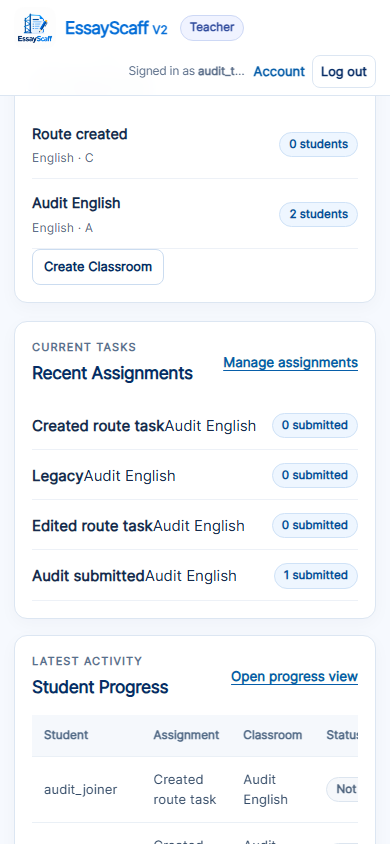
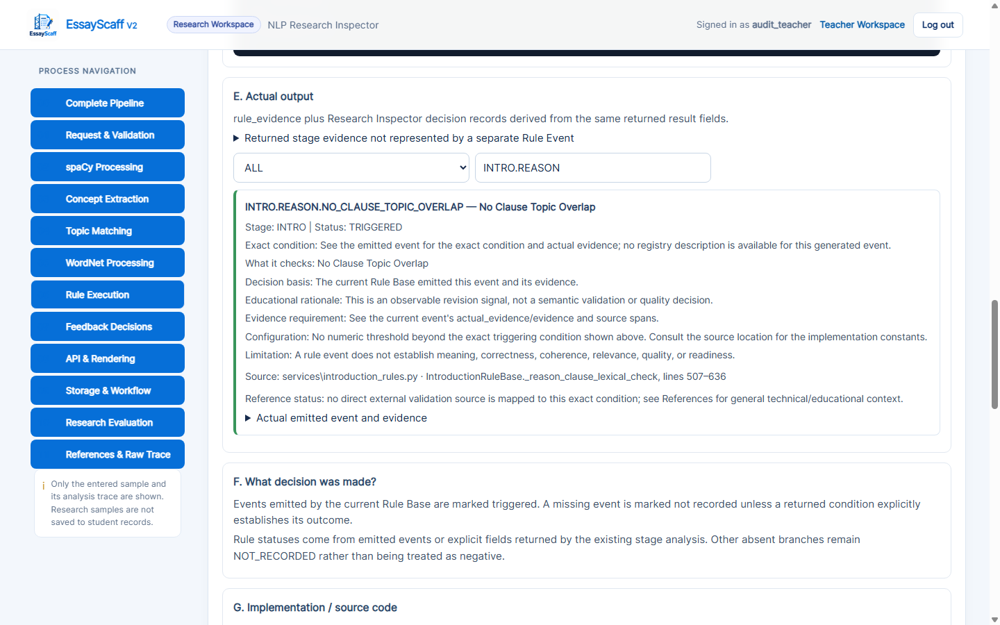
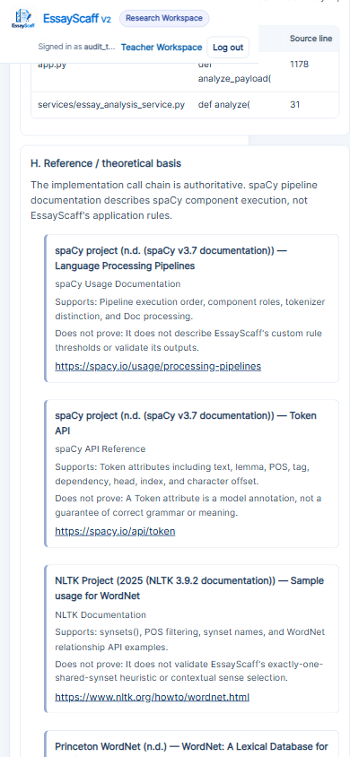
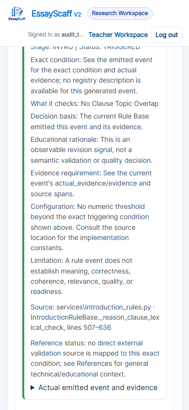
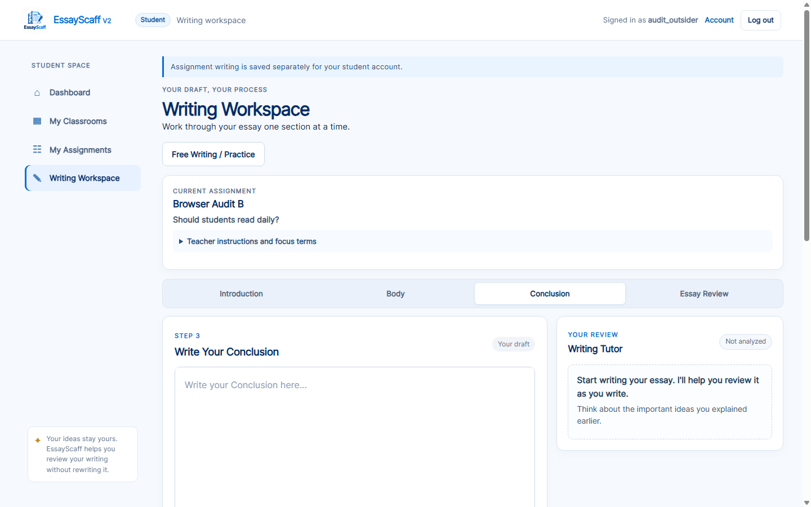
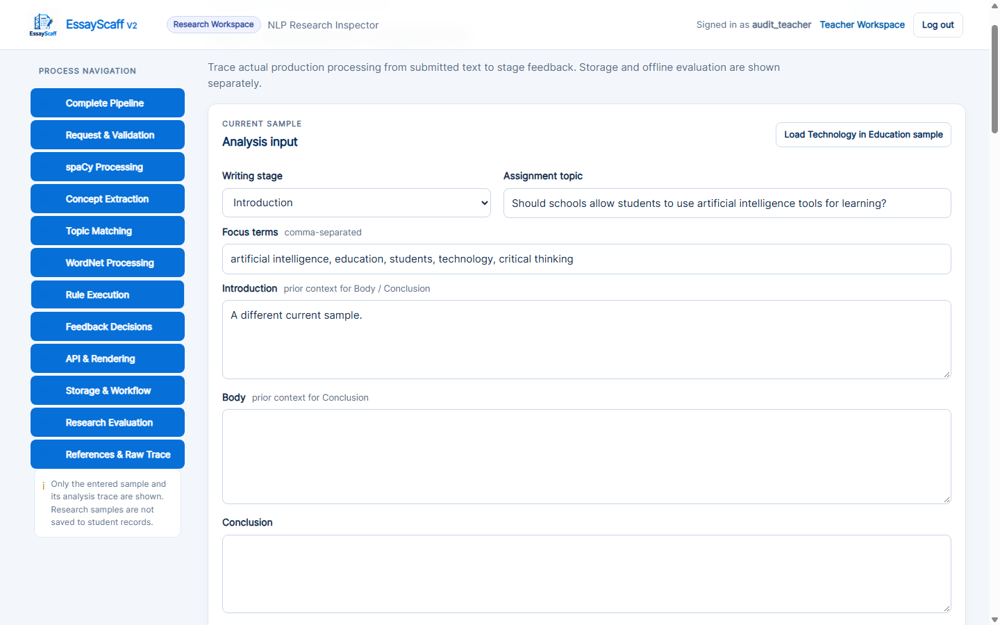
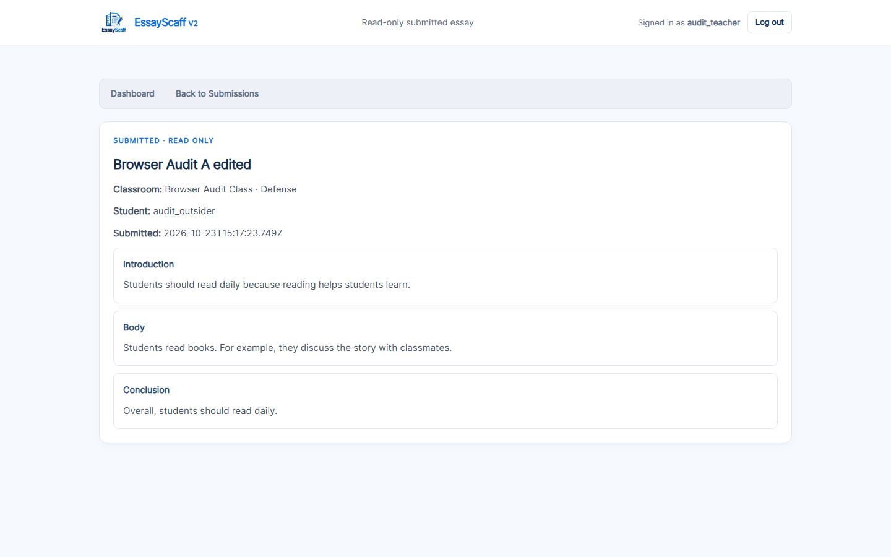
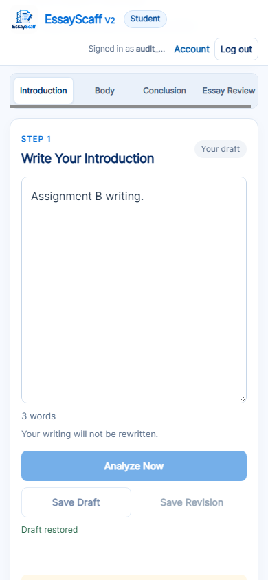

# EssayScaff V2 — pre-defense full-system audit

Audit started 2026-10-23 against `C:\Users\My Pc\Desktop\EssayScaff-V2`.

## Verified baseline and investigation log

- Full initial Python suite: **549 passed**, 108.69 seconds.
- Runtime: Python 3.11.9, Flask 3.1.3, Werkzeug 3.1.9, spaCy 3.7.5,
  `en_core_web_sm` 3.7.1, NLTK 3.9.2, pytest 8.3.5, Node 24.19.0.
- `pip check`: no broken requirements. No dependencies installed/upgraded.
- `create_app()` / `app.py` are the factory/entry point. Route enumeration:
  **36 rules**, no Blueprints. Implemented roles: STUDENT, TEACHER; no ADMIN.
- Real SQLite files will be opened read-only for schema/integrity checks only.
  All mutation, deletion, malformed-input, and browser workflows use temporary
  isolated accounts/databases.

Pre-repair source inspection confirms the reason Rule Event source registry
falls back to `ConclusionRuleBase._rule_events` for Introduction reason IDs.
Additional candidate defects are being reproduced in oversized-ID validation
and asynchronous workspace/revision switching before repairs are authorized by
their test evidence.

## Final result

**Suitable for a controlled localhost defense demonstration of the tested
workflows, after running the accompanying smoke checklist.** All reproduced
P0/P1 issues are resolved; no unhandled JavaScript exception or unexplained
server error remains in the tested workflows. This is a scoped readiness
assessment, **not a claim that the entire application is error-free** or ready
for public deployment.

| Evidence | Result |
|---|---|
| Initial full Python baseline | **549 passed** |
| Full Python suite after production repairs | **572 passed**, 257.97 s while browser suites also ran |
| Additional final route-fixture check | **3 passed** after extending browser coverage to legacy assignment and archive controls |
| Registered Flask route rules | **36**, all positively exercised |
| Route/method results | **94** |
| Authentication, role, CSRF and unsupported-method probes | **108 expected denials** |
| Malformed-input / foreign-ownership groups | **13** in the route artifact, plus dedicated repair regressions |
| Rendered HTML links/assets/actions checked | **112** |
| Static JavaScript fetch URL references resolved | **18** |
| Real three-stage NLP audit samples | **28**, plus the existing stage/highlight suites |
| Python source files parsed / templates compiled | **65 / 9**; environments, caches and rollback copies excluded |
| Chrome workflow and full transparency suites | **PASS / PASS** |
| Original databases and research JSON | Checksums unchanged; read-only integrity checks passed |

Stable evidence: [execution summary](pre_defense_evidence/audit-summary.json),
[route matrix](pre_defense_evidence/route-matrix.md),
[complete route/link/denial records](pre_defense_evidence/route-audit.json),
[NLP records](pre_defense_evidence/nlp-audit.json),
[Chrome workflow records](pre_defense_evidence/workflow-browser.json),
[startup log](pre_defense_evidence/startup.log),
[browser result log](pre_defense_evidence/browser.log), and
[screenshot manifest](pre_defense_evidence/screenshots.json).

## 1. Environment and clean startup

Actual command, from the project directory:

```powershell
& ".venv\Scripts\python.exe" -B app.py
```

The audit started this as a real child process, obtained **HTTP 200** and the
actual login HTML at `http://127.0.0.1:5000/login`, confirmed the child remained
running, and terminated only that audit-owned child afterward. No traceback,
missing import/template, or database exception occurred. DEBUG is **off** and
binding is **127.0.0.1**. Werkzeug's development-server warning is expected for
this localhost prototype; it is not a startup failure or a public-deployment
recommendation. Startup evidence is retained in `startup.log`.

The factory uses lazy NLP initialization. Actual analyses and inspector metadata
were also executed, so startup was not judged solely from the model-free login
page. The installed spaCy model and WordNet corpus were available. The CLI was
executed with `--topic "Reading habits" --focus-term reading "Students read
books."`: exit **0**, valid JSON, 3 alphabetic tokens, 4 total tokens, one sentence,
one observed focus term, WordNet available. No packages or models were installed.

## 2. Project inventory and dependency inspection

- Entry points: `app.py` (`app = create_app()`, loopback server), `cli.py`, and
  the optional password-prompting `create_teacher.py` setup tool.
- Flask routes are factory-local functions in `app.py`; **no Blueprints**.
- Production services: NLPService; TopicService and related-concept evidence;
  shared stage-evidence helpers; Introduction/Body/Conclusion Rule Bases;
  sentence-level Introduction observations; FeedbackService; prepared lesson
  loader; Research Inspector metadata; DraftStore.
- SQLite is used directly through `sqlite3`, not an ORM. The seven current
  tables are users, classrooms, assignments, classroom_enrollments,
  writing_sessions, writing_revisions and submissions.
- Nine templates: login, register, index, teacher, teacher_edit_assignment,
  teacher_submissions, teacher_submission, account and research_inspector.
- Browser scripts: `static/app.js`, `teacher.js`, `research_inspector.js`;
  shared stylesheet `style.css`; local logo served by `brand_logo`.
- The installed package compatibility check passed. Production imports,
  syntax/AST parsing, template compilation, actual service construction and
  route execution revealed no broken/circular import in the tested application.
- The project is not a Git repository. No initialization, commit, push or
  deployment was performed.

**Retained historical/unused material:** `_rollback_feedback_replacement/*.bak`
is a deliberate restore point; historical reports describe earlier interfaces;
`__pycache__` and `.pytest_cache` are generated caches; `.freebuff` is harness
material, not an application dependency. The older reason-only browser runner
uses a machine-specific default artifact directory; the verified full audit and
transparency runners use isolated temporary directories instead. The internal
`assignment_from_payload` helper has no call site found in the current app.
These were not deleted. Offline semantic-feasibility scripts/data and their
separate environment are not part of production NLP. No encoder was downloaded
or research result regenerated during this audit.

## 3. Complete registered route audit

The list below is derived from `app.url_map`, not guessed URLs. All factory
endpoint names below connect to `create_app.<locals>.<endpoint>` in `app.py`;
the `static` endpoint is Flask's built-in static-file function. The generated
matrix records the full qualified function, current source line, all methods,
expected content, actual results and redirect destination.

Permission abbreviations: **P** public; **A** authenticated Student/Teacher;
**S** Student with writing ownership / assignment enrollment where applicable;
**T** Teacher, with ownership checks on record-bearing operations. Inspector
routes require Teacher role but analyze the entered custom sample, not another
student's stored records. **G/H/O** mean GET/HEAD/OPTIONS; **POST** is explicit.

| URL | Endpoint / connected function | Methods | Permission | Expected / actual authorized result | Status |
|---|---|---|---|---|---|
| `/static/<path:filename>` | `static` (Flask built-in) | G/H/O | P | Local asset; 200 / 200 / 200 | PASS |
| `/assets/essayscaff-logo.png` | `brand_logo` | G/H/O | P | PNG; 200 / 200 / 200 | PASS |
| `/register` | `register` | G/H/O | P | Registration HTML; 200 / 200 / 200 | PASS |
| `/register` | `create_account` | POST/O | P + CSRF | Valid registration; 302 → `/`; O 200 | PASS |
| `/login` | `login` | G/H/O | P | Login HTML; 200 / 200 / 200 | PASS |
| `/login` | `authenticate_student` | POST/O | P + CSRF | Correct credentials; 302 → `/`; O 200 | PASS |
| `/logout` | `logout` | POST/O | A + CSRF | 302 → `/login`; O after logout 302 | PASS |
| `/account` | `account_settings` | G/H/O | A | Account HTML; 200 / 200 / 200 | PASS |
| `/account/delete` | `delete_account` | POST/O | A + CSRF + password + confirmation | Disposable account removed; 302 → `/login`; O afterward 302 | PASS |
| `/` | `homepage` | G/H/O | A | Student HTML 200; Teacher redirects to `/teacher` | PASS |
| `/teacher` | `teacher_dashboard` | G/H/O | T | Dashboard HTML; 200 / 200 / 200 | PASS |
| `/teacher/research-inspector` | `research_inspector` | G/H/O | T | Inspector HTML; 200 / 200 / 200 | PASS |
| `/api/research-inspector/metadata` | `research_inspector_metadata` | G/H/O | T | JSON object; 200 / 200 / 200 | PASS |
| `/teacher/classrooms` | `create_classroom` | POST/O | T + CSRF | Classroom created; 302 → `/teacher`; O 200 | PASS |
| `/teacher/assignments` | `create_assignment` | POST/O | T + CSRF | Assignment created; 302 → `/teacher`; O 200 | PASS |
| `/teacher/assignments/<int:assignment_id>/edit` | `edit_assignment` | G/H/POST/O | T + ownership, CSRF for POST | GET/HEAD 200, POST 302 → `/teacher`, O 200 | PASS |
| `/teacher/assignments/<int:assignment_id>/delete` | `delete_assignment` | POST/O | T + ownership + CSRF | Archive, retain work; 302 → `/teacher`; O 200 | PASS |
| `/teacher/assignments/<int:assignment_id>/classroom` | `assign_legacy_assignment` | POST/O | T + ownership + CSRF | Legacy assignment attached; 302 → `/teacher`; O 200 | PASS |
| `/api/assignments` | `available_assignments` | G/H/O | S | Enrolled active assignments JSON; 200 / 200 / 200 | PASS |
| `/api/archived-assignments` | `student_archived_assignments` | G/H/O | S | Own retained archived work JSON; 200 / 200 / 200 | PASS |
| `/api/classrooms` | `student_classrooms` | G/H/O | S | Own enrolled classrooms JSON; 200 / 200 / 200 | PASS |
| `/api/classroom-enrollments` | `enroll_student` | POST/O | S + CSRF | Valid code joins classroom; 200 JSON; O 200 | PASS |
| `/api/classrooms/<int:classroom_id>/assignments` | `classroom_assignments` | G/H/O | S + enrollment | Classroom assignments JSON; 200 / 200 / 200 | PASS |
| `/api/assignments/<int:assignment_id>/workspace` | `assignment_workspace` | G/H/O | S + enrollment | Own unique workspace JSON; 200 / 200 / 200 | PASS |
| `/api/submissions` | `submit_assignment` | POST/O | S + ownership + enrollment + CSRF | Saved full essay snapshot; 200 JSON; O 200 | PASS |
| `/api/submissions/<int:assignment_id>` | `student_submission` | G/H/O | S + ownership + enrollment | Own submission JSON; 200 / 200 / 200 | PASS |
| `/teacher/assignments/<int:assignment_id>/submissions` | `teacher_assignment_submissions` | G/H/O | T + ownership | Submissions HTML; 200 / 200 / 200 | PASS |
| `/teacher/submissions/<int:submission_id>` | `teacher_submission_view` | G/H/O | T + ownership | Read-only essay HTML; 200 / 200 / 200 | PASS |
| `/api/analyze-introduction` | `analyze_introduction` | POST/O | S + CSRF | Real Introduction JSON; 200; O 200 | PASS |
| `/api/analyze-stage` | `analyze_stage` | POST/O | S + CSRF | Selected real stage JSON; 200; O 200 | PASS |
| `/api/research-inspector/analyze` | `analyze_research_inspector` | POST/O | T + CSRF | Authorized custom-sample JSON; 200; O 200 | PASS |
| `/api/drafts` | `save_draft` | POST/O | S + ownership + CSRF | Draft/version JSON; 200; O 200 | PASS |
| `/api/drafts` | `restore_draft` | G/H/O | S + ownership | Draft JSON; 200 / 200 / 200 | PASS |
| `/api/revisions` | `save_revision` | POST/O | S + ownership + CSRF | Revision metadata JSON; 200; O 200 | PASS |
| `/api/revisions` | `list_revisions` | G/H/O | S + ownership | Revision list JSON; 200 / 200 / 200 | PASS |
| `/api/revisions/<revision_id>` | `view_revision` | G/H/O | S + ownership | Read-only revision JSON; 200 / 200 / 200 | PASS |

Automatic HEAD responses were checked for empty bodies. OPTIONS after deliberate
logout/account deletion is an **EXPECTED DENIAL** redirect, not an authenticated
200. No registered route is left NOT TESTED. This does not mean every possible
parameter combination was tested.

For protected routes, anonymous HTML requests redirect to `/login`; anonymous
API requests return **401 JSON**. Wrong-role route probes return **403**.
Missing CSRF returns **400**; unsupported authenticated PUT returns **405**.
Foreign teacher/student records return **404**, not another account's data.
Malformed array/null/string/number JSON requests return **400 JSON**. These are
classified **EXPECTED DENIAL**, with individual records in `route-audit.json`.
Out-of-range IDs and missing submissions/assignments have dedicated regressions.
All observed unexpected 500/traceback paths listed in section 12 were repaired.

## 4. Links, assets, navigation and button checks

Rendered pages were parsed for `href`, `src`, form actions and duplicate IDs;
all templates were compiled. Internal form/link destinations were resolved
against the real Flask map and referenced local assets were fetched. Eighteen
literal/template `fetch(...)` references in the three production JavaScript
files resolve to existing routes/method sets. No missing core URL, missing
template, removed handler or broken local asset remains in those checks.

`#dashboard`, `#classrooms`, `#assignments`, `#workspace` and teacher `#progress`
are **frontend hash views**, not missing Flask routes. Both Chrome browser Back
and sidebar view restoration were exercised. The favicon repair reuses the
existing local logo endpoint, rather than adding a new route.

Actual Chrome interactions included:

| Page / controls | Actual action and result |
|---|---|
| Login / registration | Wrong login, registration link/form, correct login, logout and protected-page redirect |
| Teacher sidebar / dashboard Create Classroom | Hash views switch; Back restores prior view; action opens correct form |
| Classroom form and assignment form | Native forms create actual isolated records and render them on return |
| Legacy assignment Assign | Select classroom, click Assign; item becomes classroom-owned in the active assignment list |
| Assignment Edit / Save Changes / Delete | Fields update before work; only title editable after work; deletion confirms and archives with retained writing |
| Student classroom card / Join / Show all | Invalid code is handled; valid join works; card opens assignments; filter can be cleared |
| Assignment details / Start Writing | Correct assignment context, separate saved text and current revision history load |
| Analyze Now / stage buttons / Essay Review | Real Introduction, Body, Conclusion results; complete combined read-only review |
| Optional Introduction guide / Return | Guide opens/closes and preserves original editor text; teaching-source disclosure toggles |
| Self-check boxes / Review Suggestions / Continue | UI changes and Body navigation occur without rerunning analysis |
| Show more feedback / concern tabs | Disclosures and Main Feedback/Also Check switch with matching evidence; no saving or NLP rerun |
| Save Draft / Save Revision / revision entry | Persists correct sections, deduplicates unchanged revision, opens immutable preview without replacing editor |
| Free Writing / assigned workspace switches | Saved sessions restore independently; unsaved and in-flight-save switches are blocked |
| Submit / cancel confirmation / duplicate request | Cancel keeps draft editable; accept snapshots once; duplicate returns 409; saved submission restores read-only |
| Teacher Submissions / View Essay / back links | Correct student's three saved sections display as read-only |
| Archived assignment button | Own saved writing restores read-only after teacher archive |
| Account / back / Delete account | Settings route works; disposable student deletion requires password and checkbox, clears session |
| Inspector navigation / filters / Copy / Export | Twelve process buttons and Previous/Next work; reason-source filter resolves; clipboard and actual downloaded JSON checked |

External academic/reference links are retained URLs, not required application
assets. Their live remote availability was **NOT TESTED**; they are disclosed
in section 17. No core navigation is assessed solely from its screenshot.

## 5. Authentication, authorization and sessions

The supported roles are Student and Teacher. Public registration intentionally
offers both roles; ADMIN registration is rejected by existing tests. Teacher
role does not authorize reading another teacher's class/assignment/submission.
Student role does not authorize teacher pages or inspector APIs, including a
crafted browser metadata request (**403**).

The suite covers correct/incorrect credentials, case-insensitive duplicate
usernames, password hashing, deleted/invalid sessions, logout, CSRF on mutation,
and student-to-student / teacher-to-teacher ownership boundaries. The new audit
verifies signature expiration through Flask's real cookie verifier using an
expired `max_age`; eight hours were not waited in real time.

Configuration inspected: persistent secret from `ESSAYSCAFF_SECRET_KEY` or
ignored `instance/.flask_secret_key`; HttpOnly session cookie; SameSite Lax;
8-hour permanent lifetime; Secure enabled only when
`ESSAYSCAFF_COOKIE_SECURE=1`; no-store account responses. Secret values, cookies
and audit passwords are not included in the evidence/report. Audit account
passwords are randomly generated and passed to Chrome through its environment.

## 6. Student workflow and data safety

Chrome used disposable accounts and an isolated database, including a second
login in the same browser with the previous account's local-storage IDs. The
server denied those foreign restores and no prior writing appeared.

PASS evidence covers practice setup with optional focus terms, all essay stages,
readiness/self-check advisory controls without hard stage locks, analysis,
manual saving, immutable revisions, refresh restoration, re-login restoration,
assignment details, switching assignments and switching practice/assigned work.
Two distinct assignments retained independent section text and revision history.

The async probes hold **actual backend responses** before delivering them:
late analysis responses are rejected by the existing generation/snapshot guards;
in-flight save switches are now blocked; old revision previews/history are now
ignored after session changes. Saving snapshots across stage changes was covered
by the existing workspace suite and the three-section browser save/reload test.
Duplicate Analyze Now requests reuse/serialize the same snapshot; injected
network failure and retry are checked by the full transparency browser suite.

Unsaved navigation within the application preserves the editor and blocks
workspace replacement. Drafts are not autosaved. An intentional tab close or
forced process termination can still lose unsaved text; that is not a persistence
guarantee. Final submission requires saved, nonempty sections and a current saved
draft version, prevents duplicates and makes the assignment read-only.

## 7. Teacher / administrative workflows

PASS evidence covers teacher login/dashboard, classroom creation, enrollment
codes and enrolled-student lists, assignment creation/topic/instructions/focus,
legacy assignment placement, editing, work-started locking, title-only changes,
soft archive, student progress, submission lists and read-only essay viewing.
Missing/foreign IDs are denied, and student work remains readable after archive.

There is **no Admin role or Admin interface**. Classroom editing/deletion,
assignment-specific word-count settings and deadlines are **not implemented**;
there are no corresponding controls/routes to test or add. Word counts are
writing/review observations, not configurable assignment requirements. Teacher
account deletion intentionally removes linked classroom work after the explicit
warning, password and confirmation; transactional tests cover that behavior in
temporary databases, while Chrome exercised disposable student deletion.

## 8. NLP and feedback regression

The audit changed **no NLP rule, model, trait, scoring scheme or lesson logic**.
The source-pointer correction is metadata only. Actual Rule Event IDs,
provenance subsets and selected-message/trace equality were checked on 28
fresh coordinator runs. The full existing backend, catalog, highlighting and
service-call regressions also pass.

| Stage | Real sample groups and observed behavior |
|---|---|
| Introduction (12) | Empty → neutral; topic-only/main statement → main-point review; explanation/complete Because/complete Although → recorded point/reason review; incomplete Because/Although → Complete Your Sentence; unrelated sentence → topic-connection review; pronoun sentence and keyword-rich unrelated statement retain cautious observational status; simultaneous concerns preserve incomplete sentence as primary. |
| Body (9) | One/multiple paragraphs and no-detail cases retain development review where the existing count check applies; example and unrelated-example samples can both produce neutral observable feedback; repeated openings select Sentence Beginnings; disconnected paragraphs select Connect Paragraphs; missing Introduction is represented explicitly. |
| Conclusion (7) | Empty → neutral; no closing statement → neutral review; final-sentence/new-topic/paraphrase cases can trigger recorded new-word comparison; missing earlier context falls back to Clear Ending. |

The last two rows expose **method limitations**, not semantic correctness: an
unrelated example can satisfy a structural detail count, a useful ending or
paraphrase can contain words unseen earlier, and topic keywords do not prove a
statement logically relevant. The sample label “valid-ending” in the artifact
does not constitute system approval; its actual observed branch is
`conclusion_ideas_new_words`. No thresholds or new semantic classifier were
introduced to make those cases appear accurate.

The real-Chrome regression preserves the full six-sentence smartphone example:
Although remains Main Feedback and the slumber-party sentence is Also Check.
Educational-app and invisible-dragon reason clauses remain marked **only at the
correct reason subtree**. Unicode offsets, repeated words, multiple events,
invalid spans, missing events and stale editor text retain the tested fallback
behavior. Analysis does not rewrite the student's essay or produce a grade.

## 9. Transparency Mode and Inspector

The five Simple View processes remain Student Text, Language Analysis, Topic
Check, Rule Check and Feedback Result, with Advanced Inspector available. All
45 technical sub-tabs, Simple/Technical switching, dependency tree, rule tree,
feedback decision flow, field/item selection, evidence offsets and Full Analysis
export were exercised by the complete Chrome suite. Inspection/copying does not
rerun NLP or create draft/revision/submission rows in that suite.

The incorrect `services.introduction_rules.ConclusionRuleBase._rule_events`
pointer for emitted `INTRO.REASON.*` records was reproduced and repaired in
`research_inspector._rule_spec`. Both reason-event variants now resolve to the
actual `IntroductionRuleBase._reason_clause_lexical_check` helper, file and
`inspect.getsourcelines` range. Permanent real-analysis tests verify both.

The original protected fingerprint remains
`ff6ea8aae5e067fbce29c9fb9587f1933889343038b37ce877c884e2bd9e5c04`.
The existing test-only legacy projection additionally restores the **old wrong
source-pointer dictionary in its copy only** before checking that original
hash. The returned API retains the corrected pointer, asserted independently by
real-analysis and browser tests. No fingerprint expectation was silently re-pinned.

Inspector input changes now invalidate an in-flight result through a request
snapshot comparison. An intentionally delayed old sample response cannot enable
Copy/Export for the new sample. Actual clipboard content (normalizing Windows
CRLF line endings only) and the completed JSON file download were verified.

## 10. Browser and responsive results

Existing Chrome/CDP setup was reused: **Chrome 155.0.8059.85**, no driver or
browser package installation. Major login, registration, student, teacher,
account, edit, submission, review and inspector views were measured/captured at
**1440×900**, **1366×768**, and **390×844**. The workflow log has **58** measured
view/summary entries; 57 are size-specific checks and one is the workflow summary.
Additional repair-state captures are in the screenshot manifest.

Two measured responsive defects were repaired: teacher header expanded a 390px
layout to 516px; inspector grid content expanded it to 528px. Reusing the
student's wrapping-header behavior across shared headers and constraining the
inspector grid tracks restored **390px viewport/document width**. Long technical
tables use their existing local scroll containers instead of widening the page.
No interface redesign was performed.

The full transparency suite also verifies editor/mirror font, padding, width,
scroll alignment, exact highlight text, native undo/redo, fixed header/sidebar
focus mode and mobile controls. Tested workflows have **no unhandled JavaScript
exceptions/rejections, console API errors or unexplained HTTP failures**. Explicit
401/403/404/409 negative probes are recorded as expected denials, not hidden.

## 11. Database integrity, compatibility and failure handling

The current database and **five historical database backups** were opened via
SQLite `mode=ro` for schema/integrity inspection. Every file returned
`PRAGMA integrity_check = ok` and zero foreign-key violations. Current schema
contains all seven required tables and ownership/archive columns. Historical
files legitimately have older schemas and were **not migrated**.

DraftStore enables foreign keys per connection, uses parameterized values,
commits/rolls back transactions and closes connections. Revision allocation and
submission snapshots use `BEGIN IMMEDIATE`; unique session-owner/assignment,
revision number and student/assignment submission constraints prevent tested
duplicates. Final snapshots use a current saved-draft version token. Account
deletion is an explicitly ordered transaction; archive retains related work.

Existing additive schema initialization/migration logic was inspected and its
temporary legacy-database regressions passed. No migration or repair was run
against the real data. The audit compares checksums before/after for all six
database files and five research JSON files; **all are unchanged**. The isolated
workflow database also passes integrity and foreign-key checks after its CRUD
and deletion scenarios. No backup/data-changing production repair was needed.

Bad JSON, CSRF failure, malformed/missing IDs, foreign records, stale draft
versions, duplicate submissions, analysis/API errors and an injected edit-storage
outage have controlled tested outcomes. The latter now returns a clear **503**
instead of an unhandled exception. Physical disk-full/power-loss testing is not
claimed.

## 12. Complete confirmed-defect register

All entries below are resolved. **No unresolved confirmed P0 or P1 defect** remains
from this audit. Priorities describe the reproduced impact, not a claim about
every possible threat or concurrency interleaving.

| ID / priority | Reproduction: expected → actual before repair | Root cause / smallest correction | Permanent evidence |
|---|---|---|---|
| D01 P1 | URL/JSON ID `2**80` and an oversized stored session identity should be denied → SQLite `OverflowError` / server failure | `app.py` now validates positive signed-64-bit record IDs before queries; invalid identity expires; revision IDs are bounded before conversion | 12 URL/JSON/session regressions |
| D02 P1 | Submit a valid-shaped request for nonexistent assignment → 404 JSON expected, uncaught `AssignmentNotFoundError` actual | `submit_assignment` catches that store exception with missing-draft denial | Missing-assignment submission regression |
| D03 P1 | HEAD assignment-edit should render headers without mutation → 302 and update branch actual | `edit_assignment` treats HEAD like GET, rather than POST | Complete route HEAD test plus update-forbidden regression |
| D04 P1 | Switch workspace during a delayed clean save → remain in current workspace expected; late response could set old session ID into new state | `selectAssignment` / `selectPracticeMode` block during save, revision save or submission | Deferred-save frontend regression and held-real-response Chrome probe |
| D05 P1 | Open another assignment → its revision history expected; old practice list retained / no fetch for new session actual | `selectAssignment` loads the current revision history | Frontend fetch-context regression and real assigned/practice history switches |
| D06 P1 | Deliver old revision after workspace switch → ignore expected; old preview displayed under new assignment actual | `loadRevisionHistory` / `viewRevision` verify captured session context before rendering/errors | Late-preview regression and held real revision response in Chrome |
| D07 P2 | Introduction reason source should resolve to Introduction helper → unresolved ConclusionRuleBase pointer actual | Metadata fallback in `_rule_spec` maps Introduction reason IDs to real helper; no NLP-rule change | Two actual-analysis source-range regressions and filtered Inspector screenshot |
| D08 P2 | Change Inspector sample during request → invalidate old trace expected; old response enabled current export actual | `clearStaleAnalysis` and `analyzeSample` compare request/input snapshots on success and failure | Permanent delayed real-response Chrome test |
| D09 P2 | 390px teacher layout should fit → viewport expanded to 516px | Shared mobile header/account controls wrap using existing student behavior | Desktop/laptop/mobile measured Chrome assertions |
| D10 P2 | Inspector content should scroll locally → grid track expanded page to 528px | `minmax(0,1fr)`, minimum-width constraints and wrapping on existing inspector containers | Before-overflow diagnostic and final three-size Inspector/source checks |
| D11 P2 | Edit-storage outage should be recoverable → initial lookup outside try raised sqlite exception | `edit_assignment` catches initial storage failure and returns 503 | Injected SQLite-outage regression |
| D12 P3 | Browser icon should resolve locally → automatic missing favicon request / no icon link | Nine templates reference the existing PNG logo as favicon | All-template favicon regression and actual asset/network checks |
| D13 P3 | Teacher CLI description should match supported registration → docstring claimed no web teacher registration | Corrected setup-tool docstring only | Source inspection; existing role tests confirm public Teacher choice |

Reproduction commands and observed error excerpts are retained in
[confirmed-defects.log](pre_defense_evidence/confirmed-defects.log). One initial
new reason-source test used a short sample that spaCy did not parse as the
intended advcl; it was corrected to the already-verified full reason example.
This was a test-fixture problem, not a production NLP change. Browser harness
selectors were scoped to their visible assignment view; clipboard equality
accounts for Windows CRLF. A repeated run also exposed a harness query before
the Inspector DOM had loaded; navigation now waits for the new document/handlers
and checks element availability. The subsequent complete run passed. No
application exception was hidden by that synchronization correction.
No test was deleted or condition weakened to hide
an application failure.

## 13. Exact repaired production files / functions

- `app.py`: `require_account`, `edit_assignment`, `submit_assignment`,
  `save_draft`, `save_revision`, `view_revision`, `analyze_payload`, existing
  `assignment_from_payload` validation, and `_valid_record_id` helper.
- `services/research_inspector.py`: `_rule_spec` source selection for Introduction reasons.
- `static/app.js`: `selectAssignment`, `selectPracticeMode`,
  `loadRevisionHistory`, `viewRevision`.
- `static/research_inspector.js`: `clearStaleAnalysis`, `analyzeSample`.
- `static/style.css`: existing mobile header selectors,
  `.research-process-content` and `.research-explanation` constraints.
- All nine existing HTML templates: one existing-logo favicon link each.
- `create_teacher.py`: descriptive docstring, no account policy change.

The writing/NLP pipeline, FeedbackService selection algorithms, traits, stored
schema, models and application architecture were not rebuilt.

## 14. Permanent regression additions

- `tests/test_pre_defense_repairs.py`: **20 cases** for ID boundaries, invalid
  identity, nonexistent submission assignment, safe HEAD, both reason mappings,
  current revision loading, in-flight clean-save switching, edit-storage outage
  and stale revision preview.
- `tests/test_pre_defense_system.py`: **3 cases** covering every registered
  route/method/permission/link plus actual stage audit records, signed-session
  expiry and all-template favicon resolution.
- `tests/pre_defense_audit.py`: reproducible real startup, route/link/static URL
  audit, AST/template checks, 28 real analyses, read-only database checks,
  protected-file comparisons and optional artifact publication.
- `tests/pre_defense_browser_check.cjs`: permanent actual-Chrome workflow,
  responsive, save/revision race, inspector staleness, clipboard/download,
  archive, guide/checklist and role-isolation checks.
- `tests/test_nlp_transparency.py`: documented test-only compatibility projection
  for the repaired source pointer, retaining the original protected hash.

## 15. Final verification commands and results

```powershell
& ".venv\Scripts\python.exe" -B -m pytest -q -p no:cacheprovider --tb=short
node --check static/app.js
node --check static/teacher.js
node --check static/research_inspector.js
node --check tests/pre_defense_browser_check.cjs
node --check tests/transparency_browser_check.cjs
& ".venv\Scripts\python.exe" -B tests\pre_defense_audit.py --publish-evidence
& ".venv\Scripts\python.exe" -B tests\transparency_browser_check.py
```

Full suite: **572 passed**. Five JavaScript syntax checks: **PASS**. Complete
route/workflow audit: **PASS**. Full existing Chrome/transparency regression:
**PASS**, `javascriptErrors: []`, zero writing/revision/submission rows created
by analysis/inspection. The separate CRUD audit intentionally creates isolated
test records and verifies their integrity; those counts are not confused with
the no-persistence analysis check. A final focused three-test route rerun also
passed after extending test-only legacy/archive browser actions.

Full transparency artifacts remain at
`C:\Users\My Pc\AppData\Local\Temp\opencode\essayscaff-transparency-_da7be1q`.
The stable project evidence directory contains the final CRUD/route/startup
results, screenshots and source manifest. See also
[test execution record](pre_defense_evidence/test-results.md).

## 16. Screenshots and error logs

Major-page captures at all three requested sizes are under
[`docs/screenshots/pre-defense`](screenshots/pre-defense/). They are actual Chrome
captures of isolated test accounts, not mockups. Screenshots demonstrate rendered
states; action assertions and returned records are the functional evidence.

**Teacher header after mobile repair**



**Inspector source mapping after repair**



**Inspector narrow layout before and after grid repair**





**Current-session revision state after a late preview was rejected**



**Inspector input change invalidates late export state**



**Submitted essay and retained archived writing**





API validation/storage repairs have no dedicated visual interface; their
before/after exceptions, controlled HTTP results and permanent regressions are
the evidence, rather than fabricated error screenshots. Startup's expected
Werkzeug warning is retained; unexpected server/JS errors were not suppressed.

## 17. Remaining limitations and NOT TESTED areas

| Area | Coverage / limitation |
|---|---|
| External scholarly links | URLs/consumption inspected; live remote reachability NOT TESTED. Network availability is outside local application control. |
| Experimental encoder / annotation production run | Source syntax and existing experiment tests inspected; new encoder downloads, human annotation, model performance and dataset regeneration NOT TESTED. Research JSON retained unchanged. |
| Public hosting / HTTPS / multi-host deployment | NOT TESTED; localhost Flask development-server audit only. No deployment recommendation. |
| Other browsers / real touch devices | NOT TESTED; installed headless Chrome with device metrics at the stated widths. |
| Sustained load, all concurrency interleavings, OS crash/power loss/disk full | NOT TESTED. Tested late-response, duplicate and transactional paths are not an exhaustive concurrency or disaster-recovery proof. |
| Eight-hour wall-clock idle session | NOT waited; actual signed-cookie verifier expiry was exercised with an expired max_age. |
| Manual local teacher-setup CLI against real DB | Read/validated source; deliberately NOT executed against research accounts. Public role registration and isolated teacher accounts were tested. |
| Every native confirmation's cancel branch | Submit cancel/accept and successful archive/account confirmations exercised; not every combination of cancel/retry on every destructive confirmation was enumerated. |
| Production research users/submissions | Not edited or used as destructive fixtures. Schema/integrity/checksums only; behavior tested against isolated accounts. |
| Semantic and pedagogical accuracy | Not established by passing tests. Keyword-rich unrelated ideas, implicit links, reworded conclusions and structural-support counts retain documented false-positive/false-negative limitations. |
| Historical docs / legacy helper defaults | Historical phase reports and machine-specific legacy runner remain; use the verified full audit/transparency commands and current smoke checklist. |

There is no runtime coverage metric or independent penetration-test claim in
this report. Absence of an observed failure is not proof of all future inputs.

## 18. Defense-readiness assessment

- All core Student/Teacher, persistence, submission, NLP and transparency
  workflows listed here have passing evidence.
- No unresolved **confirmed P0/P1** defect from the audit remains.
- No broken core link/dead navigation control or unhandled JavaScript error was
  observed in the tested workflows after repairs.
- No unexplained server error remains in those final runs.
- The complete automated suite passes and real research files are unchanged.
- Untested areas and methodology limits are explicit above.

Proceed with a **controlled local demonstration**, using the verified
[`defense_smoke_test_checklist.md`](defense_smoke_test_checklist.md), dedicated
demo accounts and a rehearsal on the presentation machine. Do not describe the
software as universally error-free, semantically understanding essays, or
validated for public deployment. No commit, push, deployment or risky database
migration was performed. Work stops for review.
