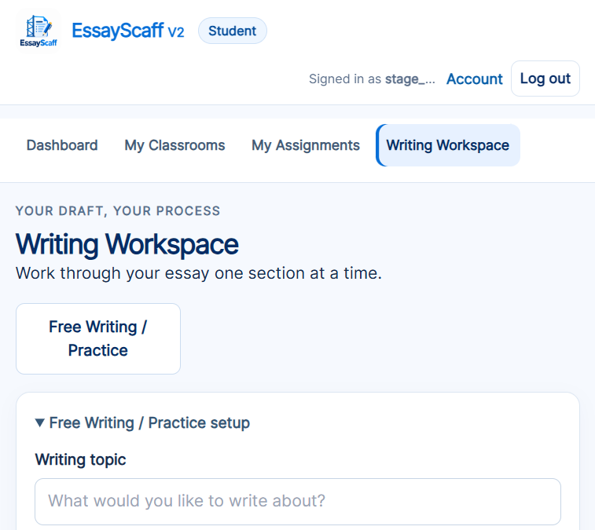
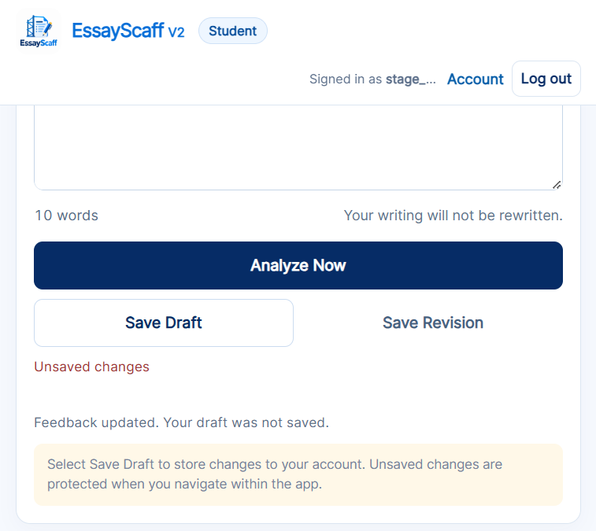
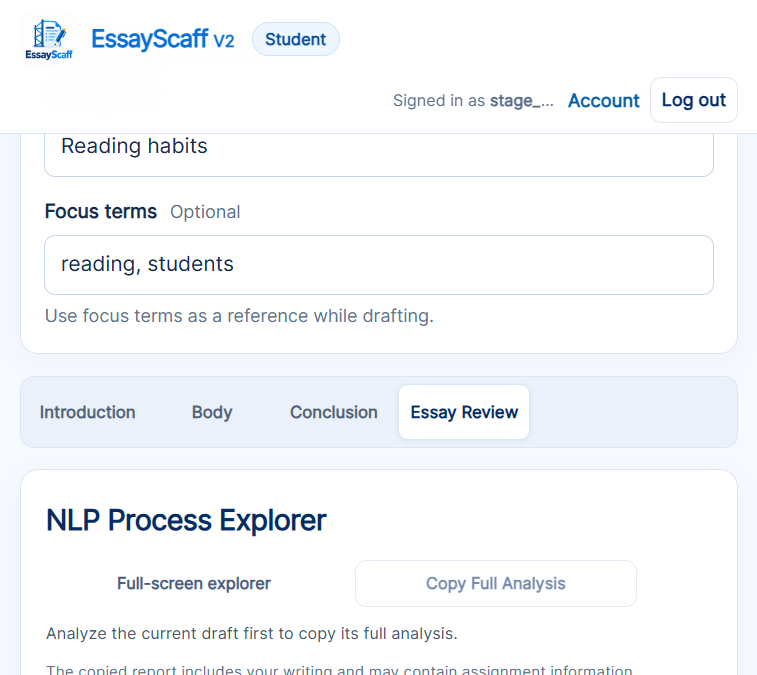
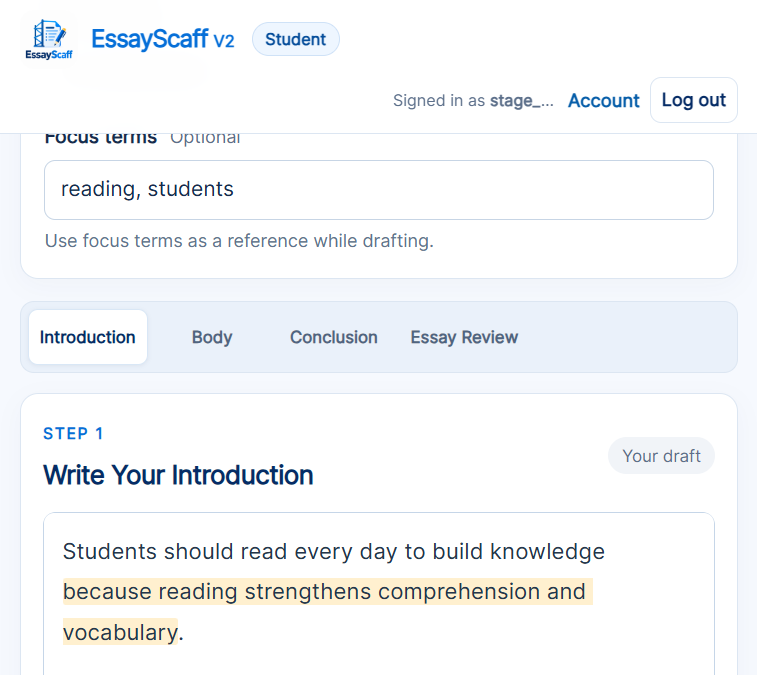

# Stage Progress and Continue Guidance — Implementation Report

Date: 2026-10-25
Scope: Student Writing Workspace only.

## Summary

A compact **Stage Progress** section now sits directly under the existing Writing Tutor. It reports one of three states from the current stage's recorded analysis:

- **Ready to Review Your Writing?** — no current analysis exists.
- **No Specific Writing Issue Detected** — the available checks recorded a neutral result.
- **Review Suggested** — the recorded primary feedback is a specific concern.

It reuses the existing `selectStage` navigation, never blocks progression, never saves a draft or revision, and defers to the existing freshness/invalidation behavior when the student edits analyzed text.

No new stage, readiness score, mandatory checkbox, dashboard, pop-up, progress percentage, or NLP rule was added. The 6+1 Trait Writing Tutor and Transparency Mode were not redesigned.

## Files Modified

| File | Change |
| --- | --- |
| `templates/index.html` | Added the Stage Progress section inside the feedback aside after `feedback-content` (line 190). |
| `static/style.css` | Added compact Stage Progress styling, including the amber `REVIEW_SUGGESTED` badge state (line 595). |
| `static/app.js` | Added Stage Progress state derivation, rendering, freshness checks, and button handlers (lines 6427–6551); wired updates into `displayFeedback`, `selectStage`, and `navigateAppView`. |
| `tests/test_workspace_frontend.py` | Added the Stage Progress navigation/freshness/draft-safety scenario and template assertions (line 21), plus the new DOM IDs in the Node harness. |
| `docs/stage_transition_guidance_report.md` | This report. |
| `docs/stage-progress-verification/*.png` | Chrome verification screenshots. |

No backend, NLP rule, lesson, database schema, or Transparency Mode file was changed.

## Functionality Implemented

### States and copy

| State | Title | Lead | Actions |
| --- | --- | --- | --- |
| Not analyzed | Ready to Review Your Writing? | Click Analyze Now to receive feedback, or continue when you are ready. | Continue to `{next stage}` |
| Neutral recorded result | No Specific Writing Issue Detected | The available checks did not identify a specific structural concern. | Continue to `{next stage}` |
| Specific concern | Review Suggested | EssayScaff found something you may want to review. | Review Writing, Continue to `{next stage}` |

The neutral state also shows "Review your ideas before continuing." A stale analyzed draft shows the not-analyzed title plus: "Your writing has changed since the last analysis. Analyze again to update this guidance."

### Stage navigation

- Introduction → Body
- Body → Conclusion
- Conclusion → Essay Review

The buttons call the existing `selectStage` function. That preserves in-memory drafts, stage access rules, assignment authorization, and existing navigation safeguards. Navigation is never blocked by a warning, and it does not call Save Draft or Save Revision.

### Review Writing

`Review Writing` focuses the active writing editor and scrolls it into view. It is only rendered for a specific recorded concern. Neutral results and unanalyzed drafts do not show it.

### Using recorded feedback only

Concern text and the guidance task come from the current stage's recorded tutor items and feedback decision trace (`research_trace.stages.{STAGE}.feedback_decisions`). If a paragraph index is recorded and the message does not already name it, the UI prefixes `Paragraph N:`. No warning text is invented.

Neutral results are recognized from recorded backend signals, not by guessing from warning wording:

- A `NO_SUPPORTED_CONCERN_SELECTED` role or Body selection status.
- Recorded neutral branches:
  - Introduction: `intro_ideas_point_and_reason`, `intro_ideas_review_details`
  - Body: `body_neutral_observable`
  - Conclusion: `conclusion_ideas_bring_together`, `conclusion_organization_clear_ending`, `conclusion_neutral_general`

Boilerplate limitation messages in "Needs Attention" (for example "These checks record structure and wording only…") are filtered out so they cannot turn a neutral result into a warning.

### Freshness

The section only treats an analysis as current when:

- The result belongs to the current stage and is `ANALYZED`.
- The recorded analysis snapshot matches the current inputs.
- The editor text matches the stored draft.
- No existing tutor stale flag is set.

Editing the draft already deletes the stage analysis through `invalidateAnalysesFor`, so the section falls back to the not-analyzed state and explains that the writing changed. After a new analysis it returns to the recorded neutral/concern state. In live Chrome use, the existing debounced auto-analysis may refresh the result quickly; the stale message is transient because that is existing app behavior.

## Automated Verification

Baseline before edits:

```text
682 passed in 204.02s
```

After implementation:

```text
683 passed in 117.57s
```

New test: `tests/test_workspace_frontend.py::test_stage_progress_guidance_navigation_freshness_and_draft_safety`

It uses real `EssayAnalysisService` payloads and verifies:

1. Introduction → Body navigation through the Stage Progress button.
2. The next-stage label changes correctly at each stage.
3. Review Writing focuses and scrolls the active editor.
4. Neutral Introduction and Body results do not create warnings.
5. The Body paragraph-2 concern shows the recorded message and task.
6. The Conclusion concern shows its recorded message and task.
7. Body → Conclusion and Conclusion → Essay Review navigation.
8. Editing analyzed text produces the stale callout and hides Review Writing.
9. Unsaved Introduction/Body drafts survive navigation and appear in Essay Review.
10. Revision and persistence writes stay at zero; no draft or revision is saved by navigation.

The full suite also continues to cover the existing Writing Tutor, 6+1 trait presentation, Transparency Mode, and NLP decision tests.

## Chrome Verification

Method: started the Flask app locally, registered a local verification student (`stage_progress_verify`), used the real UI and real `/api/analyze-stage` responses. No database migration was run. No console errors or warnings were recorded.

| Check | Result |
| --- | --- |
| Not analyzed state before any analysis | Passed — title, lead, badge "Before Body", Continue to Body. |
| Neutral Introduction result | Passed — "No Specific Writing Issue Detected"; Review Writing hidden. |
| Specific Body concern (Paragraph 2) | Passed — recorded paragraph-2 message and recorded activity/example/explanation task; Review Writing visible. |
| Review Writing focus | Passed — `document.activeElement` was the editor after clicking. |
| Edit after analysis | Passed — immediately after input, title returned to "Ready to Review Your Writing?" and the stale message appeared; Review Writing hidden. Existing debounced analysis then refreshed the result. |
| Body → Conclusion | Passed — Continue changed to "Continue to Essay Review". |
| Conclusion concern | Passed — recorded new-idea-words message/task shown. |
| Conclusion → Essay Review | Passed — read-only Essay Review opened; Stage Progress hidden. |
| Unsaved draft preservation | Passed — Introduction, Body (including appended edits), and Conclusion text all present in Essay Review and after returning to Introduction. |
| Revision count | Passed — revision list remained empty ("Save a revision to begin your history."); save status stayed "Unsaved changes". |
| Existing Tutor / Transparency Mode | Passed — Writing Tutor and NLP Process Explorer rendered and updated normally throughout. |

### Screenshots











## Remaining Limitations

- Neutral classification depends on explicit recorded branch lists. If backend branches are renamed or new neutral branches are added, the list in `static/app.js` must be updated; otherwise a neutral result could be labeled as a concern.
- Guidance is derived from the current primary tutor item and decision trace. It does not aggregate or rank multiple concerns.
- If the backend records no paragraph index (for example the Conclusion new-wording branch), the UI shows the message without a `Paragraph N:` prefix.
- In live use, debounced auto-analysis can refresh a stale result within a second or two. The stale notice is therefore brief; this uses the existing freshness behavior and does not change it.
- The Chrome run created a local verification student account. This is application data only; no schema migration was performed.
- No commit, push, deploy, database migration, or unrelated feature change was made.
