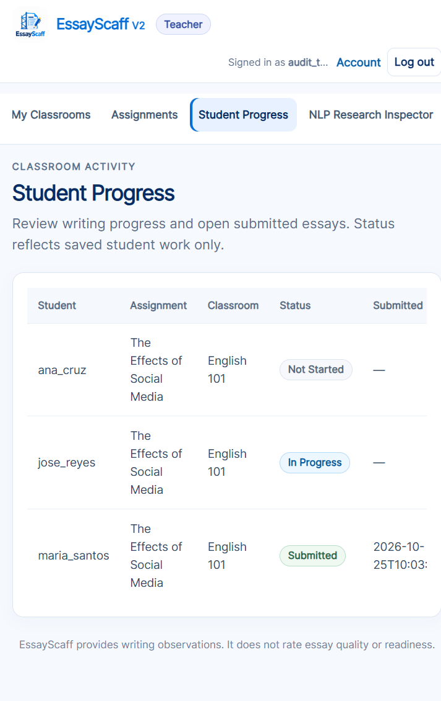
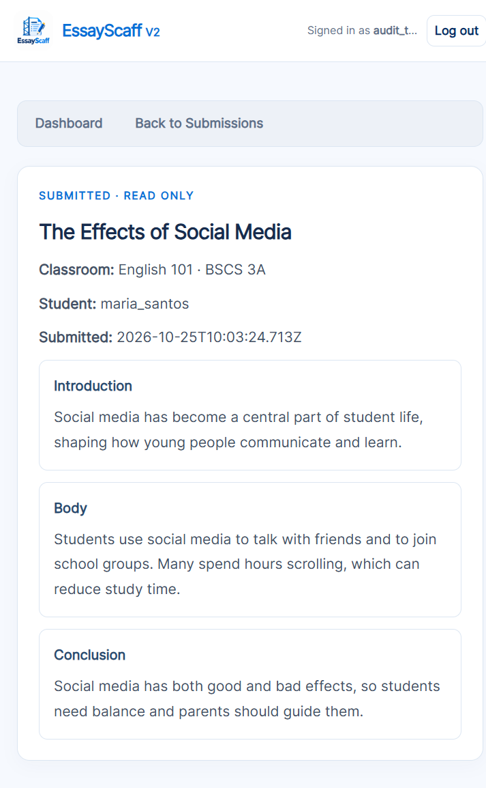
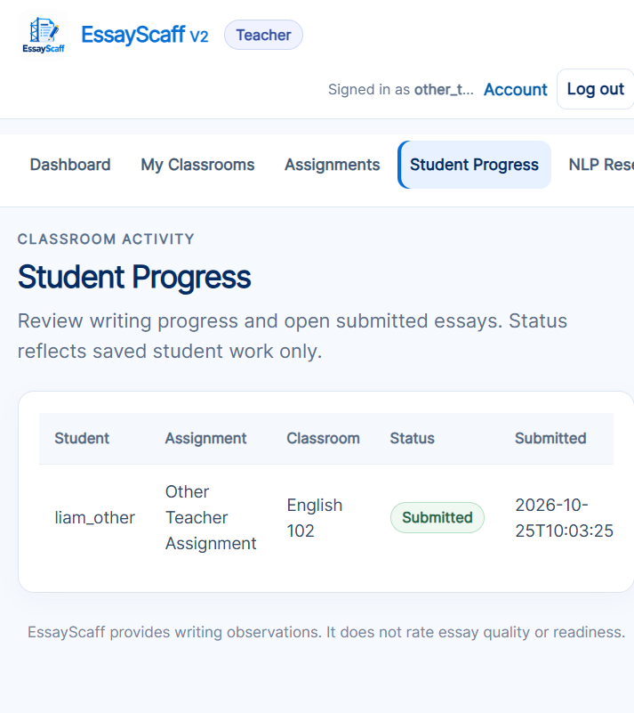
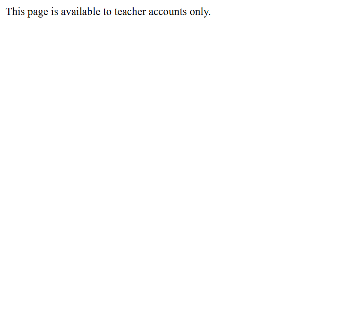

# EssayScaff V2 — Student Progress Monitoring Audit

**Phase:** 1 — Existing system audit (inspection only)
**Date:** 2026-10-25
**Scope:** Teacher Student Progress page, student writing activity, drafts/revisions, essay-stage progress, NLP feedback history, writing-time tracking.
**Method:** Source inspection, controlled Flask test-client runs against throwaway SQLite databases, current full pytest suite, and a Chrome walkthrough of the teacher page using an isolated seeded database.

**Constraints honored:** no NLP algorithm changes, no feedback changes, no dashboard redesign, no new dashboards/graphs/AI features, no writing-difficulty score, no migrations, no changes to real student records, no commits/pushes/deploys, no Adaptive Scaffolding, and no implementation changes during this phase.

---

## 1. Executive summary

| Area | Status | What actually exists |
|---|---|---|
| Teacher Student Progress page | **PARTIAL** | Real server-rendered page with per-student/per-assignment status (`Not Started`, `In Progress`, `Submitted`), submission timestamp, and link to the submitted essay. Teacher isolation is enforced. No writing time, revision count, stage progress, or concern history. |
| Student writing activity | **PARTIAL** | Draft text, revisions, and submissions are persisted per student and assignment. There is no activity log, session duration, or event history. |
| Draft and revision saving | **IMPLEMENTED** | Autosaved current draft; manual immutable full-essay revisions; sequential numbering; identical consecutive saves deduplicated; owner- and assignment-scoped. |
| Essay-stage progress | **PARTIAL** | Introduction/Body/Conclusion text is stored separately in `writing_sessions`, so content presence is observable. No stage completion/status is persisted or reported to teachers. The student-side Stage Progress panel is derived from the current in-memory analysis and is not saved. |
| NLP feedback history | **NOT IMPLEMENTED** | Analyses are returned by the API and cached only in browser memory. No feedback, concern, rule ID, or analysis result is stored in the database or attached to a revision. |
| Writing-time tracking | **NOT IMPLEMENTED** | No active-time, idle-time, visibility, or per-stage timing fields or code. Timestamps are creation/update/save/submission clocks only and cannot be converted into active writing minutes. |
| Revision monitoring for teachers | **PARTIAL** | Revision rows exist and are accurate for the student, but no teacher route, view, or count exposes them. Counts are per writing session, not per stage. |
| Recurring writing concerns | **NOT IMPLEMENTED** | There is no historical concern record, so recurrence and later non-selection cannot be established. |

**Confirmed defect status:** no data-integrity, ownership, authorization, or revision-deduplication defect was found. The confirmed problems are missing reporting data and missing instrumentation, not corrupt persistence.

---

## 2. Actual source map

### 2.1 Persistence (`services/draft_store.py`)

Schema is created in `DraftStore.__init__`:

| Table | Definition line | Relevant fields |
|---|---|---|
| `users` | `services/draft_store.py:63` | `user_id`, `username`, `password_hash`, `role`, `created_at` |
| `classrooms` | `services/draft_store.py:74` | `classroom_id`, `teacher_user_id`, `classroom_name`, `subject`, `section`, `enrollment_code`, `created_at` |
| `assignments` | `services/draft_store.py:87` | `assignment_id`, `teacher_user_id`, `classroom_id`, `title`, `topic`, `instructions`, `focus_terms`, `created_at`, `deleted_at` |
| `classroom_enrollments` | `services/draft_store.py:112` | `classroom_id`, `student_user_id`, `enrolled_at` |
| `writing_sessions` | `services/draft_store.py:125` | `session_id`, `user_id`, `assignment_id`, `assignment_topic`, `focus_terms`, `introduction_text`, `body_text`, `conclusion_text`, `created_at`, `updated_at` |
| `writing_revisions` | `services/draft_store.py:163` | `revision_id`, `session_id`, `revision_number`, `assignment_topic`, `focus_terms`, `introduction_text`, `body_text`, `conclusion_text`, `created_at`, unique `(session_id, revision_number)` |
| `submissions` | `services/draft_store.py:186` | `submission_id`, `student_user_id`, `assignment_id`, `session_id`, three stage snapshots, `submitted_at`, unique `(student_user_id, assignment_id)` |

There is **no** table or column for duration, active time, idle time, tab visibility, per-stage status, analysis results, feedback decisions, rule IDs, or concerns. A runtime `PRAGMA table_info` audit of all seven tables returned an empty set for keywords such as `duration`, `time_spent`, `active`, `idle`, `visibility`, `minute`, `second`, `concern`, `feedback`, `analysis`, `stage_status`, and `progress`.

Default database path: `app.py:90` → `instance/essay_scaff_drafts.sqlite3`. This audit did not write to it.

### 2.2 Routes and authorization (`app.py`)

| Route / function | Line | Behavior |
|---|---|---|
| `before_request` role gate | `app.py:137-199` | Requires a logged-in account; student-only and teacher-only endpoint sets; returns 403 for the wrong role. |
| `GET /teacher` — `teacher_dashboard` | `app.py:356-446` | Loads only the logged-in teacher’s classrooms, assignments, students, and submissions. |
| `POST /api/submissions` | `app.py:812` | Student submission creation. |
| `GET /api/submissions/<assignment_id>` | `app.py:855` | Student’s own submission. |
| `GET /teacher/assignments/<id>/submissions` | `app.py:868` | Teacher-owned assignment submissions. |
| `GET /teacher/submissions/<id>` | `app.py:893` | Teacher-owned submitted essay view. |
| `POST /api/analyze-stage` | `app.py:920-935` | Computes Introduction/Body/Conclusion analysis; no database write. |
| `POST /api/drafts` | `app.py:951-1009` | Saves the current draft; does not create a revision. |
| `GET /api/drafts` | `app.py:1011` | Restores the current draft. |
| `POST /api/revisions` | `app.py:1027-1088` | Creates/deduplicates a saved revision. |
| `GET /api/revisions` | `app.py:1090-1104` | Lists the session owner’s revision numbers/timestamps. |
| `GET /api/revisions/<revision_id>` | `app.py:1106-1124` | Reads one owner-scoped revision. |
| `analyze_payload` | `app.py:1178` | Builds analysis response only. |

### 2.3 Teacher UI

| File | Line | Content |
|---|---|---|
| `templates/teacher.html` | `:33` | Student Progress navigation link (`data-teacher-link="progress"`). |
| `templates/teacher.html` | `:59` | Dashboard summary table: Student, Assignment, Classroom, Status. |
| `templates/teacher.html` | `:106-108` | Full Student Progress view: Student, Assignment, Classroom, Status, Submitted, Essay. |
| `templates/teacher_submissions.html` | `:41` | Assignment submission list: Student, Status, Submitted At, Action. |
| `templates/teacher_submission.html` | `:34` onward | Read-only student/classroom/submitted metadata and three stage snapshots. |

### 2.4 Student UI and analysis cache

| File | Line | Content |
|---|---|---|
| `static/app.js` | `:140-153` | In-memory `state` including `analyses: {}` and `analysisSnapshots: {}`. |
| `static/app.js` | `:6949-6999` | `saveRevision()` posts to `/api/revisions` and reports unchanged saves. |
| `static/app.js` | `:7001-7037` | `loadRevisionHistory()` reads `/api/revisions`. |
| `static/app.js` | `:7039-7064` | `viewRevision()` reads a saved revision (text only). |
| `static/app.js` | `:7221-7222` | Analysis responses stored only in the in-memory caches. |
| `static/app.js` | `:6615-6617` | Editing invalidates and deletes the in-memory analysis for the affected stage. |

No timing instrumentation exists in `static/app.js`: no `visibilitychange`, `document.hidden`, idle timer, blur/focus activity accumulation, or per-stage duration. The only `Date.now()` uses are a transparency-panel focus guard and click deduplication, not writing time.

---

## 3. Feature findings

### 3.1 Teacher Student Progress page — **PARTIAL**

**What it does**
- `teacher_dashboard` loads the teacher’s own classrooms (`app.py:360`), students (`:366`), and assignments (`:370`), then calls `assignment_progress` and `list_teacher_submissions` (`:374`, `:377`).
- It flattens those into `student_progress` rows containing only `username`, `assignment_title`, `classroom_name`, `status`, `submitted_at`, and `submission_id` (`app.py:390-401`).
- `assignment_progress` (`services/draft_store.py:766-794`) returns exactly three states:
  - `Submitted` when a submission row exists;
  - `Not Started` when no session exists or all three stage texts are blank;
  - `In Progress` otherwise.
- The full progress view (`templates/teacher.html:106-108`) displays those fields only. For an in-progress or not-started row, Submitted and Essay are `—`.

**Verified behavior (Chrome, isolated data)**
- `ana_cruz` → Not Started; `jose_reyes` → In Progress; `maria_santos` → Submitted with the real submission timestamp and a View Essay link.
- `other_teacher` saw only `liam_other` / `Other Teacher Assignment`; no audit-teacher data appeared.
- A student account requesting `/teacher` received the 403 message “This page is available to teacher accounts only.”

**What it does not do**
- No per-stage (Introduction/Body/Conclusion) status.
- No writing time or active-time estimate.
- No saved revision count.
- No concern/feedback history.
- It does not show draft text itself.

**Data sufficiency:** the page accurately reports the only states the database can currently prove. It cannot support time, concern, or stage-progress claims.

### 3.2 Student writing activity — **PARTIAL**

**What is recorded**
- A writing session is created per student and assignment by `get_or_create_assignment_workspace` (`services/draft_store.py:977`) and holds the three stage texts.
- Current draft saves update that row (`save`, `services/draft_store.py:220`; route `app.py:951`).
- Revisions create immutable full-essay snapshots (`save_revision`, `:1037`).
- Submissions snapshot the latest saved draft (`create_submission`, `:1174`).

**What is not recorded**
- No event log, login activity, edit count, keystrokes, focus/blur events, or timeline.
- `writing_sessions.created_at` and `updated_at` are save clocks, not activity durations. A session left open for two days and edited for five minutes is indistinguishable from one written continuously for two days.

**Teacher visibility:** the teacher sees only overall status and submission metadata. Draft text and activity details are not exposed.

### 3.3 Draft and revision saving — **IMPLEMENTED**

**Verified behavior**
- Autosave via `/api/drafts` changed the draft and created **zero** revisions.
- First saved revision → revision 1.
- An identical consecutive save → `created: false`, same revision ID, no new row.
- A changed save → revision 2.
- Changing **only** the Introduction still produced a new **full-essay** snapshot containing all three stage fields.
- Revision history survived a logout and a fresh login: revisions `[2, 1]` were returned.
- A second student received 404 for both listing and viewing the first student’s revision.
- A teacher received 403 for both listing and posting revisions.
- Revision view returns only text/metadata keys; it contains no `analysis`, `feedback`, or `concerns` field.
- Existing automated tests cover numbering, consecutive deduplication, Unicode/all-stage snapshots, rollback, concurrency, API validation, and owner scoping in `tests/test_draft_revisions.py` (e.g. `:54`, `:80`, `:93`, `:116`, `:136`).

**Important limits**
- Revisions are per writing session, not per stage. A count cannot be attributed to Introduction, Body, or Conclusion without new per-stage persistence.
- Analyze Now is not a revision and does not change revision counts (verified: 0 revision rows created and unchanged session `updated_at`).
- Teacher revision counts are not available anywhere in the UI or API.

### 3.4 Essay-stage progress — **PARTIAL**

- The three stage texts are stored independently, and the student workspace navigates between them.
- The teacher page does not inspect which stages are non-empty; “In Progress” is triggered by any non-blank stage text.
- The previously built student-facing Stage Progress panel is generated from the **current** analysis held in `state.analyses`; it is not persisted, so it disappears on refresh and is not available to teachers.
- Therefore: content presence is available from existing data; stage completion, stage-level revision counts, and stage-level “progress” are not.

### 3.5 NLP feedback and writing-concern history — **NOT IMPLEMENTED**

- `/api/analyze-stage` (`app.py:920`) calls `analyze_payload` (`:1178`) and returns an analysis result. It performs no `DraftStore` write.
- The controlled call returned keys `analysis`, `availability`, `feedback`, `interpretation_limit`, `related_topic_concept_evidence`, and `stage_id`, but created 0 revisions and did not touch the session timestamp.
- On the client, results live only in `state.analyses` / `state.analysisSnapshots` (`static/app.js:152-153`, `:7221-7222`) and are deleted when the stage text changes (`:6615-6617`).
- There is no feedback/concern table, no foreign key to a revision, and no API to query past feedback.

**Consequences for the audit questions**
- A specific selected rule-based concern cannot be tied to a stage and saved version.
- Recurrence across revisions cannot be established.
- A concern that is absent from a later analysis cannot be treated as resolved; the later analysis may simply have selected a different primary concern.
- Current feedback must not be presented as historical feedback, and disappearance of a concern must not be presented as writing improvement.

### 3.6 Writing-time tracking — **NOT IMPLEMENTED**

Required behavior vs. actual behavior:

| Required criterion | Actual |
|---|---|
| Separate active time for Introduction, Body, Conclusion | No timing fields or timers. |
| Starts on actual editing | No edit-event tracking. |
| Pauses on inactivity | No idle detection. |
| Excludes time away from the browser tab | No `visibilitychange`/hidden-tab handling. |
| Continues across sessions | No accumulated duration; only per-row timestamps. |
| Correctly tied to student and assignment | Sessions/revisions are correctly scoped, but there is no time value to tie. |
| Active time distinguished from elapsed browser time | Not possible: `created_at`/`updated_at` are save clocks. |

**Conclusion:** writing time must be reported as **NOT IMPLEMENTED**. Elapsed timestamp differences must not be converted into “minutes spent writing.”

---

## 4. Task-by-task verification matrices

### 4.1 Writing time (Task 2)

All timing criteria: **NOT IMPLEMENTED**. No per-stage timing, no start-on-edit, no inactivity pause, no hidden-tab exclusion, no cross-session accumulation, and no active-vs-elapsed distinction. Session ownership and assignment linkage are correct for the underlying text/revisions, but this does not constitute timing.

### 4.2 Revisions (Task 3)

| Criterion | Status | Evidence |
|---|---|---|
| Actual saved revisions | IMPLEMENTED | Revision rows and `revision_number` are real and persisted. |
| Per-stage counts | NOT IMPLEMENTED | Revisions store full-essay snapshots; there is no stage attribution. |
| Unchanged saves excluded | IMPLEMENTED | Identical consecutive save returned `created: false`; no new row. |
| Analyze Now not counted | IMPLEMENTED | Analysis call created 0 revisions and did not change the session timestamp. |
| Persists after logout/refresh | IMPLEMENTED | History returned `[2, 1]` after logout and fresh login; rows are stored in SQLite. |
| Correct student/assignment association | IMPLEMENTED | Session ownership and assignment are enforced; foreign student gets 404. |
| Teacher availability | NOT IMPLEMENTED | Teacher GET/POST revision endpoints return 403; no teacher revision UI. |

### 4.3 Concern history (Task 4)

| Criterion | Status |
|---|---|
| Specific selected concern tied to stage and saved version | NOT IMPLEMENTED |
| Recurrence across saved versions | NOT IMPLEMENTED |
| Later non-selection recorded as history | NOT IMPLEMENTED |
| Current feedback treated as historical | Prevented: no history exists; current feedback is in-memory only |
| Claim of improvement from a disappeared concern | Not supported and must not be made |

### 4.4 Teacher Student Progress page (Task 5)

| Check | Result |
|---|---|
| Authorized students only | PASS — enrolled students only; teacher scoping in SQL |
| Assigned tasks shown | PASS — assignment title and classroom shown |
| Introduction/Body/Conclusion progress | NOT AVAILABLE — only overall status |
| Actual recorded writing time | NOT AVAILABLE — no time data |
| Saved revision counts | NOT AVAILABLE — no UI/API |
| Available concern history | NOT AVAILABLE — no persistence |
| Submission/completion status | PASS — Submitted / In Progress / Not Started |
| Teacher isolation | PASS — second teacher saw only their own student/assignment |
| Student denied teacher page | PASS — 403 with teacher-only message |

### 4.5 Screenshots (Chrome, isolated database)

Teacher Student Progress view (current implementation):



Submitted essay view (read-only stage snapshots; no time, revisions, or concerns):



Teacher isolation (a different teacher sees only their own class):



Student denied access to the teacher page:



The Chrome run used a throwaway SQLite database seeded with fictional users (`audit_teacher`, `other_teacher`, `maria_santos`, `jose_reyes`, `ana_cruz`, `liam_other`) on `127.0.0.1:5099`. The real `instance/essay_scaff_drafts.sqlite3` was not modified.

---

## 5. Current test suite result

Command run from the project root:

```text
PYTHONIOENCODING=utf-8 .venv/Scripts/python.exe -m pytest -q
```

Actual result on 2026-10-25:

```text
683 passed in 126.59s (0:02:06)
```

No assertions were weakened and no test data was manufactured. Existing coverage confirms revision numbering/deduplication/rollback/concurrency, teacher/student authorization, teacher A/B isolation, role-specific view shells, and submission visibility. Existing coverage does **not** assert writing time, per-stage progress, teacher revision counts, or concern history, because those features do not exist.

---

## 6. Does existing data support accurate teacher reporting?

| Desired teacher report | Supported by existing data? | Notes |
|---|---|---|
| Overall status (Not Started / In Progress / Submitted) | Yes | Already implemented and accurate. |
| Submission timestamp and essay | Yes | Already implemented. |
| Saved revision count per assignment | Yes, from `writing_revisions` joined via `writing_sessions` | Not currently exposed. Must be presented as total saved revisions, not per stage. |
| Which stage texts have content | Yes, from `writing_sessions` columns | Can show “has saved text” per stage; this is not completion or quality. |
| Per-stage revision counts | No | A revision is a whole-essay snapshot; stage attribution is not stored. |
| Active writing time (overall or per stage) | No | No timers, idle handling, visibility handling, or duration fields. |
| Concern history / recurrence | No | Analyses are transient client state. |

Existing historical rows cannot retroactively supply active time, per-stage revision counts, or concern history. Adding those later requires new instrumentation/persistence, not a recomputation over old timestamps.

---

## 7. Confirmed problems

1. **No teacher-visible revision count.** The data exists but there is no route or UI, and no test covers teacher revision reporting.
2. **No stage-level progress.** The teacher sees one overall status; stage text presence is available but unused.
3. **No writing-time instrumentation.** All timing criteria are unmet; timestamps cannot substitute.
4. **No concern history.** Current analysis cannot be audited, compared across revisions, or tied to a saved version.
5. **Revision data is not per stage.** This constrains any future “revisions per stage” report.
6. **Minor presentation issue:** `submitted_at` is displayed as a raw ISO timestamp (e.g. `2026-10-25T10:03:24.713Z`) rather than a localized date/time. This is cosmetic, not a data defect.

No authorization bypass, cross-teacher leak, revision corruption, duplicate-numbering failure, or real-record modification was found.

---

## 8. Smallest changes and prioritized plan (not implemented in this phase)

### Essential, no schema change

1. **Expose the existing saved revision count to the teacher** for each student/assignment, using `writing_revisions` joined through `writing_sessions`. Label it “Saved revisions” and state that it counts manual revisions, excludes unchanged saves, and is not per stage.
2. **Expose per-stage text presence** from `writing_sessions` (Introduction / Body / Conclusion: saved text or no saved text). Label it content presence, not completion, quality, or time.
3. **Keep overall status and submission behavior unchanged**, and preserve the existing teacher/student authorization checks.

### Requires new persistence/instrumentation — do not fake with timestamps

4. **Concern history:** store the selected concern with its stage, rule identifier, and associated session/revision, and keep prior selections queryable. This requires a schema change and a decision about whether students can see the history. It must not alter the current NLP rules or the six-trait feedback.
5. **Active writing time:** add explicit edit-event tracking with an inactivity threshold, hidden-tab exclusion, cross-session accumulation, and per-stage attribution. This also requires a schema change and must be validated against real behavior before any teacher-facing display.
6. **Per-stage revision counts:** only after deciding whether a revision should be attributed to a single stage or to all changed stages. The current whole-essay snapshot model cannot answer this question by itself.

### Explicit non-actions

- Do not derive minutes from `created_at`/`updated_at`/`submitted_at`.
- Do not count Analyze Now as a revision or as writing activity.
- Do not infer improvement from a concern disappearing.
- Do not expose current analysis as past feedback.

---

## 9. Stop point

This audit stops here. No application code, templates, styles, NLP rules, feedback behavior, database schema, or real student records were changed. No migration, commit, push, or deployment was performed.
