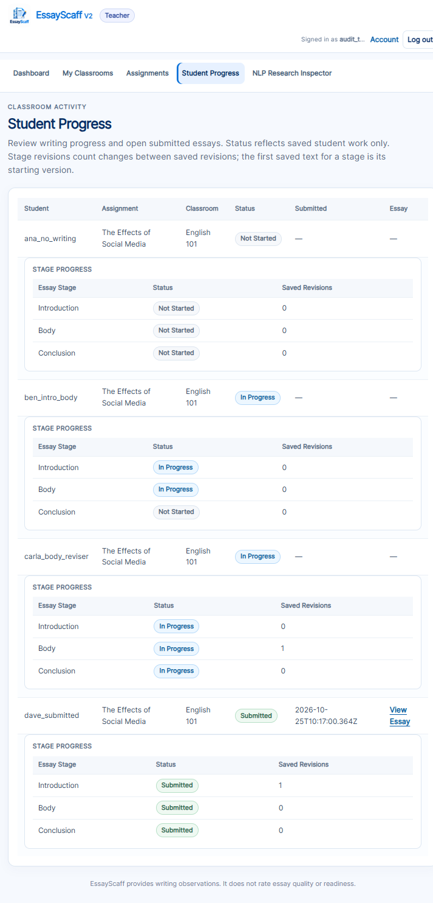
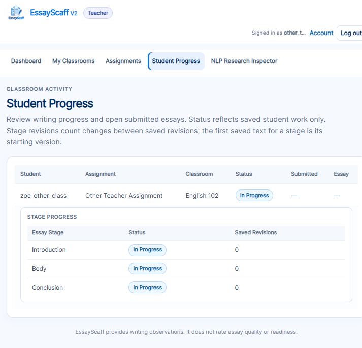

# EssayScaff V2 — Student Progress Monitoring, Phase 2 Report

**Phase:** Stage status and per-stage revision counts
**Date:** 2026-10-25
**Scope:** Extend the existing Teacher Student Progress page using only persisted student records.
**Result:** Implemented, tested, and verified in Chrome. Full suite: **690 passed**.

---

## 1. Outcome

The existing Teacher Student Progress page now includes, for each student/assignment row, a compact stage table:

| Essay Stage | Status | Saved Revisions |
|---|---|---|
| Introduction | Actual status | Actual count |
| Body | Actual status | Actual count |
| Conclusion | Actual status | Actual count |

The existing overall status, submission timestamp, and View Essay link remain unchanged. No new page, dashboard, graph, score, database table, or migration was added. No NLP or feedback code was changed.

---

## 2. Source files changed

| File | Change |
|---|---|
| `services/draft_store.py` | Added `STAGE_PROGRESS_FIELDS`; extended `assignment_progress()` to derive stage status and per-stage revision counts; added `_stage_status()` and `_stage_revision_counts()`. |
| `app.py` | Passes the derived `stages` data into `student_progress` rows in both the normal teacher page path and the existing error-render path. |
| `templates/teacher.html` | Added the compact stage table beneath each student progress row. |
| `static/style.css` | Added small inset-table styles consistent with the existing table design. |
| `tests/test_student_progress.py` | Added 7 controlled tests covering statuses, counts, deduplication, Analyze Now, autosave, logout persistence, submissions, authorization, and unavailable history. |
| `docs/student_progress_phase2_report.md` | This report. |

Relevant locations:

- `services/draft_store.py:773` — `assignment_progress`
- `services/draft_store.py:863` — `_stage_status`
- `services/draft_store.py:869` — `_stage_revision_counts`
- `app.py:398`, `app.py:661` — stage data added to teacher page rows
- `templates/teacher.html:108` — stage table markup
- `static/style.css:734-738` — stage table styling
- `static/app.js:6545-6548` — Continue action calls `selectStage()` only; it performs no save or analysis request

---

## 3. Canonical saved records

The feature uses only records that are already persisted:

| Purpose | Record |
|---|---|
| Current saved stage text (not submitted) | `writing_sessions.introduction_text`, `body_text`, `conclusion_text` |
| Submitted stage text | `submissions.introduction_snapshot`, `body_snapshot`, `conclusion_snapshot` |
| Saved revision snapshots | `writing_revisions`, ordered by `revision_number` within the student’s writing session |
| Overall submission status | Existing `submissions`/`writing_sessions` logic in `assignment_progress()` |
| Student/teacher assignment scope | `classroom_enrollments`, `assignments.classroom_id`, `classrooms.teacher_user_id` |

Unsaved browser text is not in the database and is not used. Analyze Now does not save or create a revision. Continue to Next Stage only changes the student’s current client view.

No new teacher API was added. The existing page remains server-rendered, and the HTML exposes only the three stage names, statuses, and counts—not raw draft text or revision history.

---

## 4. Stage status definition

For each stage, independently:

| Condition | Status |
|---|---|
| Essay submitted and the submitted snapshot for the stage has non-blank text | **Submitted** |
| Essay submitted but the submitted snapshot for the stage is blank | **Not Started** (defensive; normal submission requires all three stages) |
| Not submitted and the saved session text for the stage has non-blank text | **In Progress** |
| Not submitted and the saved session text is blank, or no session/missing record exists | **Not Started** |

The overall assignment status remains the existing `Not Started` / `In Progress` / `Submitted` value. Stage statuses describe saved content presence only. They are not writing-quality judgments, readiness judgments, or claims that an NLP rule was satisfied.

Submitted essays use the submission snapshots, so the displayed stage statuses match what the teacher can open in the read-only submitted essay view.

---

## 5. Exact revision-counting definition

1. Resolve the teacher-authorized assignment and its currently enrolled students.
2. For each student, load that student’s writing session for the assignment.
3. Load `writing_revisions` for that session ordered by `revision_number` ascending.
4. If the revision numbers are not exactly `1..N` (a gap or missing first revision), show **Unavailable** for all three stages instead of inventing a count.
5. If there are no revision rows, the count is **0** saved revisions. This is a known absence of revision snapshots, not missing history.
6. For each stage independently, iterate the saved revision snapshots:
   - Whitespace-only text is treated as empty.
   - The first non-empty text for that stage is the **initial saved version** and is **not counted**.
   - A later revision whose stage text differs from the previous revision’s text for that stage adds **1**.
   - Clearing a previously saved stage adds **1** (it is a persisted change).
   - An unchanged stage never gains a count because another stage changed.
7. Counts are based only on manual **Save Revision** snapshots:
   - Save Draft / autosave does not create a revision and is not counted.
   - Analyze Now does not create a revision and is not counted.
   - Continue to Next Stage does not save and is not counted.
   - An unchanged Save Revision is deduplicated by the existing store and is not counted.
   - Submission is not converted into a revision snapshot for counting.
8. Counts indicate recorded stage-text changes only. They do not indicate improvement, quality, or effort.

Example: if revision 1 contains Introduction A and revision 2 contains Introduction B with the same Body, Introduction gets 1 and Body gets 0. If the Conclusion first appears in revision 2, the Conclusion's first saved version is initial and gets 0.

---

## 6. Controlled test evidence

New file: `tests/test_student_progress.py` (7 tests).

Required scenarios covered:

| Required scenario | Coverage |
|---|---|
| No saved writing | `ana_no_writing`: all stages Not Started, counts 0 |
| Introduction only | `intro_only`: Introduction In Progress; Body/Conclusion Not Started |
| Introduction and Body | `intro_body`: Introduction/Body In Progress; Conclusion Not Started |
| All three stages | `all_three`: all In Progress |
| Submitted essay | `submitted`: all stage statuses Submitted; overall status Submitted |
| Revised only Body | `body_reviser`: Body 1, Introduction 0, Conclusion 0 |
| Introduction and Body in different saves | `staged_reviser`: Introduction 1, Body 1, Conclusion 0 |
| Analyze Now without saving | `analyser`: analysis returned 200, revision count unchanged, saved text unchanged |
| Unchanged writing | Duplicate Save Revision returned `created: false`, same revision ID, no new row |
| Return after logout | `returning_writer`: history persisted, later Introduction change counted 1 |
| Teacher viewing authorized student | Teacher A sees student A's stage table |
| Teacher attempting unauthorized student | Teacher B sees no student A data; direct scoped query returns `[]` |
| Student accessing teacher-only progress | `GET /teacher` returns 403 |

Sample comparisons from actual tests:

```text
body_reviser
  R1: Introduction A | Body A | Conclusion empty
  R2: Introduction A | Body B | Conclusion empty
  Counts: Introduction 0, Body 1, Conclusion 0

staged_reviser
  R1: Introduction A | Body A | Conclusion empty
  R2: Introduction B | Body A | Conclusion empty
  R3: Introduction B | Body B | Conclusion empty
  R4: Introduction B | Body B | Conclusion C
  Counts: Introduction 1, Body 1, Conclusion 0

unchanged
  R1: Introduction A | Body A
  R2: duplicate -> created false, no new row
  R3: Introduction A | Body B
  Counts: Introduction 0, Body 1

submitted
  R1: Introduction A | Body A | Conclusion A
  R2: Introduction B | Body A | Conclusion A -> submitted
  Statuses: Submitted / Submitted / Submitted
  Counts: Introduction 1, Body 0, Conclusion 0

incomplete history
  persisted revision rows: [2] (revision 1 missing)
  Counts: Unavailable / Unavailable / Unavailable
```

Test commands and actual results:

```text
.venv/Scripts/python.exe -m pytest tests/test_student_progress.py -q
7 passed in 6.51s

.venv/Scripts/python.exe -m pytest tests/test_assignments.py tests/test_draft_revisions.py tests/test_interface_views.py tests/test_submissions.py tests/test_assignment_management.py tests/test_draft_store.py tests/test_auth.py -q
60 passed in 20.44s

.venv/Scripts/python.exe -m pytest -q
690 passed in 141.80s (0:02:21)
```

Baseline before this phase was 683 passing tests. The seven new tests account for the increase to 690. No existing tests were weakened or removed.

---

## 7. Authorization and privacy verification

- Teacher A's page contains only Teacher A's students and assignments.
- Teacher B's page contains only Teacher B's students and assignments.
- `assignment_progress(teacher_b_user_id, assignment_a_id)` returns `[]`, confirming the progress query is scoped by teacher ownership.
- A student requesting `/teacher` receives 403: “This page is available to teacher accounts only.”
- The teacher HTML does not contain the test students' draft text; only statuses and counts are rendered.
- The existing student revision endpoints remain student-only (403 for teachers), and revision views remain owner-scoped. This phase did not add a route that exposes revision text or history.

---

## 8. Chrome verification

Verified against an isolated temporary SQLite database on `http://127.0.0.1:5099` with fictional users only. The real `instance/essay_scaff_drafts.sqlite3` was not modified.

Observed teacher page values:

| Student | Overall | Introduction | Body | Conclusion |
|---|---|---|---|---|
| `ana_no_writing` | Not Started | Not Started, 0 | Not Started, 0 | Not Started, 0 |
| `ben_intro_body` | In Progress | In Progress, 0 | In Progress, 0 | Not Started, 0 |
| `carla_body_reviser` | In Progress | In Progress, 0 | In Progress, 1 | In Progress, 0 |
| `dave_submitted` | Submitted | Submitted, 1 | Submitted, 0 | Submitted, 0 |

The counts match the persisted test records. The stage table is displayed inside the existing progress table, and the existing Submitted/View Essay columns remain.



Teacher isolation check: `other_teacher` saw only `zoe_other_class` and the other teacher's assignment; no audit-teacher student or stage data appeared.



---

## 9. Remaining missing monitoring features

These remain intentionally out of scope:

- **Writing time:** no active-time, idle-time, tab-visibility, or per-stage timing instrumentation exists. Existing timestamps are save clocks and are not converted into minutes.
- **Concern history:** analyses are still transient client state; no concern, rule, or feedback record is tied to a stage/revision.
- **Stage completion semantics:** statuses reflect saved text presence and submission, not completion of a checklist or NLP rule.
- **Per-stage revision timestamps:** only counts are shown; the teacher cannot see when each stage changed.
- **Raw revision history:** not exposed to teachers; the page intentionally shows only statuses and counts.
- **Teacher progress API:** the feature remains part of the existing server-rendered teacher page.

---

## 10. Stop point

Implementation, focused tests, full regression, and Chrome verification are complete. No database migration, new table, new revision architecture, new dashboard, NLP change, feedback change, adaptive scaffolding, writing-time instrumentation, concern-history instrumentation, commit, push, or deployment was performed. Work stops here for review.
