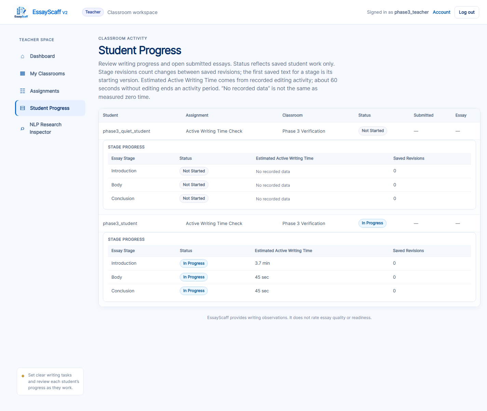
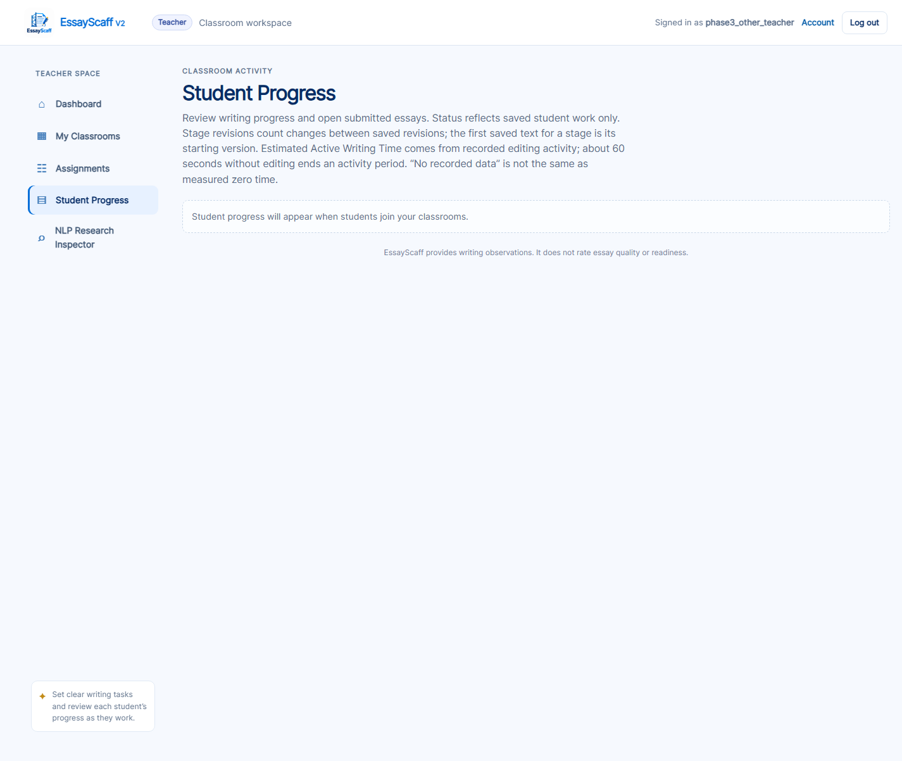

# EssayScaff V2 — Student Progress Monitoring, Phase 3 Report

**Phase:** Estimated Active Writing Time
**Date:** 2026-10-25
**Scope:** Extend the existing Teacher Student Progress page with active editing time per essay stage, recorded from real editing activity and persisted safely.
**Result:** Implemented and verified end to end in an isolated environment. Focused Phase 3 tests: **18 passed**. Complete Python regression suite: **701 passed**. The existing `instance/essay_scaff_drafts.sqlite3` database was not modified and does not contain the new table; the migration awaits explicit approval (Section 12).

---

## 1. Outcome

The existing stage table on the Teacher Student Progress page now reads:

| Essay Stage | Status | Estimated Active Writing Time | Saved Revisions |
|---|---|---|---|
| Introduction | Existing status | Recorded active seconds | Existing count |
| Body | Existing status | Recorded active seconds | Existing count |
| Conclusion | Existing status | Recorded active seconds | Existing count |

- Time is derived only from activity records written while the student edited the corresponding stage. It is not inferred from revision timestamps or essay text.
- A student with no recorded activity shows **No recorded data**, not `0`.
- The label **Estimated Active Writing Time** is used everywhere the value appears.
- No new page, dashboard, graph, score, grade, or database column on existing tables was added.
- Revision counting and stage-status rules from Phase 2 are unchanged. Time and revisions are computed independently.

Chrome evidence (isolated database) shows `3.7 min`, `45 sec`, and `45 sec` for an active student, and `No recorded data` for a student who opened the workspace but never edited.

---

## 2. Source files changed

| File | Change |
|---|---|
| `services/draft_store.py` | Added activity constants, opt-in `writing_activity` table creation, `record_writing_activity()`, activity aggregation in `assignment_progress()`, and activity cleanup during account deletion (including the deleted teacher's assignments). |
| `app.py` | Added the `ESSAYSCAFF_ENABLE_WRITING_ACTIVITY` configuration flag, enabled store creation, exposed `activity_tracking_enabled` in the workspace payload, added `POST /api/writing-activity`, and registered the endpoint in the student allow-list. |
| `static/writing_activity.js` | New client tracker: edit detection, 5-second ticks, 60-second idle grace, periodic flush, visibility/pagehide stop, stage switching, retry buffer, and multi-tab lease. |
| `static/app.js` | Wires the tracker to the existing editor, stage navigation, workspace load/close, submit, and visibility/pagehide events. |
| `templates/index.html` | Loads `writing_activity.js` before `app.js`. |
| `templates/teacher.html` | Added the `Estimated Active Writing Time` column and an explanatory sentence; no layout redesign. |
| `tests/test_writing_activity.py` | 9 controlled server tests for attribution, persistence, authorization, validation, submission lock, multi-day totals, deletion, disabled default, cross-stage bucket deduplication, and simultaneous cross-stage requests. |
| `tests/test_writing_activity_frontend.py` | 2 controlled tests: a Node fake-clock simulation of the tracker and a static audit that only editor input starts activity. |
| `tests/test_student_progress.py` | Updated the expected stage-table header and no-data label. |
| `tests/pre_defense_audit.py`, `tests/test_pre_defense_system.py` | Route audit coverage for the new activity endpoint. |
| `docs/student_progress_phase3_report.md` | This report. |
| `docs/student_progress_phase3/` | Chrome verification JSON, teacher screenshots, and teacher authorization verification. |

Relevant locations:

- `services/draft_store.py:25` — activity constants
- `services/draft_store.py:232` — opt-in table and index creation
- `services/draft_store.py:825` — `record_writing_activity`
- `services/draft_store.py:898` — `assignment_progress` activity aggregation
- `app.py:85` — tracking configuration flag
- `app.py:803` — `activity_tracking_enabled` in the workspace payload
- `app.py:1041` — `POST /api/writing-activity`
- `static/writing_activity.js:8` — client timing constants
- `static/app.js:125` — tracker creation and eligibility rules
- `static/app.js:732` — workspace configuration
- `static/app.js:6599` — stage switch ends the current period
- `static/app.js:6787` — editor `input` starts/refreshes activity
- `static/app.js:6816` — visibility and pagehide handling
- `templates/teacher.html:107-108` — help text and time column
- `templates/index.html:12` — script include

---

## 3. Definition of Estimated Active Writing Time

For each student, assignment, and stage:

> **Estimated Active Writing Time** is the sum of persisted five-second activity buckets recorded while the student was actively editing that stage in the essay editor.

Properties:

- It measures **editing activity**, not essay quality, effort, difficulty, or readiness.
- It is an **estimate** with five-second granularity and one-decimal minute display.
- It excludes page-open time, idle time beyond 60 seconds, hidden-tab time, stage navigation, and automatic saving.
- It is not derived from revision timestamps, draft `created_at`/`updated_at`, submission time, or text length.
- It is never stored as a client-supplied total. The server stores validated intervals and computes sums.
- Longer time is not labeled good or poor anywhere in the UI.

Display rules in `templates/teacher.html:108`:

| Stored value | Display |
|---|---|
| No recorded buckets for the student/assignment/stage | `No recorded data` |
| At least one bucket and total < 60 seconds | `N sec` |
| Total ≥ 60 seconds | `N.N min` (one decimal, rounded) |

There is no stored zero-second record: the database `seconds` column only accepts 1–5. Therefore the UI never presents a measured zero as if it were a real measurement; absence of records is labeled explicitly as no recorded data.

---

## 4. Exact recording rules

### 4.1 Client (student editor)

The tracker is `static/writing_activity.js`; it is created in `static/app.js:125` only when all of these are true:

- the student is in the assignment workspace view,
- an assignment is open,
- the visible editor matches the current stage,
- the essay is not submitted,
- the assignment is not deleted,
- the workspace is not restoring or submitting.

Rules:

1. **Start:** only an `input` event in the stage editor calls `noteEdit(stage)`. Opening the page, receiving focus, clicking buttons, loading a draft, analyzing, saving, or navigating never starts a period.
2. **Tick:** while a period is active, a 5-second timer records up to 5 seconds for the active stage in the bucket containing the current time. Each bucket is aligned to a multiple of 5 seconds since the Unix epoch.
3. **Thinking grace:** ticks continue while the time since the last edit is at most **60 seconds**. At more than 60 seconds without an edit, the period ends, the timer stops, and the buffer is flushed.
4. **Flush:** pending buckets are sent every 30 seconds of active tracking, when the buffer reaches 60 events, on stage change, on tab hide/pagehide, on leaving the workspace, and on submit. Requests carry at most 24 events.
5. **Hidden tab:** `visibilitychange` to hidden and `pagehide` call `leaveWorkspace()`, which ends the period, stops the timer, and flushes. Returning to a visible tab without editing records nothing.
6. **Stage switch:** `selectStage()` calls `stageChanged()`, which ends the current period and flushes pending seconds to the stage that was being edited. The new stage records nothing until it receives its own input.
7. **Refresh:** `pagehide` flushes the pending buffer; the reloaded page starts with an empty buffer but the same persisted session.
8. **Logout / navigation:** leaving the workspace ends and flushes the period. After logging back in and editing, a new period starts against the same persisted student/assignment session.
9. **Multiple tabs:** a `localStorage` lease (`essayScaffActivityWriter:<assignmentId>`, 20-second TTL, renewed on ticks) makes the most recently edited tab the writer. Another tab that does not own the lease stops and flushes. Server-side bucket uniqueness provides a second layer of deduplication.
10. **Retries:** network errors and 5xx responses are requeued (up to 240 events). A `503` disables the tracker. `400`, `403`, `404`, and `409` responses discard the affected events. Duplicate flushes are chained and the client merges identical stage/bucket keys.
11. **Not counted:** page-open time, Analyze Now clicks, automatic saves, revision saves, stage navigation, view navigation, hidden-tab time, and time beyond the 60-second grace with no editing.

One documented nuance: seconds immediately after an edit, up to the 60-second grace, are treated as a short thinking/reviewing pause by design. Analyze Now does not start or extend a period, and repeating it without editing cannot add time; however, if an analysis request happens inside the grace window after an edit, those seconds are indistinguishable from a brief pause and may be included.

### 4.2 Server validation

`POST /api/writing-activity` (`app.py:1041`) and `DraftStore.record_writing_activity()` (`services/draft_store.py:825`) enforce:

| Check | Behavior |
|---|---|
| Tracking disabled in configuration | `503`; no table is created and no records are written. |
| Authenticated role | Student-only endpoint; the user is taken from the server session, never from the payload. |
| Session ownership | `session_id` must belong to that user and assignment; otherwise `404`. |
| Assignment state | Deleted assignments and submitted essays return `409`. |
| Stage | Must be `INTRODUCTION`, `BODY`, or `CONCLUSION`; otherwise `400`. |
| Event shape | Non-empty list of objects, at most 24 events per request; otherwise `400`. |
| Bucket start | Must be an integer. The server floors it to the 5-second grid, so clients cannot create offset or duplicate bucket keys. |
| Bucket age | No older than 600 seconds and no more than 30 seconds in the future; otherwise `400`. |
| Duration | Integer from 1 to 5 seconds per bucket; `0`, `6`, `31`, booleans, and non-integers are rejected. |
| Storage failure | Logged; `500` returned. |

Persistence uses:

```sql
INSERT INTO writing_activity (...)
VALUES (...)
ON CONFLICT(user_id, assignment_id, bucket_start)
DO UPDATE SET seconds = MAX(writing_activity.seconds, excluded.seconds)
```

The conflict target deliberately excludes `stage`. A five-second interval can receive reports for more than one stage if the student switches stages inside that interval or if two tabs report the same interval for different stages. Because the conflict update changes only `seconds`, at most one row exists per student, assignment, and bucket, and the `stage` column keeps the value from the first successful insert. Retries, duplicate tab reports, refresh replays, identical requests, and cross-stage reports therefore cannot increase a bucket beyond 5 seconds.

---

## 5. Storage design and exact proposed migration

The smallest suitable change is one additive table plus one index. No existing table, column, index, or row is altered.

```sql
CREATE TABLE IF NOT EXISTS writing_activity (
    activity_id INTEGER PRIMARY KEY AUTOINCREMENT,
    user_id INTEGER NOT NULL REFERENCES users(user_id),
    assignment_id INTEGER NOT NULL REFERENCES assignments(assignment_id),
    session_id TEXT NOT NULL REFERENCES writing_sessions(session_id),
    stage TEXT NOT NULL CHECK (stage IN ('INTRODUCTION', 'BODY', 'CONCLUSION')),
    bucket_start INTEGER NOT NULL,
    seconds INTEGER NOT NULL CHECK (seconds BETWEEN 1 AND 5),
    recorded_at TEXT NOT NULL DEFAULT (strftime('%Y-%m-%dT%H:%M:%fZ', 'now')),
    UNIQUE (user_id, assignment_id, bucket_start)
);

CREATE INDEX IF NOT EXISTS writing_activity_assignment_student
ON writing_activity(assignment_id, user_id);
```

Design notes:

- The unique key is the core anti-inflation mechanism: one row per student, assignment, and five-second bucket, regardless of stage.
- `stage` is retained for per-stage reporting. When reports for different stages collide on the same bucket, the first successfully stored stage keeps the row and later stages add no time. This is acceptable because the metric is explicitly an estimate with five-second granularity.
- `seconds` is bounded at 5, so no single bucket can claim more than its real width.
- `recorded_at` records when the row was first stored, not when the student edited; totals use `seconds`, not timestamp differences.
- `session_id` ties a record to the exact writing session and is validated on every write.
- `assignment_progress()` loads activity only for the requested assignment and its enrolled students, and only when tracking is enabled.
- Account deletion removes matching activity rows—including activity for that teacher's assignments—before linked sessions/assignments, preserving referential integrity. Single-assignment deletion is a soft archive; recorded activity stays with the retained records.
- **Opt-in:** `DraftStore` creates this schema only when `ESSAYSCAFF_ENABLE_WRITING_ACTIVITY=1`. The default is disabled.

**Current real-database status:** the existing `instance/essay_scaff_drafts.sqlite3` contains the original tables and **no `writing_activity` table**. No tracking records were written to it. All implementation testing and Chrome verification used temporary databases under `%TEMP%\essayscaff_phase3_verify\`.

---

## 6. Teacher page behavior

- The stage table is still inside each existing student/assignment progress row; no new page or section was created.
- Column order is `Essay Stage | Status | Estimated Active Writing Time | Saved Revisions`.
- The help text states that the value comes from recorded editing activity, that about 60 seconds without editing ends a period, and that “No recorded data” is not the same as measured zero time.
- The page remains server-rendered and scoped by the existing classroom/assignment authorization query. There is no new teacher activity API and no student read endpoint.
- Time does not affect stage status or revision counts. A stage can be `Not Started` while having recorded time (the student typed and then cleared the saved draft), and a stage can have `In Progress` text with no recorded time (records unavailable or tracking disabled).

---

## 7. Automated tests

Command:

```bash
.venv/Scripts/python.exe -m pytest tests/test_writing_activity.py tests/test_writing_activity_frontend.py tests/test_student_progress.py -q
```

Result: **18 passed in 10.10s**.

| Test | What it proves |
|---|---|
| `test_activity_is_attributed_deduped_and_persists` | Intro/Body attribution, identical retry adds no time, Conclusion absent means no data, logout/login persistence, revision save does not alter time, teacher page shows `20 sec`, `10 sec`, `1.1 min`, and `No recorded data` for a quiet student. |
| `test_activity_is_scoped_by_student_assignment_and_role` | A student cannot write to another student's session or another assignment (`404`); a teacher cannot post activity (`403`); Teacher A sees only their assignment; Teacher B does not see A's students; an outside student gets `403` on `/teacher`; unauthorized store queries return nothing. |
| `test_activity_validation_rejects_invalid_events` | Empty lists, unknown stage, `0`/`6`/`31`/boolean seconds, stale and future buckets, and 25 events are rejected with `400`; the store also rejects invalid data when HTTP is bypassed. |
| `test_activity_stops_after_submission` | Activity is accepted before submission and rejected with `409` after submission; earlier recorded time remains visible. |
| `test_activity_store_sums_days_and_keeps_assignments_separate` | Records from two different days sum for the same assignment (15 s + 10 s = 25 s), while a second assignment's 20 s stays separate. |
| `test_account_deletion_removes_activity_before_linked_records` | Deleting a student or teacher removes matching activity rows and leaves `PRAGMA foreign_key_check` empty. |
| `test_tracking_disabled_by_default_creates_no_table` | Default configuration returns `503`, creates no table, reports `None` activity, and the teacher page still renders `No recorded data`. |
| `test_cross_stage_bucket_is_recorded_once_and_keeps_first_stage` | Introduction, Body, and Conclusion reports for the same five-second bucket produce exactly one row of 5 s; the first stage (Introduction) owns it and Body/Conclusion remain without data. Repeating Introduction adds nothing; a later bucket accumulates for Body; different students and different assignments keep independent rows. |
| `test_simultaneous_cross_stage_requests_create_one_bucket` | Two threads barrier-synchronized to record Body and Conclusion for the same bucket both complete without error, produce exactly one row of 5 s whose stage is one of the two, and leave `PRAGMA foreign_key_check` empty. |
| `test_active_writing_interval_rules_with_fake_clock` | Node simulated clock: continuous typing, sub-60-second pause, stop after 60 seconds and resume on edit, hidden tab stop/visible-return inactivity, stage-switch isolation, refresh flush, two-tab lease without duplicate buckets, duplicate flush suppression, retry without loss, and page-open-only producing zero events. |
| `test_activity_events_are_only_started_by_editor_input` | Static audit: `noteEdit` appears only in the editor `input` handler; save/revision functions do not call it; stage change, leave, and visibility hooks are present; the tracker script loads before `app.js`. |

Complete suite:

```bash
.venv/Scripts/python.exe -m pytest -q
```

Result: **701 passed in 105.87s**.

---

## 8. Chrome end-to-end verification (isolated database)

Environment:

- Flask at `http://127.0.0.1:5057` with `ESSAYSCAFF_ENABLE_WRITING_ACTIVITY=1`
- `DRAFT_DATABASE_PATH=%TEMP%\essayscaff_phase3_verify\phase3_verify.sqlite3`
- Headless Chrome over CDP with a fresh profile; real student/teacher accounts were not used.

Measured database state at each phase:

| Phase | Action | Persisted state (seconds / buckets) |
|---|---|---|
| 0 | Quiet student opens the workspace, 12 s, no edit | `{}` — 0 rows |
| A | Continuous Introduction typing (7 bursts) | Introduction 30 / 6 |
| B | 80 s without editing | Introduction 80 / 16 (+50 during the 60 s grace) |
| B2 | 12 s more idle | Introduction 80 / 16 — unchanged |
| C | Resume Introduction editing | Introduction 120 / 24 |
| D1 | Switch to Body, no edit | Introduction 120; Body absent |
| D2 | Body editing | Body 45 / 9 |
| E1 | Conclusion typing, then tab hidden | Conclusion 5 / 1 |
| E2 | 12 s hidden, then visible without edit | Conclusion 5 / 1 — unchanged |
| E3 | Visible Conclusion editing | Conclusion 40 / 8 |
| F1 | Refresh, idle | Conclusion 45 / 9 (pending 5 s flushed by pagehide); Introduction 120 / 24 |
| F2 | Introduction editing after refresh | Introduction 155 / 31 |
| G | Two tabs typing alternately | Introduction 180 / 36; 54 rows = 54 distinct buckets |
| H | Logout, login, Introduction editing | Introduction 220 / 44; 62 rows = 62 distinct buckets |
| Final | Teacher page | Introduction `3.7 min`; Body `45 sec`; Conclusion `45 sec`; quiet student `No recorded data` |

The two-tab phase added 5 new buckets (+25 s) for an overlapping 23-second editing window. Concurrent tab reports were merged into unique bucket rows; there were no duplicate rows (`rows == distinct_buckets` at every final snapshot).

Screenshots:

- 
- 

Machine-readable evidence:

- `docs/student_progress_phase3/chrome-verification.json` — phase snapshots parsed verbatim from the recorded run log, plus teacher values and authorization results.
- `docs/student_progress_phase3/teacher-verification.json` — teacher page excerpt, other-teacher isolation, and student denial.

The student workspace intentionally has no visible timer, so no workspace screenshot was added; the feature is visible only on the teacher page, and the database snapshots above are the activity evidence.

Authorization results in the same run:

- `phase3_other_teacher` opened `/teacher#progress` and saw “Student progress will appear when students join your classrooms.” with no student names.
- The student account requested `/teacher` and received **403** (“This page is available to teacher accounts only.”).

---

## 9. Controlled calculations

The displayed values are direct sums of stored buckets:

- Introduction: 44 buckets × 5 s = **220 s**; `220 / 60 = 3.666…` → **3.7 min**.
- Body: 9 buckets × 5 s = **45 s** → **45 sec** (below one minute).
- Conclusion: 9 buckets × 5 s = **45 s** → **45 sec**.
- Total database rows: 62; distinct `(student, assignment, bucket_start)` keys: 62 → no duplicates.
- Quiet student: no rows → **No recorded data**.

Idle arithmetic:

- A 60-second grace window after the last edit produced 10 additional buckets (+50 s) after the earlier snapshot, then counting stopped.
- A further 12 seconds of idle changed nothing.
- A hidden tab at 5 s stayed at 5 s for 12 seconds; returning to the tab without editing changed nothing.
- A refresh flushed the pending 5 seconds to Conclusion (40 → 45) and left Introduction at 120; the post-refresh edit added 35 seconds (155).

---

## 10. Authorization verification

- Activity writes are student-only and derive `user_id` from the authenticated session.
- The writing session must match the authenticated user and assignment; mismatches return `404` without revealing whether the session exists for someone else.
- Submitted and deleted assignments return `409`.
- Teacher data access uses the existing `assignment_progress(teacher_user_id, assignment_id)` query, which joins through `classrooms.teacher_user_id`; an unrelated teacher receives an empty result.
- The teacher page is server-rendered, so there is no client-side endpoint that returns raw activity for arbitrary students.
- Students have no activity-read endpoint.
- Automated tests cover cross-student, cross-assignment, cross-teacher, out-of-classroom, teacher-write, and student-teacher-page access.
- Chrome verification independently confirmed teacher isolation and the student `403`.

---

## 11. Limitations and interpretation guidance

1. **It is an estimate.** Values have five-second granularity and minutes are rounded to one decimal. They are not exact labor time.
2. **Thinking grace includes non-typing seconds.** Up to 60 seconds after an edit counts by design, including brief reviews. Analyze Now or automatic saving inside that window is indistinguishable from a pause; repeated Analyze Now without editing cannot add time.
3. **Input-event based.** Keyboard typing, pasting, and other edits that fire `input` count. Input methods that do not fire standard input events may be undercounted.
4. **Network loss.** Unflushed seconds are retried in memory; if the tab is closed while offline, the last few seconds may be lost. `pagehide` flushing is best-effort.
5. **Multiple tabs are best-effort last-editor-wins.** Server bucket uniqueness prevents duplicate inflation, but if two tabs write disjoint buckets while both are active, the union can still approach wall-clock time. The measured case undercounted rather than inflated.
6. **A five-second bucket that spans two stages is credited to the first recorded stage.** If the student switches stages inside a bucket, or two tabs report the same bucket for different stages, the server keeps one row of at most 5 seconds and preserves the stage from the first successful insert. Later stages for that bucket add no time. This can move at most one bucket (5 seconds) between stages per stage switch and never increases the total; it is acceptable for an explicitly estimated metric.
7. **Client clock dependence.** Buckets come from the browser clock; the server accepts only buckets within 10 minutes in the past and 30 seconds in the future. A badly skewed client clock loses events rather than inflating totals.
8. **No daily breakdown or graphs.** The page shows lifetime totals per stage for the assignment, by design.
9. **Not comparable across students as effort or quality.** The value must not be used to rank, grade, or label students. The UI never says that more time is better or worse.
10. **“No recorded data” can also mean tracking is disabled.** In the default configuration the column still renders but all stages show `No recorded data`. After enabling tracking, absence means no qualifying editing activity was recorded.
11. **Records stop at submission.** No activity is accepted for a submitted essay; the recorded time remains visible.

---

## 12. Real-database migration and approval gate

**Status: not applied. No real database schema change or tracking record has been made.**

The existing database (`instance/essay_scaff_drafts.sqlite3`) contains only the original tables. The application creates the new schema only when `ESSAYSCAFF_ENABLE_WRITING_ACTIVITY=1`.

### 12.1 Exact proposed migration

Run the following against the real database after stopping the application (or let the first start with the flag enabled execute the same statements from `services/draft_store.py`):

```sql
BEGIN;
CREATE TABLE IF NOT EXISTS writing_activity (
    activity_id INTEGER PRIMARY KEY AUTOINCREMENT,
    user_id INTEGER NOT NULL REFERENCES users(user_id),
    assignment_id INTEGER NOT NULL REFERENCES assignments(assignment_id),
    session_id TEXT NOT NULL REFERENCES writing_sessions(session_id),
    stage TEXT NOT NULL CHECK (stage IN ('INTRODUCTION', 'BODY', 'CONCLUSION')),
    bucket_start INTEGER NOT NULL,
    seconds INTEGER NOT NULL CHECK (seconds BETWEEN 1 AND 5),
    recorded_at TEXT NOT NULL DEFAULT (strftime('%Y-%m-%dT%H:%M:%fZ', 'now')),
    UNIQUE (user_id, assignment_id, bucket_start)
);
CREATE INDEX IF NOT EXISTS writing_activity_assignment_student
ON writing_activity(assignment_id, user_id);
COMMIT;
```

The `BEGIN;` / `COMMIT;` wrapper is optional; the table and index statements are the migration.

### 12.2 Backup procedure (required before applying)

1. Stop the Flask application so no writes occur during the backup.
2. Create a timestamped copy of the database:

   ```bash
   cd "/c/Users/My Pc/Desktop/EssayScaff-V2"
   cp -p instance/essay_scaff_drafts.sqlite3 \
     "instance/essay_scaff_drafts.backup-$(date +%Y%m%d-%H%M%S).sqlite3"
   ```

   Or use SQLite's online backup API while the app is stopped:

   ```bash
   .venv/Scripts/python.exe - <<'PY'
   import datetime, sqlite3
   source = "instance/essay_scaff_drafts.sqlite3"
   target = f"instance/essay_scaff_drafts.backup-{datetime.datetime.now():%Y%m%d-%H%M%S}.sqlite3"
   with sqlite3.connect(source) as src, sqlite3.connect(target) as dst:
       src.backup(dst)
   print(target)
   PY
   ```

3. Record the backup path and verify it:

   ```bash
   .venv/Scripts/python.exe -c "import sqlite3; c=sqlite3.connect('instance/essay_scaff_drafts.backup-YYYYMMDD-HHMMSS.sqlite3'); print(c.execute('PRAGMA integrity_check').fetchone()[0]); print(c.execute('PRAGMA foreign_key_check').fetchall())"
   ```

   Expected: `ok` and `[]`.

### 12.3 Apply and verify

1. With the app stopped, run the table and index statements above, or start once with:

   ```bash
   ESSAYSCAFF_ENABLE_WRITING_ACTIVITY=1 .venv/Scripts/python.exe app.py
   ```

   The store executes the same `CREATE TABLE IF NOT EXISTS` and `CREATE INDEX IF NOT EXISTS` statements at initialization. Stop the app again after the table and index exist.
2. Verify schema and health (read-only):

   ```bash
   .venv/Scripts/python.exe - <<'PY'
   import sqlite3
   c = sqlite3.connect("instance/essay_scaff_drafts.sqlite3")
   print(c.execute("SELECT name, type FROM sqlite_master WHERE name IN ('writing_activity','writing_activity_assignment_student')").fetchall())
   print("integrity", c.execute("PRAGMA integrity_check").fetchone()[0])
   print("fks", c.execute("PRAGMA foreign_key_check").fetchall())
   print("rows", c.execute("SELECT COUNT(*) FROM writing_activity").fetchone()[0])
   PY
   ```

   Expected: the table and index are present, `integrity` is `ok`, `fks` is `[]`, and `rows` is `0` immediately after migration.
3. Start the application with the flag enabled and confirm one student edit produces a row and the teacher page shows a value.

### 12.4 Rollback

Choose one, based on whether data written after the backup must be preserved:

- **Schema-only rollback (recommended if no activity data must be kept):**

  ```sql
  DROP INDEX IF EXISTS writing_activity_assignment_student;
  DROP TABLE IF EXISTS writing_activity;
  ```

  This permanently removes all recorded active-writing time. Do this only after a fresh backup.

- **Full restore:** stop the app, replace `instance/essay_scaff_drafts.sqlite3` with the verified backup made in 12.2, and restart without the tracking flag. This reverts both the schema and any activity rows, and also discards any other database changes made after the backup.

- **Disable without dropping:** unset `ESSAYSCAFF_ENABLE_WRITING_ACTIVITY` (the default). The endpoint returns `503`, the tracker is disabled, no new records are written, and existing activity rows remain in the database but are not displayed.

### 12.5 Approval

I have **not** applied the migration, created the table, or written any activity record to the real database. Please confirm explicitly before I apply the SQL or start the application with `ESSAYSCAFF_ENABLE_WRITING_ACTIVITY=1`.

---

## 13. Restrictions confirmed

- No NLP algorithm, feedback rule, rubric, or 6+1 Trait mapping was changed.
- No concern-history tracking was added.
- The Student Workspace and Teacher Dashboard layouts were not redesigned; only one column and one explanatory sentence were added to the existing stage table.
- No graphs, grades, or writing-difficulty scores were added.
- No revision-counting rule was changed; time and revisions are independent.
- No real student data was modified; testing used isolated temporary databases.
- No commit, push, or deployment was performed.
